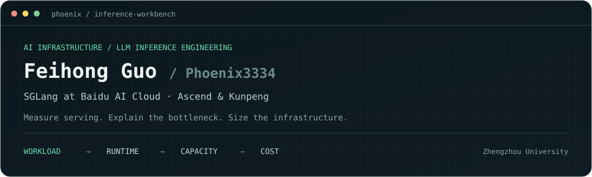
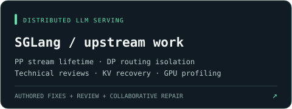
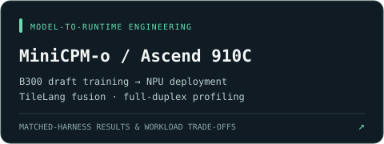

[Portfolio](https://phoenix3334.github.io/) · [Upstream contributions](https://github.com/Phoenix3334/Phoenix3334.github.io/blob/main/SGLANG_CONTRIBUTIONS.md) · [Authored SGLang PRs](https://github.com/sgl-project/sglang/pulls?q=is%3Apr+author%3APhoenix3334) · [Technical reviews](https://github.com/sgl-project/sglang/pulls?q=is%3Apr+reviewed-by%3APhoenix3334+-author%3APhoenix3334)

### `$ whoami`

**Feihong Guo · 郭飞鸿** — AI Infrastructure / LLM Inference Engineering  
Zhengzhou University · Baidu AI Cloud AI Infrastructure internship (May–Nov 2026) · SGLang contributor

I benchmarked and tuned **SGLang serving for DeepSeek-V4-Pro, V4.1-Flash and Kimi K3** on H200/B300/GB300. I use workload measurements to select hardware and parallel layouts, size Prefill and Decode against a service objective, and trace correctness issues to their runtime cause.

### `$ work --focus`

| Track | What I work on |
| --- | --- |
| **Baidu / SGLang** | P/D and end-to-end benchmarks, TP/PP/EP/CP/DCP/DP Attention, speculative decoding, KV/SSM and graph capacity, Nsight attribution, and reproducible deployment |
| **Huawei ICT / Ascend** | xLLM and vLLM-Ascend, Ascend C / Triton / TileLang, kernel-to-engine integration, and MiniCPM-o on Ascend 910C |
| **Capacity & economics** | TTFT/TPOT and throughput trade-offs, per-stage QPS, P/D instance sizing, GPU allocation, and comparative cost modeling |
| **CPU foundations** | Kunpeng HPCG / FFTW, memory locality, NUMA placement, SIMD, and MPI/OpenMP |

### `$ upstream --evidence`

| Record | My contribution | Upstream result |
| --- | --- | --- |
| [SGLang #47614](https://github.com/sgl-project/sglang/pull/47614) | PP receive-tensor lifetime diagnosis, implementation, and B300 validation | **Authored · merged** |
| [SGLang #35721](https://github.com/sgl-project/sglang/pull/35721) | Isolate health-check state from user routing; regression tests | **Authored · merged · v0.5.22** |
| [#43786](https://github.com/sgl-project/sglang/pull/43786) | Fused inverse RoPE into CUDA UE8M0 FP8 `wo_a` activation quantization while preserving BF16 rounding and packed scales | Authored · merged 4 Nov 2026 · B200 kernel and graph tests 7/7 |
| [#48404](https://github.com/sgl-project/sglang/pull/48404) | Reproduced incompatible EPLB recorder modes crashing at rebalance and added startup argument validation | Authored · merged 7 Nov 2026 · 4×B300 local invalid/valid path checks |
| [SGLang #32467](https://github.com/sgl-project/sglang/pull/32467#discussion_r3749014153) | Formal technical review and controlled A/B/C validation of the planner-race repair | **Fix merged** · EanWang211123 authored the PR |
| [SGLang #39487](https://github.com/sgl-project/sglang/pull/39487) | Original report, draft implementation, and DCP KV-recovery validation | **Fix merged** · kpham-sgl integrated the repair |
| [SGLang #32183](https://github.com/sgl-project/sglang/pull/32183#pullrequestreview-4897392620) | Formal review distinguishing verifier-window correctness from other DSpark failures | **PR open** |

PR states verified on 8 November 2026. Authored fixes, technical reviews, and maintainer-integrated repairs retain their own attribution.

### `$ benchmark --selected`

- **DeepSeek-V4-Pro:** At 60k input / 1k output, recorded eight-GPU phase-isolated AR Decode throughput of **43.74k tok/s on B300** and **46.09k tok/s on GB300**. Independent EAGLE points reached **46.81k / 48.01k output tok/s** with simulated acceptance ≈0.70. Each platform and configuration has its own measurement scope.
- **V4.1-Flash:** On the reported real-token 64K/C32 Prefill workload, frozen placement lowered rank-count CV **0.149 → 0.047** and increased input throughput **0.95%**. The [RFC #44697](https://github.com/sgl-project/sglang/issues/44697) separates logical routing, physical placement and runtime cost.
- **Kimi K3:** Compared TP/EP/MegaMoE and PP layouts, investigated KV/SSM capacity and diagnosed a cross-stream tensor lifetime fault in async pipeline Decode.

### `$ upstream --in-progress`

- **Multimodal startup:** [lazy CUDA VMM transport #45384](https://github.com/sgl-project/sglang/pull/45384) and [multi-tokenizer warmup serialization #45584](https://github.com/sgl-project/sglang/pull/45584).
- **Graph and speculative execution:** [Breakable CUDA Graph synchronization #34286](https://github.com/sgl-project/sglang/pull/34286) and [DSpark P/D handoff regression #34410](https://github.com/sgl-project/sglang/pull/34410).
- **GB300 DCP investigation:** [Issue #45367](https://github.com/sgl-project/sglang/issues/45367) documents my reproduction and NCCL registration A/B. The broader [upstream #43216](https://github.com/sgl-project/sglang/pull/43216) covers the reported graph-enabled configuration at the source level. My [DCP guard #45371](https://github.com/sgl-project/sglang/pull/45371) was superseded, and [persistent buffers #45824](https://github.com/sgl-project/sglang/pull/45824) closed after high-load correctness failures. [Case study](https://phoenix3334.github.io/#gb300-dcp).

### `$ projects --selected`

- **[SGLang engineering portfolio](https://phoenix3334.github.io/#opensource):** serving measurements, root-cause investigations, merged repairs, and public evidence.
- **[MiniCPM-o / Ascend 910C](https://github.com/Phoenix3334/minicpmo45-ascend):** draft training, speculative execution, kernel fusion, and duplex profiling. Matched-harness Core RTF **0.6754 → 0.4829**; workload trade-offs and accuracy gates are documented.
- **[AI Infra portfolio source](https://github.com/Phoenix3334/Phoenix3334.github.io):** performance → capacity → resource and cost decisions, with Databricks / NVIDIA methodology references.

### `$ toolchain`

| Layer | Tools and systems |
| --- | --- |
| Serving & runtime | SGLang · xLLM · vLLM-Ascend · llama.cpp-omni · PyTorch |
| Kernels & execution | CUDA · Triton · TileLang · Ascend C · CANN · CUDA / ACL Graph |
| Profiling & validation | Nsight Systems · Nsight Compute · msprof · controlled A/B experiments · regression tests |
| Systems | Python · C/C++ · Linux · NCCL · MPI/OpenMP · NUMA |

### `$ method`

**Deploy → measure → explain → improve → validate → size.**

I evaluate throughput together with latency, correctness, failure behaviour, and memory limits. Phase-isolated, kernel-level, and end-to-end results keep separate measurement boundaries. Performance and capacity evidence support cost assessment; a complete TCO result also needs actual prices, utilisation, redundancy, operations, and delivered traffic.

### `$ contact`

[GitHub](https://github.com/Phoenix3334) · [Website](https://phoenix3334.github.io/) · [Email](mailto:1187883824@qq.com)
