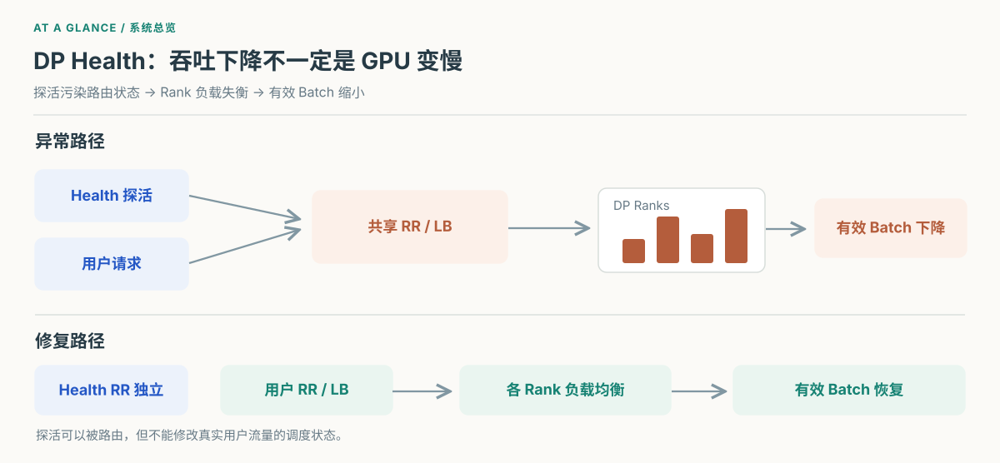
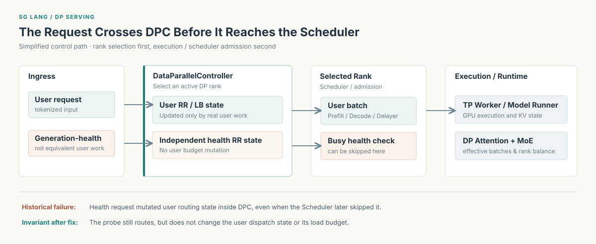
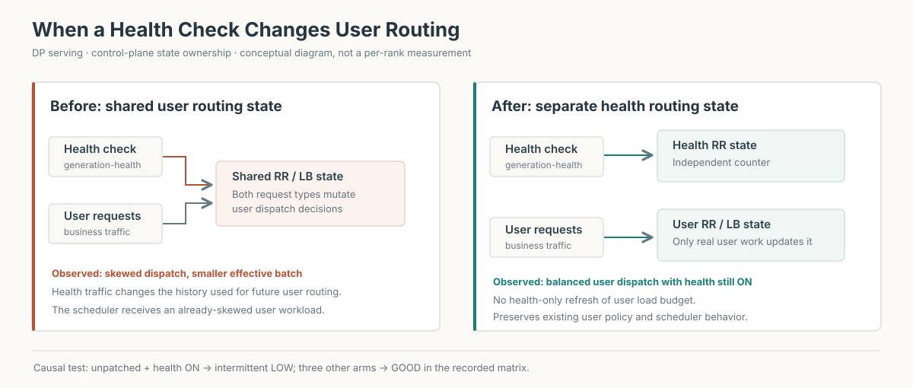

同一个模型、同样的压测配置，为什么某些运行能稳定接近 **95k input tok/s**，另一些运行却只剩下 **68k**？更麻烦的是：请求全部完成，服务没有崩溃，也没有某个明显变慢的 GPU Kernel。

我在排查 SGLang 的一次 Prefill 吞吐异常时，最后定位到的根因并不在 Attention、MoE 或 CUDA Kernel，而是在更靠前的 **DataParallelController（DPC）**：健康检查请求错误地推进了属于真实用户流量的路由状态。

**先说结论：** 这次 Prefill 吞吐波动不是 GPU 算子突然变慢，而是 generation-health 探活请求在经过 DPC 时改变了与真实用户共享的 RR/LB 路由状态，造成部分 DP Rank 请求不均、有效 Batch 缩小。通过“补丁前后 × Health 开关”的 2×2 对照，才把偶发性能退化和路由状态污染联系起来；修复的关键是**隔离探活与用户请求的状态所有权**，而不是关掉健康检查。以后看到 TPS 下降，应该先分清是请求分配出了问题，还是 GPU 执行真的变慢。

  

*速览图 · 一眼看懂 DP Health：异常路径和修复路径的区别。*

修复对应 [SGLang PR #35721](https://github.com/sgl-project/sglang/pull/35721)，原始问题见 [Issue #35241](https://github.com/sgl-project/sglang/issues/35241)。这篇文章记录的不只是一个修复，更是一次**从吞吐症状追到控制面状态，再用受控实验确认因果**的过程。

## 01 · 一个看起来不像 Bug 的性能问题

测试环境是 DeepSeek-V4-Pro、8×B300，使用 TP8/DP8、DP Attention、MegaMoE 与 PrefillDelayer。工作负载固定为 **60k 输入 / 1 输出、C16、160 个请求**，主要用于观察 Prefill 处理能力。

异常运行里，系统没有报错，请求也全部返回；真正不正常的是**各 DP rank 拿到的用户请求，以及最终形成的有效 batch**。正常情况下，用户任务在 rank 之间较均匀；LOW 运行里，per-rank work inventory 出现偏斜，有效 batch 缩小，整体吞吐随之下降。

这个观察改变了排查顺序。如果是纯算子退化，我预期相同工作量下每次执行都更慢；但这里更像是**工作进入 GPU 之前，分配方式就已经发生变化**。

## 02 · 一条在 Scheduler 之前出错的请求路径

  

*系统总览 · 一次请求从 TokenizerManager 经 DPC、Scheduler 到 Model Runner；异常发生在执行之前的路由控制面。*

我们可以把相关请求生命周期压缩成：

~~~text
Client / Generation-Health
          |
          v
    TokenizerManager
          |
          v
 DataParallelController    ← 选择 DP rank / 管理路由状态
          |
          v
  Scheduler / Delayer
          |
          v
  TP Worker / Model Runner
          |
          v
        GPU
        |
        v
   输出结果 / Detokenizer
        |
        v
      Client
~~~

**文首的系统图体现了两个相互独立的边界**：DPC 负责把请求路由到某个 DP rank，Scheduler 决定该 rank 上的请求如何组织、何时进入执行。一个请求在 Scheduler 被跳过，不代表它先前经过 DPC 时就没有产生副作用。

正常的用户生成请求在进入 GPU 后，还会沿着 Model Runner、Logits/Sampling、Scheduler、Detokenizer 等路径把新 Token 逐步交回请求管理层。**本次修复位于 TokenizerManager 之后、Scheduler 之前的路由控制面**，而不是 Transformer 的 Attention、LM Head 或采样后处理。

DPC 的工作不是执行模型，而是决定请求应该交给哪个 DP rank。不同负载均衡策略需要不同状态：round-robin 依赖当前分发位置，负载感知策略可能还需要用户请求相关的 load budget。

**generation-health 请求也会经过 DPC，但它在后续 Scheduler 阶段并不成为等价的业务工作。** 旧实现里，这类健康检查可能推进共享的 user-RR 状态，或者触发 user-LB budget 更新。于是：

> 健康检查没有增加等量的用户计算，却改变了之后真实请求的分发历史。

结果不是健康检查直接吃掉了全部吞吐，而是共享路由状态被“伪用户工作”扰乱，真正的用户流量在 rank 间分发不均。最终，异常从控制面一路放大到了 GPU 的有效计算批量。

  

这里有一个值得强调的区分：**Health 请求占了多少计算资源**，和 **它是否有权改变业务流量的路由状态**，是完全不同的问题。这次的主要根因是第二个。

## 03 · DP8 / TP8 / EP8：到底在分什么

这次配置里同时出现 TP8、DP8、DP Attention 和 MegaMoE，很容易误以为这是 8 × 8 × 8 张 GPU 的组合，或者把每个 DP rank 简单理解成一整套完全独立的 TP8 模型。实际并不是这样。

**TP、DP、EP 描述的是不同的并行维度和执行组织，不是可以不加条件地相乘得出物理 GPU 数量的标签**：

| 概念 | 主要解决什么问题 | 和这次故障的联系 |
| :--- | :--- | :--- |
| TP（Tensor Parallelism） | 将某些张量计算分摊到多个设备 / rank | 影响模型算子的计算和通信组织，不是本次路由状态错误发生的位置 |
| DP（Data Parallelism） | 将请求或工作量分配给不同的数据并行执行单元 | **DPC 选择请求归属 rank 的问题就在这一层** |
| DP Attention | Attention 工作能在不同 DP rank 上相对独立地推进 | 用户请求分布不均会造成各 rank 上的有效工作量差异 |
| EP（Expert Parallelism）/ MegaMoE | 将 MoE Expert 计算及相应 Token dispatch/通信组织起来 | Attention 局部独立不等于 MoE 全路径完全独立 |
| PrefillDelayer | 调整 Prefill 的工作推进、等待与批次组织 | 可能放大上下游失衡的表现，但不是修改 DPC 状态的代码路径 |

在本次 **8×B300 的 TP8/DP8** 配置中，这些并行维度有共享的物理设备与不同的逻辑划分，不能把数字简单乘成 64 块 GPU。具体并行映射由模型结构、DP Attention 和 MoE 组织方式决定。

理解了这个差别，才容易看出为什么 DPC 的影响如此大：它改变的不是一个 Kernel 的运行速度，而是 **哪份用户工作由哪个逻辑 DP rank 承接**。在后续阶段仍存在跨 rank 协作的场景下，这种不均衡可能转化为有效计算资源利用率的损失。

## 04 · 怎样证明是它，而不是某个偶然相关的开关

仅凭“关掉 health 后恢复了”还不够：关闭一项功能也可能改变系统负载、CPU 开销或某个调度时序。更可靠的办法是让**补丁状态**与 **generation-health 开关**交叉组合，进行 2×2 对照。

这四组使用相同的用户负载与服务配置，每个实验组都重新启动服务。外部 HTTP health polling 仍然存在，所谓 Health OFF 主要隔离的是 generation-health 行为，而不是把全部探活流量删除。

| 代码与开关 | 实验结果 | Input tok/s |
| :--- | :--- | ---: |
| 原版 + Health ON | **2/8 次 LOW**，其余正常 | LOW 例子：68,403 / 82,883 |
| 原版 + Health OFF | 4/4 GOOD | 94,783–94,847 |
| 修复版 + Health ON | **4/4 GOOD** | 94,558–94,699 |
| 修复版 + Health OFF | 4/4 GOOD | 94,850–94,934 |

最有价值的不是某一次的最高 tok/s，而是 **LOW 只出现在原版 + Health ON 这一象限**；而修复版在保留 generation-health 的情况下，依然能保持正常路由与吞吐。

结合 DPC 的 health 计数、per-rank user dispatch 和 batch 观测，可以把因果链表达为：

~~~text
generation-health 进入 DPC
             ↓
共享 user RR / LB 状态被修改
             ↓
后续真实用户请求的 rank ownership 偏斜
             ↓
各 rank 有效 batch 下降或分化
             ↓
Prefill input TPS 间歇性回退
~~~

这比简单地说“Health ON 会降速”准确得多。实际上原版 Health ON 的八次运行中仍有六次正常；这是一个**条件触发、间歇放大**的 Bug，而不是稳定存在的固定额外开销。

## 05 · 真正有诊断价值的不是 TPS，而是 Rank 级证据

端到端吞吐只能告诉我“有问题”，却很难说明“谁导致了问题”。为了确认控制面与数据面之间的关联，还需要沿着请求生命周期观察几类指标：

- **DPC 中的 HEALTH 请求数量**：health 是否确实经过了 DPC。
- **Per-rank user dispatch**：真实用户请求在各 rank 上是否仍然均匀分配。
- **Per-rank batch / running work inventory**：不均匀的路由是否进一步表现为有效批量差异。
- **Input TPS / TTFT**：前面这些差异最终是否反映到端到端性能。

PR 保留的三组代表性记录非常说明问题：

| 观测组 | HEALTH@DPC | 用户分发（均值 ± 标准差） | Per-rank batch 观测 | Input TPS |
| :--- | ---: | :--- | :--- | ---: |
| 原版 + Health ON，LOW | 61 | 29.0 ± 1.12 | 各 rank 平均约 3.71–7.12 | **68,403** |
| 原版 + Health OFF，GOOD | 0 | 29.0 ± 0.00 | 约 10.0 × 8 | 94,847 |
| 修复版 + Health ON，GOOD | 50 | 29.0 ± 0.00 | 约 10.0 × 8 | 94,583 |

这里最关键的事实是：**修复后 DPC 依然看到了大约 50 次健康检查，但用户分发恢复均衡，吞吐也处于正常区间**。如果真正原因只是“探活请求占用了计算资源”，这个结果就很难解释。

与此同时，也不能仅凭一次 rank 级标准差，就宣称完全捕捉了所有调度动态。它需要与实际 batch 和端到端 TPS 放在同一轮实验中对齐，才能构成较强的证据链。

## 06 · DP Attention 和 PrefillDelayer 是什么角色

这次现象发生在 DP Attention、长输入 Prefill 与 PrefillDelayer 的组合中。它们确实影响了异常的表现，但不能把这些组件直接当成根因。

DP Attention 让各 rank 的 Attention 工作具有相对独立的推进节奏；MoE 等阶段又涉及跨 rank 的协作。PrefillDelayer 参与请求推进与批次组织。当用户流量先在 DPC 处发生偏斜，后续调度更难维持均匀的有效工作量，吞吐异常就可能被放大。

我后来更重视**必要条件与伴随现象**的区分。PR 的后续分析表明，某些容易联想到的指标并不具有判别力：例如 <code>IDLE-while-EXTEND</code> 不是 LOW 必备事件，出现 <code>wait_timeout</code> 也不必然意味着 LOW。因此，不能把 Delayer 的 timeout 简化成这次 Bug 的根因。

更准确的三层关系是：**触发发生在 DPC 共享状态 → 分发失衡体现在用户工作量 → 下游执行和批次组织决定退化被放大的程度**。

## 07 · 两个很容易走偏的归因

**误区一：既然 LOW 出现在 Delayer 开启的环境，那就是 Delayer 把请求卡住了。**

实际上，Delayer 的一些等待与混合调度现象是**下游行为**，不一定是最初的触发点。扩展实验中，27 轮分析里 <code>IDLE-while-EXTEND</code> 都是 0，包含严重 LOW；修复版 Health ON 在保持 GOOD 的同时，仍可能出现 12–24 次 <code>wait_timeout</code>。因此，单独观察 timeout 或 idle 指标，既无法证明根因，也不能充当 LOW 的可靠分类器。

**误区二：Round-robin 很简单，Health 请求推进一次计数器应该影响不大。**

RR 指针本身确实简单，但请求路由并不只由一个加法组成。真实请求在不同 rank 上的运行时间、batch 合并机会以及后续跨 rank 协作，都可能让很小的分发扰动累积成显著的有效批量差异。此外，load-aware 方法还存在 budget 刷新这一类状态边界。因此，修复不应停留在“把 RR 指针调回来”，而应保证 **Health 与 User 之间不会共享可变的用户负载状态**。

这也是为什么根因陈述必须说清楚“Health 修改 user routing state”，而不是笼统说“Delayer 效率低”或“Round-robin 不均衡”。

## 08 · 修复不是关闭探活，而是隔离状态所有权

补丁的核心是一条很清楚的约束：

> generation-health 可以被路由，但不能更新真实用户请求的 RR / LB 状态。

实现上，健康检查使用独立的 RR 计数器；health-only dispatch 不再刷新用户 load budget。混合 batch 只有确实包含真实用户工作时，才更新对应用户预算。显式路由 rank、active worker 筛选和 P/D 相关语义也必须保持兼容。

这比在外层简单“少发健康检查”更可靠，因为它明确了 **State Ownership：状态归谁所有，谁可以修改它**。

验证同样分层看待：历史 B300 受控实验说明了具体故障族的性能因果；最终 rebased 代码的 **30 项 CPU 测试**证明相关路由与边界语义得到回归覆盖。需要诚实区分：**最终 rebase 之后没有重做同一轮 B300 性能测试**，因此不能把不同阶段的证据说成同一次实验。

## 09 · 回归测试应该守住哪些边界

这次补丁关注的不是“健康检查应该总是固定落到某张卡”，而是 **Health Dispatch 不应改变真实用户请求路由的状态机**。因此，回归测试要覆盖正常与异常输入的边界，而不能只测试单个健康检查接口有没有返回成功：

| 测试范围 | 希望守住的行为 |
| :--- | :--- |
| User RR / Health RR | 两类请求各自推进自己的计数器 |
| Active worker selection | 健康检查只会选择当前可用的工作节点 |
| Explicit <code>routed_dp_rank</code> | 指定 rank 的请求保持显式路由语义，不扰动 Health RR |
| Health-only batch | 不刷新、不改变用户负载预算 |
| Mixed batch | 仅在确实包含用户请求时刷新 User LB budget |
| P/D <code>FOLLOW_BOOTSTRAP_ROOM</code> | 不破坏依赖请求特定信息的路由路径 |

最终 rebased 代码的针对性 CPU 测试达到 **30 passed**。这类测试保障控制面状态隔离的**语义正确性**，不应和 B300 的吞吐实验混成一个结果：CPU 测试守住接口契约；GPU 压测验证真实运行时是否还有故障表现。

从生产可观测性角度，我还会优先保留一个分层仪表盘的思路：

~~~text
入口：用户 QPS / generation-health 触发次数
  ↓
DPC：各 rank 用户分发、路由状态、负载预算
  ↓
Scheduler：running / waiting、有效 batch、Delayer 状态
  ↓
Runtime：Prefill TPS、TTFT、MoE/通信利用情况
~~~

这里是**值得持续建设的观测清单**，不表示这些项目都已经在 PR 中实现。它的价值是让“控制面偏斜”和“GPU 真慢了”在第一轮排查时就能被区分。

## 10 · 从这次 Bug 学到的排障顺序

做推理系统优化时，很容易直接进入 nsys、ncu、NCCL、Attention 或 MoE 分析。但高性能 Serving 的“快”不仅要求 GPU 算得快，还要求**真实用户请求被正确分配，能持续形成有效 batch**。

这次之后，我遇到端到端吞吐下降，会先分辨：是工作量变化、工作分配变化、批次组织变化，还是执行同一批工作真的变慢？这四类问题的第一证据往往不一样。

**这次修复的核心不是让 health check 更轻，而是阻止它越过用户路由状态的边界。** 一个控制面上的小状态错误，最终可以呈现为 GPU 端的大吞吐退化。

---

**参考与代码**：[PR #35721](https://github.com/sgl-project/sglang/pull/35721) · [Issue #35241](https://github.com/sgl-project/sglang/issues/35241)

*实验边界：以上数字来自对应 DeepSeek-V4-Pro、8×B300、60k/1、C16/N160 的历史部署配置；不能推广为所有模型和所有 DP 拓扑的通用吞吐结论。*
