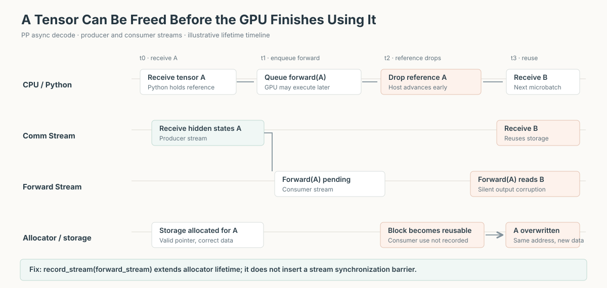

一次 Decode 请求没有 OOM，没有 CUDA illegal access，也没有明显的服务崩溃，却可能长时间连续输出异常 token。对于在线推理服务，这类**静默正确性错误**比一个明确的 Crash 更难被快速发现。

我在 Kimi-K3、8×B300 的异步 Pipeline Parallel（PP）Decode 场景里遇到过这样的问题。最后发现，模型和算子本身并不是主要原因：**一个在通信 Stream 上接收的 Tensor，随后在 Forward Stream 上消费，却没有把这段异步使用关系正确登记给 CUDA Caching Allocator。**

修复对应 [SGLang PR #47614](https://github.com/sgl-project/sglang/pull/47614)，问题记录在 [Issue #47613](https://github.com/sgl-project/sglang/issues/47613)。这篇文章主要讲清楚它为什么会发生、如何被定位，以及一个容易混淆的事实：**<code>record_stream</code> 解决的是内存生命周期，不是 Stream 执行顺序。**

## 01 · 为什么异步 PP 会出现两条时间线

PP 将模型层分布到多个 stage。前一 stage 计算出 hidden states，后一 stage 接收之后继续 Forward。在简单的同步路径中，“接收完再计算”比较直观；异步 PP 为了提高流水线利用率，会让多个 microbatch 的通信和计算同时在飞。

对一个接收侧 stage，可以先把角色分为四个：

- **Comm Stream**：接收前一个 stage 发送的 Tensor。
- **Forward Stream**：在本 stage 的模型前向中消费这个 Tensor。
- **CPU / Python**：负责发起接收、排队计算、推进事件循环，并维护对象引用。
- **CUDA Caching Allocator**：管理显存块复用，需要知道 Tensor 在哪些 Stream 上仍然被使用。

关键问题是：CPU 把 Forward 工作排队完成，并不意味着 GPU 已经运行到那里。**Host 侧引用的存亡、CUDA Stream 的工作进度和 Allocator 对生命周期的理解，是三件相关但不相同的事。**

而这类问题容易和“通信与计算的同步关系”混为一谈。Stream 事件或等待机制负责数据生产先于消费的 **execution ordering**；Allocator 还需要知道消费者的使用何时结束，这属于 **memory lifetime**。前者正确，并不能自动保证后者正确。

## 02 · 把这次 Bug 放回完整的 PP Forward 链路

理解这次修复之前，需要先分清：**Stage 之间传递的模型中间结果**，和 **最后一个 Stage 生成、准备返回给请求管理层的 Token 结果**，不是同一种消息。

以 **PP2** 为例，可以把正常的 Decode 过程理解为：

~~~text
Stage 0（第一个 PP Stage）                 Stage 1（最后一个 PP Stage）
────────────────────────                 ─────────────────────────────
Token IDs
    ↓
Embedding
    ↓
前半段 Transformer Blocks
    ↓
中间 Hidden States / 辅助状态
    │
    └───── proxy ───────────────────────→ recv（Comm Stream）
                                              │
                                              │ record_stream(Forward Stream)
                                              │ ← 本次 PR 修复的位置
                                              ↓
                                         后半段 Transformer Blocks
                                              ↓
                                          Final Norm
                                              ↓
                                           LM Head
                                              ↓
                                            Logits
                                              ↓
                                           Sampling
                                              ↓
                                        next_token_ids
    ↑                                         │
    └───── output ───────────────────────────┘
    ↓
Scheduler / 请求管理层更新生成状态
~~~

这是理解路径的示意图，不代表每种模型、PP 规模或推测解码配置都有完全相同的执行细节。对不止两个 Stage 的情形，中间的 proxy 会沿多个 Stage 继续传递。

在 SGLang 的 PP 调度代码中，**<code>proxy</code> 和 <code>output</code> 是两类不同的消息语义**：

| 消息 | 主要携带内容 | 用途 |
| :--- | :--- | :--- |
| <code>proxy</code> | 尚需后续 Stage 计算的 Hidden States 等中间 Tensor | 沿 Forward 方向传递给下一 Stage |
| <code>output</code> | 最后 Stage 的 <code>next_token_ids</code>，以及按执行模式需要同步的附加状态 | 沿结果回传路径交给前面的 Stage 和调度逻辑 |

例如，推测解码场景还可能在 output 中携带 acceptance length、bonus token 等元数据，以便各 Stage 维持一致的生成与 KV 状态。它不是纯粹的“打印生成文本”消息。

**因此，本次修复的落点非常明确：**下游 Stage 的 <code>_pp_recv_proxy_tensors</code> 接收中间 Tensor；<code>_pp_launch_batch</code> 随后将这些 Tensor 交给 Forward Stream 的 <code>run_batch</code>。在这里调用 <code>record_stream(self.forward_stream)</code>，是为了保护**进入后续 Transformer Forward 的输入存储**，不是在 LM Head、Logits 或 Sampling 之后修复 Token 后处理。

虽然最终观察到的是“采样输出错误”，**错误最早出现的位置在上游 Hidden States 的接收—消费边界**。一旦输入激活已经被覆盖，后续的 Final Norm、LM Head 和 Sampling 即使各自实现完全正确，也会基于错误的输入继续生成结果。

相关实现可对照 [SGLang scheduler_pp_mixin.py](https://github.com/sgl-project/sglang/blob/main/python/sglang/srt/managers/scheduler_pp_mixin.py) 中的 <code>_pp_recv_proxy_tensors</code>、<code>_pp_launch_batch</code> 和 <code>_pp_prepare_tensor_dict</code>。

## 03 · 一块合法显存，为什么会装着错误的数据

假设通信 Stream 刚接收到 microbatch A 的 hidden states，Forward Stream 已经排队准备计算 A，但是还没有真正读取它。

CPU 端事件循环并不会等这个 Forward 做完：它可能很快释放上一批 A 的 Python 引用，然后继续接收 microbatch B。

如果没有登记 Forward Stream 的后续使用，Caching Allocator 可能认为 A 使用的 storage 已经可以复用。下一次接收 B 时，这块显存被重新分配，写入 B 的数据。等 Forward Stream 真正读取 A 时，**地址是合法的，但内容已经不属于 A**。

  

这解释了为什么它可能产生 Silent Corruption，而不是 Crash：访问不是越界，而是**在错误时刻读取了被复用的内存内容**。从 Kernel 看，输入地址仍然有效；从模型计算语义看，这个 microbatch 的 hidden states 已经被污染。

当 async batch depth 更大、同时在飞的 microbatch 更多时，CPU 引用释放与 GPU 真正消费之间的时间窗口更容易扩大，所以问题更容易出现。但并不存在一个对所有 PP 实现都适用的统一深度阈值。

## 04 · 从输出异常，追到接收与消费之间的数据变化

原始异常在测试中表现为较长的连续 token-0 输出。为了形成可重复的观测，实验把**单请求中至少连续 20 个 token-0** 作为异常判据。

这个判据很实用，但它只是对该类显著错误的检测方式，**不是“所有模型输出错误”的完整定义**。真正把定位推进一层的，是在 **Receive 之后** 和 **Forward 真正消费之前** 对 Tensor 内容做校验。

未修复的两轮对照中，约 7,500 次比较里分别发现 **76 次与 378 次 checksum mismatch**；修复后，同类检查不再出现 mismatch。这个结果把问题从“采样出来的文本异常”推进到了“模型前向拿到的输入已经不同于接收时的数据”。

故障链可以概括为：

~~~text
Comm Stream 收到 A
        ↓
Forward(A) 已入队但仍在等待
        ↓
CPU 释放 A 的上一份引用
        ↓
Allocator 不知道 Forward Stream 还会用 A
        ↓
后续接收 B 时复用了 A 的 storage
        ↓
Forward(A) 读到已被 B 覆盖的数据
        ↓
Decode 出现 silent corruption
~~~

这比直接调整 Sampling 参数、怀疑模型稳定性，或者仅通过降低异步深度隐藏现象，都更接近真正的因果位置。

## 05 · 多组 PP 形状下的验证

实验主要在 Kimi-K3、8×B300、历史 v0.5.22 相关配置中完成，使用 **fake P/D transfer**。对多个 PP/TP/DCP 形状和异步深度做了对比：

| PP / TP 组合 | Async depth | 修复前异常请求 | 修复后 |
| :--- | ---: | ---: | ---: |
| PP2 × TP4 | 2 | 51 / 192 | **0 / 192** |
| PP2 × TP4 | 3 | 98 / 192 | **0 / 192** |
| PP2 × TP4 + DCP4 | 2 | 59 / 192 | **0 / 192** |
| PP4 × TP2 | 3 | 6 / 192 | **0 / 192** |
| PP4 × TP2 | 4 | 19 / 192 | **0 / 192** |

这五组结果很有说服力：不同 Pipeline 组织方式下出现了相同类型的异常，而同一种生命周期修复使得该输出判据下的异常请求降为零。

但不能因此宣称“所有请求在所有部署方式下都绝对正确”。0/192 代表**这一轮负载和检测标准下没有观察到异常**。真实两节点 P/D、所有事件循环组合以及合入后的完整 GPU 复测，不属于这组实验已证明的范围。

## 06 · <code>record_stream</code> 到底修了什么

最终修复放在公共的 PP batch 启动位置 <code>_pp_launch_batch</code>。在调用 <code>run_batch</code> 前，对接收到的非 CPU proxy Tensor 记录它的消费者 Stream。

下面是简化的概念代码，省略了实际代码中的 Tensor 判断和其他执行上下文：

~~~python
# Illustrative pseudocode, not a copy of the complete patch
for tensor in pp_proxy_tensors.values():
    tensor.record_stream(self.forward_stream)
~~~

这一句的重点不是“让 Comm Stream 等待 Forward”，也不是“强制 Forward 等待通信”。它是在告诉 Allocator：

> **虽然 Python 对象之后可能被释放，但这块内存已经交给 Forward Stream 使用。只有相关的异步使用完成后，storage 才能被安全复用。**

因此它没有加入一个新的全局同步屏障，也没有把异步 PP 退化成串行执行。

必须保留另一个边界：如果原本没有建立好生产者到消费者的执行依赖，仍需独立处理 Stream event / wait 等同步关系。**<code>record_stream</code> 不能替代执行顺序控制，它只补齐内存生命周期登记。**

把修复放在公共启动路径可以让多个 PP 事件循环共享相同的生命周期保障，但“代码路径覆盖”与“所有路径都完成 GPU 端到端实测”也不应该混为一谈。

## 07 · 为什么这是 Correctness Fix，而不是“又一个性能优化”

使用异步 Stream、流水线和 Overlap，确实是为了减少串行等待。但优化存在一个先决条件：**数据必须在被正确消费之前保持有效**。如果吞吐很高，却让请求读到其他 microbatch 的 hidden states，那么这些吞吐指标没有真正的服务价值。

这次修复避免了为了规避问题而粗暴增加全局同步。与此同时，我也不会声称它严格“零成本”：历史无异步深度的小样本测试中，修复版吞吐比两轮基线低约 **0.52%–0.93%**，样本不足以判断稳定的性能差异。更重要的是，异常输出可能扭曲一些性能观察，所以不能用未修复错误路径上的 tok/s 证明某种性能优势。

这次工作的第一目标是**正确性与内存安全契约**，不是加速。

## 08 · 我现在如何理解异步系统的正确性

这次之后，我习惯把异步正确性拆成三个单独的问题：

1. **Execution ordering**：数据是否已经生产完成，消费者能否开始读取？依赖 Stream 事件和正确的 happens-before 关系。
2. **Memory lifetime**：消费者仍在执行时，Allocator 会不会提前复用存储？依赖正确记录跨 Stream 的使用。
3. **Semantic correctness**：顺序和生命周期都合法时，拿到的是否仍是当前 microbatch 的隐藏状态、KV 和必要上下文？

三者缺一不可。仅仅让 Stream 能并发运行，不代表系统正确；仅仅避免 Crash，也不等于输出正确。

**这次 Bug 的核心，是 Forward 仍在使用一个 Tensor，而负责管理这块 Tensor 生命周期的系统并不知道。** 当推理框架越来越追求异步、Overlap 和深流水线时，数据所有权与生命周期就必须成为与吞吐、延迟同等重要的设计约束。

---

**参考与代码**：[PR #47614](https://github.com/sgl-project/sglang/pull/47614) · [Issue #47613](https://github.com/sgl-project/sglang/issues/47613)

*实验边界：主要 B300 复现与修复验证为历史 v0.5.22 / fake P/D 结果，不代表真实双节点 P/D、所有 PP 事件循环和最终合入版本均已完成相同的 GPU 复测。*
