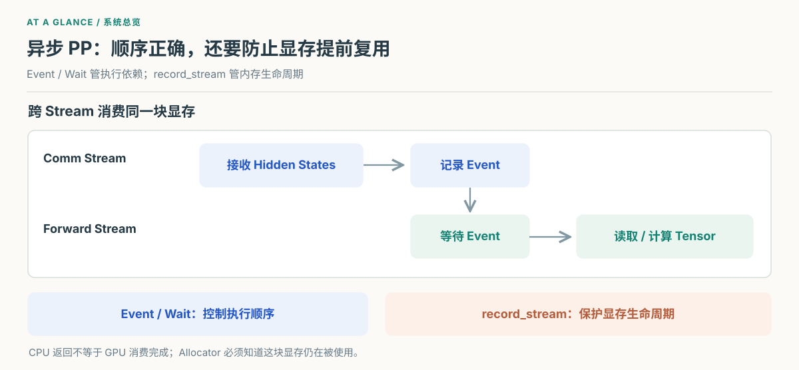
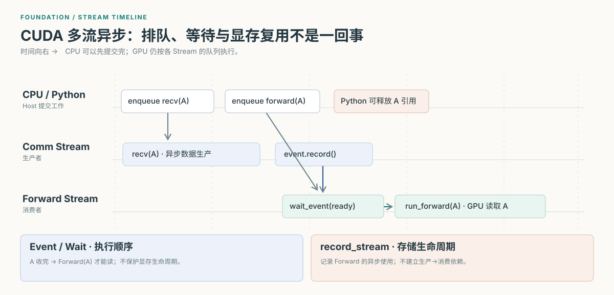
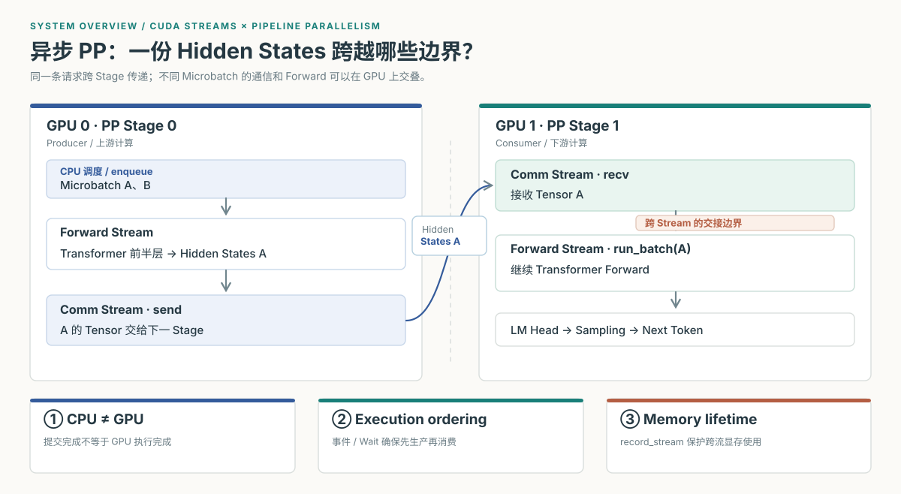

一次 Decode 请求没有 OOM，没有 CUDA illegal access，也没有明显的服务崩溃，却可能长时间连续输出异常 token。对于在线推理服务，这类**静默正确性错误**比一个明确的 Crash 更难被快速发现。

我在 Kimi-K3、8×B300 的异步 Pipeline Parallel（PP）Decode 场景里遇到过这样的问题。最后发现，模型和算子本身并不是主要原因：**一个在通信 Stream 上接收的 Tensor，随后在 Forward Stream 上消费，却没有把这段异步使用关系正确登记给 CUDA Caching Allocator。**

**先说结论：** 异步 PP 为了重叠通信与计算，让接收 Hidden States 和后续 Forward 运行在不同 CUDA Stream 上。但 CPU 提交操作后，GPU 不一定已经消费完 Tensor；如果 Caching Allocator 不知道它仍在另一条 Stream 上被使用，就可能提前复用显存，造成没有 Crash 的静默输出错误。**Event/Wait 负责生产者与消费者的执行顺序，`record_stream` 负责显存生命周期，两者不能互相替代。** 这次修复在已覆盖的测试组合中将异常请求降至 0/192；正确性是有效吞吐的前提。

  

*速览图 · 一眼看懂异步 PP：执行依赖与显存生命周期是两条独立约束。*

修复对应 [SGLang PR #47614](https://github.com/sgl-project/sglang/pull/47614)，问题记录在 [Issue #47613](https://github.com/sgl-project/sglang/issues/47613)。这篇文章主要讲清楚它为什么会发生、如何被定位，以及一个容易混淆的事实：**<code>record_stream</code> 解决的是内存生命周期，不是 Stream 执行顺序。**

## 01 · 先理解 CUDA Stream：为什么会有两条时间线

如果只熟悉普通的同步 Python 代码，这个 Bug 最不直观的一点是：**Python 已经执行到下一行，但 GPU 可能还没完成上一行提交的计算。** 要看懂异步 PP，先把 CUDA Stream、事件依赖和显存管理区分开。

### 一个 Stream 是什么？

可以把 CUDA Stream 理解为**向 GPU 提交操作的一条有序队列**。Kernel Launch、支持的异步数据拷贝和通信操作都可以按 Stream 排队。同一 Stream 中，操作按照提交顺序执行；但 CPU 发起一个异步 Kernel 并返回，通常不意味着 GPU 已经执行完成。

~~~text
CPU / Python：
    launch A → launch B → launch C → 继续执行 Python
    （提交完成，不等于 GPU 执行完成）

GPU / Stream S：
    A ─────────→ B ─────────→ C
    （同一 Stream 按顺序执行）
~~~

当程序有两条不同的 Stream，例如 Comm Stream 和 Forward Stream，工作**可能**重叠：GPU 在执行 Microbatch A 的 Forward 时，通信引擎或其他计算资源可以为 Microbatch B 工作。但这不是两个 Stream 就保证翻倍吞吐；是否真正并发还取决于硬件资源、Kernel/Collective 的实现、默认 Stream 语义、依赖关系和调度。

**多 Stream 不等于多 GPU。** 一张 GPU 可以有多个 Stream；PP 则是模型层分布在不同 GPU 或进程的 Stage 上。PP 与 Stream 是两种不同维度：前者划分模型，后者安排每个设备上的工作顺序。

### 跨 Stream 有两种完全不同的正确性约束

异步 PP 的接收侧至少有四个角色：**CPU / Python** 提交任务并维护引用；**Comm Stream** 接收来自上一 Stage 的 Hidden States；**Forward Stream** 消费它继续模型前向；**CUDA Caching Allocator** 决定何时复用 Tensor 背后的显存。

这四者必须满足两个独立条件。

第一是 **Execution ordering（执行先后）**：Comm Stream 必须先把 A 的数据生产好，Forward Stream 才能读取 A。如果两个操作分处不同 Stream，就需要事件或等价的依赖机制：生产者记录 Event，消费者等待 Event。<code>wait_event</code> / <code>wait_stream</code> 建立的是跨队列的 happens-before 关系，**不需要让 CPU 全程阻塞**。

第二是 **Memory lifetime（存储生命周期）**：即便执行顺序完全正确，CPU 仍可能提前释放最后一个 Python 引用。假如 Allocator 不知道该 Tensor 还被 Forward Stream 异步使用，它可能把这块显存给下一批请求复用。<code>record_stream</code> 用来让 Allocator 跟踪这个额外 Stream 上的使用，保护复用时机。**它不会替代 Event 或 Wait。**

  

*图 2 · 同时建立「先生产再消费」与「消费结束前不能复用显存」两个约束。*

把概念写成伪代码，比只记 API 名字更容易理解：

~~~python
# 说明执行意图的伪代码，省略 NCCL 传输及实际 PP 调度细节
comm_stream = torch.cuda.Stream()
forward_stream = torch.cuda.Stream()
ready = torch.cuda.Event()

with torch.cuda.stream(comm_stream):
    hidden = recv_hidden_states_async()   # A：在 Comm Stream 生产
    ready.record()                        # 标记 A 何时可用

with torch.cuda.stream(forward_stream):
    forward_stream.wait_event(ready)      # ① 执行顺序：等 A 生产完成
    hidden.record_stream(forward_stream)  # ② 生命周期：登记 A 的消费者
    output = run_forward(hidden)          # GPU 可能之后才真正读取 A

# CPU 离开作用域或释放 hidden 的引用时，
# Allocator 仍须考虑 Forward Stream 上未结束的使用。
~~~

这里的 recv_hidden_states_async()、run_forward() 是占位函数，并非能独立运行的 SGLang 代码。真实 NCCL 通信还有框架自己处理的通信完成事件和跨设备依赖，不能只复制这段伪代码代替 PP 同步逻辑。关键在于：

- <code>record</code> + <code>wait_event</code>：决定 **Forward 何时能读**。
- <code>record_stream</code>：决定 **Allocator 何时能安全复用**。
- <code>torch.cuda.synchronize()</code> 或 CPU 同步等待：会让 Host/设备等待相关工作，可能损失原本期望的异步 Overlap；不应该为了掩盖竞态就无条件插入全局同步。

### 回到 PP：为什么 CPU 会比 GPU 走得快？

PP 在不同 Stage 间传递 Hidden States，通常把工作拆成 Microbatch，以提高流水线利用率。对于同一个接收侧 GPU，CPU 可能连续提交“接收 A → Forward A → 接收 B → Forward B”，但不同 Stream 的实际执行进度并不与 Python 对象的引用生命周期同步。

于是就出现了本文要讨论的场景：**一个 Tensor 已经被提交给 Forward Stream，但 GPU 尚未消费完成，Python 却不再持有它；若没有登记使用关系，Allocator 可能提前复用 storage。** 后面的输出虽然不报错，却可能基于另一个 Microbatch 的 Hidden States 继续计算。

这不是 GPU 不遵守顺序，也不是普通 Python 多线程同时写同一个变量，而是 Host、多个设备工作队列和显存分配器之间的异步所有权契约没有闭合。CUDA Stream 的基本顺序、Event 与 CPU/GPU 异步行为参见 [NVIDIA CUDA Programming Guide](https://docs.nvidia.com/cuda/cuda-programming-guide/02-basics/asynchronous-execution.html)；<code>record_stream</code> 对分配器的语义参见 [PyTorch Tensor.record_stream 文档](https://docs.pytorch.org/docs/stable/generated/torch.Tensor.record_stream.html) 和 [PyTorch CUDA Semantics](https://docs.pytorch.org/docs/stable/notes/cuda.html)。

## 02 · 把这次 Bug 放回完整的 PP Forward 链路

  

*图 1 · 异步 PP 的系统总览。先看一次 Microbatch 如何跨 Stage、跨 Stream，再讨论隐藏在交接处的生命周期问题。点击可以查看完整 SVG。*

理解这次修复之前，需要先分清：**Stage 之间传递的模型中间结果**，和 **最后一个 Stage 生成、准备返回给请求管理层的 Token 结果**，不是同一种消息。

以 **PP2** 为例，可以把正常的 Decode 过程理解为：

~~~text
Stage 0（第一个 PP Stage）                 Stage 1（最后一个 PP Stage）
────────────────────────                 ─────────────────────────────
Token IDs
    ↓
Embedding
    ↓
前半段 Transformer Blocks
    ↓
中间 Hidden States / 辅助状态
    │
    └───── proxy ───────────────────────→ recv（Comm Stream）
                                              │
                                              │ record_stream(Forward Stream)
                                              │ ← 本次 PR 修复的位置
                                              ↓
                                         后半段 Transformer Blocks
                                              ↓
                                          Final Norm
                                              ↓
                                           LM Head
                                              ↓
                                            Logits
                                              ↓
                                           Sampling
                                              ↓
                                        next_token_ids
    ↑                                         │
    └───── output ───────────────────────────┘
    ↓
Scheduler / 请求管理层更新生成状态
~~~

这是理解路径的示意图，不代表每种模型、PP 规模或推测解码配置都有完全相同的执行细节。对不止两个 Stage 的情形，中间的 proxy 会沿多个 Stage 继续传递。

在 SGLang 的 PP 调度代码中，**<code>proxy</code> 和 <code>output</code> 是两类不同的消息语义**：

| 消息 | 主要携带内容 | 用途 |
| :--- | :--- | :--- |
| <code>proxy</code> | 尚需后续 Stage 计算的 Hidden States 等中间 Tensor | 沿 Forward 方向传递给下一 Stage |
| <code>output</code> | 最后 Stage 的 <code>next_token_ids</code>，以及按执行模式需要同步的附加状态 | 沿结果回传路径交给前面的 Stage 和调度逻辑 |

例如，推测解码场景还可能在 output 中携带 acceptance length、bonus token 等元数据，以便各 Stage 维持一致的生成与 KV 状态。它不是纯粹的“打印生成文本”消息。

**因此，本次修复的落点非常明确：**下游 Stage 的 <code>_pp_recv_proxy_tensors</code> 接收中间 Tensor；<code>_pp_launch_batch</code> 随后将这些 Tensor 交给 Forward Stream 的 <code>run_batch</code>。在这里调用 <code>record_stream(self.forward_stream)</code>，是为了保护**进入后续 Transformer Forward 的输入存储**，不是在 LM Head、Logits 或 Sampling 之后修复 Token 后处理。

虽然最终观察到的是“采样输出错误”，**错误最早出现的位置在上游 Hidden States 的接收—消费边界**。一旦输入激活已经被覆盖，后续的 Final Norm、LM Head 和 Sampling 即使各自实现完全正确，也会基于错误的输入继续生成结果。

相关实现可对照 [SGLang scheduler_pp_mixin.py](https://github.com/sgl-project/sglang/blob/main/python/sglang/srt/managers/scheduler_pp_mixin.py) 中的 <code>_pp_recv_proxy_tensors</code>、<code>_pp_launch_batch</code> 和 <code>_pp_prepare_tensor_dict</code>。

## 03 · 一块合法显存，为什么会装着错误的数据

假设通信 Stream 刚接收到 microbatch A 的 hidden states，Forward Stream 已经排队准备计算 A，但是还没有真正读取它。

CPU 端事件循环并不会等这个 Forward 做完：它可能很快释放上一批 A 的 Python 引用，然后继续接收 microbatch B。

如果没有登记 Forward Stream 的后续使用，Caching Allocator 可能认为 A 使用的 storage 已经可以复用。下一次接收 B 时，这块显存被重新分配，写入 B 的数据。等 Forward Stream 真正读取 A 时，**地址是合法的，但内容已经不属于 A**。

  

*图 3 · 原始故障时间线：A 的存储在 GPU 消费结束前被 B 复用，与前面的正确跨流执行示意形成对照。*

这解释了为什么它可能产生 Silent Corruption，而不是 Crash：访问不是越界，而是**在错误时刻读取了被复用的内存内容**。从 Kernel 看，输入地址仍然有效；从模型计算语义看，这个 microbatch 的 hidden states 已经被污染。

当 async batch depth 更大、同时在飞的 microbatch 更多时，CPU 引用释放与 GPU 真正消费之间的时间窗口更容易扩大，所以问题更容易出现。但并不存在一个对所有 PP 实现都适用的统一深度阈值。

## 04 · 从输出异常，追到接收与消费之间的数据变化

原始异常在测试中表现为较长的连续 token-0 输出。为了形成可重复的观测，实验把**单请求中至少连续 20 个 token-0** 作为异常判据。

这个判据很实用，但它只是对该类显著错误的检测方式，**不是“所有模型输出错误”的完整定义**。真正把定位推进一层的，是在 **Receive 之后** 和 **Forward 真正消费之前** 对 Tensor 内容做校验。

未修复的两轮对照中，约 7,500 次比较里分别发现 **76 次与 378 次 checksum mismatch**；修复后，同类检查不再出现 mismatch。这个结果把问题从“采样出来的文本异常”推进到了“模型前向拿到的输入已经不同于接收时的数据”。

故障链可以概括为：

~~~text
Comm Stream 收到 A
        ↓
Forward(A) 已入队但仍在等待
        ↓
CPU 释放 A 的上一份引用
        ↓
Allocator 不知道 Forward Stream 还会用 A
        ↓
后续接收 B 时复用了 A 的 storage
        ↓
Forward(A) 读到已被 B 覆盖的数据
        ↓
Decode 出现 silent corruption
~~~

这比直接调整 Sampling 参数、怀疑模型稳定性，或者仅通过降低异步深度隐藏现象，都更接近真正的因果位置。

## 05 · 多组 PP 形状下的验证

实验主要在 Kimi-K3、8×B300、历史 v0.5.22 相关配置中完成，使用 **fake P/D transfer**。对多个 PP/TP/DCP 形状和异步深度做了对比：

| PP / TP 组合 | Async depth | 修复前异常请求 | 修复后 |
| :--- | ---: | ---: | ---: |
| PP2 × TP4 | 2 | 51 / 192 | **0 / 192** |
| PP2 × TP4 | 3 | 98 / 192 | **0 / 192** |
| PP2 × TP4 + DCP4 | 2 | 59 / 192 | **0 / 192** |
| PP4 × TP2 | 3 | 6 / 192 | **0 / 192** |
| PP4 × TP2 | 4 | 19 / 192 | **0 / 192** |

这五组结果很有说服力：不同 Pipeline 组织方式下出现了相同类型的异常，而同一种生命周期修复使得该输出判据下的异常请求降为零。

但不能因此宣称“所有请求在所有部署方式下都绝对正确”。0/192 代表**这一轮负载和检测标准下没有观察到异常**。真实两节点 P/D、所有事件循环组合以及合入后的完整 GPU 复测，不属于这组实验已证明的范围。

## 06 · <code>record_stream</code> 到底修了什么

最终修复放在公共的 PP batch 启动位置 <code>_pp_launch_batch</code>。在调用 <code>run_batch</code> 前，对接收到的非 CPU proxy Tensor 记录它的消费者 Stream。

下面是简化的概念代码，省略了实际代码中的 Tensor 判断和其他执行上下文：

~~~python
# Illustrative pseudocode, not a copy of the complete patch
for tensor in pp_proxy_tensors.values():
    tensor.record_stream(self.forward_stream)
~~~

这一句的重点不是“让 Comm Stream 等待 Forward”，也不是“强制 Forward 等待通信”。它是在告诉 Allocator：

> **虽然 Python 对象之后可能被释放，但这块内存已经交给 Forward Stream 使用。只有相关的异步使用完成后，storage 才能被安全复用。**

因此它没有加入一个新的全局同步屏障，也没有把异步 PP 退化成串行执行。

必须保留另一个边界：如果原本没有建立好生产者到消费者的执行依赖，仍需独立处理 Stream event / wait 等同步关系。**<code>record_stream</code> 不能替代执行顺序控制，它只补齐内存生命周期登记。**

把修复放在公共启动路径可以让多个 PP 事件循环共享相同的生命周期保障，但“代码路径覆盖”与“所有路径都完成 GPU 端到端实测”也不应该混为一谈。

## 07 · 为什么这是 Correctness Fix，而不是“又一个性能优化”

使用异步 Stream、流水线和 Overlap，确实是为了减少串行等待。但优化存在一个先决条件：**数据必须在被正确消费之前保持有效**。如果吞吐很高，却让请求读到其他 microbatch 的 hidden states，那么这些吞吐指标没有真正的服务价值。

这次修复避免了为了规避问题而粗暴增加全局同步。与此同时，我也不会声称它严格“零成本”：历史无异步深度的小样本测试中，修复版吞吐比两轮基线低约 **0.52%–0.93%**，样本不足以判断稳定的性能差异。更重要的是，异常输出可能扭曲一些性能观察，所以不能用未修复错误路径上的 tok/s 证明某种性能优势。

这次工作的第一目标是**正确性与内存安全契约**，不是加速。

## 08 · 我现在如何理解异步系统的正确性

这次之后，我习惯把异步正确性拆成三个单独的问题：

1. **Execution ordering**：数据是否已经生产完成，消费者能否开始读取？依赖 Stream 事件和正确的 happens-before 关系。
2. **Memory lifetime**：消费者仍在执行时，Allocator 会不会提前复用存储？依赖正确记录跨 Stream 的使用。
3. **Semantic correctness**：顺序和生命周期都合法时，拿到的是否仍是当前 microbatch 的隐藏状态、KV 和必要上下文？

三者缺一不可。仅仅让 Stream 能并发运行，不代表系统正确；仅仅避免 Crash，也不等于输出正确。

**这次 Bug 的核心，是 Forward 仍在使用一个 Tensor，而负责管理这块 Tensor 生命周期的系统并不知道。** 当推理框架越来越追求异步、Overlap 和深流水线时，数据所有权与生命周期就必须成为与吞吐、延迟同等重要的设计约束。

---

## 参考与代码

- [NVIDIA · CUDA Programming Guide：Asynchronous Execution](https://docs.nvidia.com/cuda/cuda-programming-guide/02-basics/asynchronous-execution.html)
- [PyTorch · Tensor.record_stream](https://docs.pytorch.org/docs/stable/generated/torch.Tensor.record_stream.html)
- [PyTorch · CUDA Semantics](https://docs.pytorch.org/docs/stable/notes/cuda.html)
- **原始修复**：[PR #47614](https://github.com/sgl-project/sglang/pull/47614) · [Issue #47613](https://github.com/sgl-project/sglang/issues/47613)

*实验边界：主要 B300 复现与修复验证为历史 v0.5.22 / fake P/D 结果，不代表真实双节点 P/D、所有 PP 事件循环和最终合入版本均已完成相同的 GPU 复测。*
