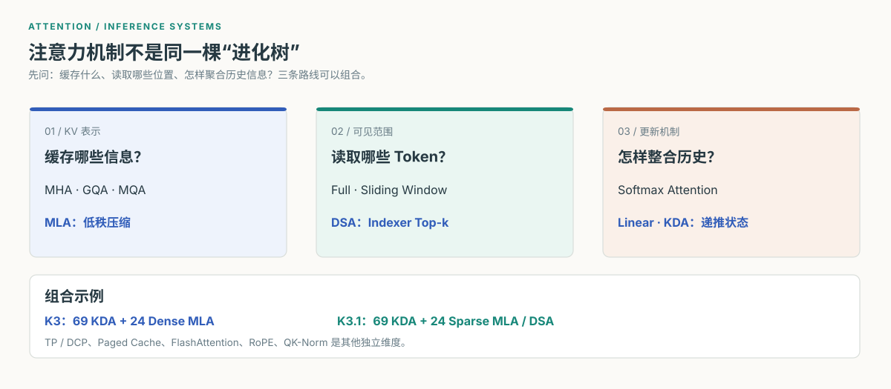
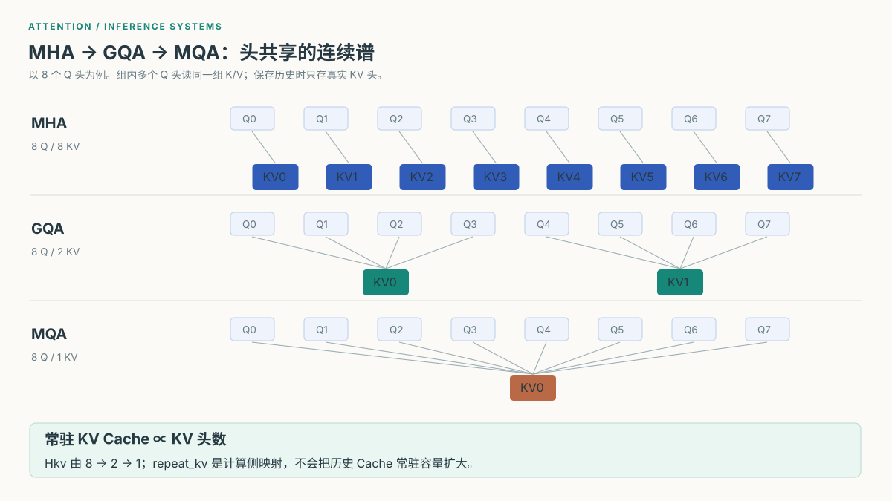
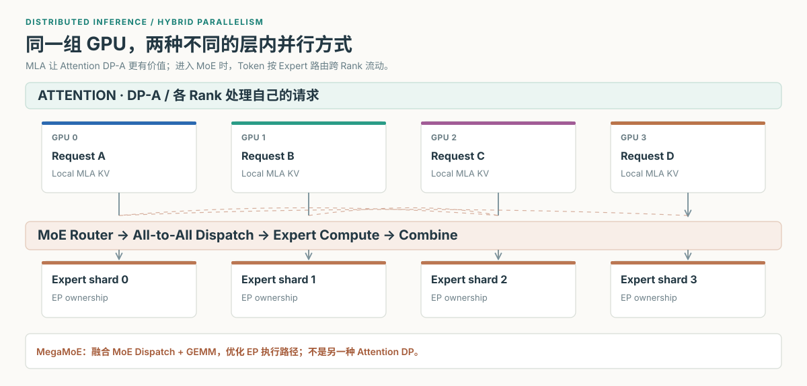

最近从手写 MHA、GQA 一路看到 MLA、Linear Attention、KDA 和 DSA，最困惑的地方并不是某一个公式，而是**它们似乎都在优化长上下文，却又能同时出现在同一个模型里**。例如 Kimi K3 有 69 层 KDA 和 24 层 MLA；K3.1 又在保留 KDA 的同时把那 24 层变成带 Indexer 的 DSA。MLA、KDA 和 DSA 到底是什么关系？

我后来发现，问题出在分类方式：**有的方案决定一份历史要存成什么形状，有的决定这次 Query 访问哪些历史位置，还有的直接改变历史信息的更新方式**。把它们强行画成一条从 MHA 进化到 KDA 的链，就会越来越乱。

这篇文章想沿着一个 Decode 请求往下看：历史信息怎么存、怎么读，最后又如何被 SGLang 一类推理引擎调度和分配显存。我们之前讨论过的 KV Cache、TP/DCP、Prefix Cache、Speculative Decode 和 Kimi K3/K3.1，也能放回同一张图里。

  

*图 1 · 先分清维度，再讨论模型。MHA/GQA/MQA、MLA、DSA 和 KDA 并非一条互斥的进化树。*

## 1. 从一次 Decode 开始：为什么会有 KV Cache？

传统 Self-Attention 可以写成：

~~~text
Q = X · Wq,   K = X · Wk,   V = X · Wv
Attention(Q, K, V) = softmax(QKᵀ / sqrt(d_head)) · V
~~~

Prefill 处理输入序列，之后 Decode 逐步生成 Token。对于第 t 个 Token，它的 Query 需要使用前面历史的 K/V。如果每步都重算所有旧 Token 的投影，代价太大，于是引擎缓存已经算出的 K/V，只在本步追加新的 K/V。

~~~text
history KV:  (K₀,V₀), (K₁,V₁), ... , (Kₜ₋₁,Vₜ₋₁)
new Qₜ ────────────────读取历史─────────────────→ Attention
new KV:                                      (Kₜ,Vₜ) → append
~~~

这里马上就出现两个不同的问题：

**容量问题：**上下文 L 越长，长期保存的 KV 越多；并发 C 越高，通常还要乘上更多请求。

**访存问题：**若使用 Full Attention，新 Query 每步都要读越来越长的历史 KV；吞吐和 TPOT 可能受显存带宽、Kernel、并行通信等制约。

所以以下机制不是都在“省 Attention 计算”：有些缩小缓存，有些只减少当前步要读取的历史，还有些改变状态表示本身。

## 2. MHA、MQA、GQA：保留多少个 KV Head？

先假设一个注意力层有 8 个 Q Head。MHA 给每个 Q Head 独立 K/V；MQA 让所有 Q Head 共享一份 K/V；GQA 让几个连续 Q Head 共享一组 K/V。Q Head 数不必因为共享 KV 而减少。

  

*图 2 · 改变的是缓存中真正保存的 KV Head 数量。*

设 Hq 为 Q Head 数、Hkv 为 KV Head 数、dh 为每个 Head 维度，单层每个历史 Token 的缓存量近似为：

~~~text
KV bytes / token / layer = 2 × Hkv × dh × bytes_per_element

MHA : Hkv = Hq
GQA : 1 < Hkv < Hq
MQA : Hkv = 1
~~~

例如 Hq=8、dh=128、BF16，每层每 Token 占用从 MHA 的 4096 bytes，变成 GQA（2 KV Head）的 1024 bytes，再变成 MQA 的 512 bytes。

之前我们手写 GQA 时，最容易卡在 repeat_kv：明明计算时把 K/V 从 2 组扩展成 8 组，为什么还省显存？答案是**缓存更新在前，计算时的 Head 映射在后**。缓存只保存 2 组 KV；Eager 实现可以通过 repeat_interleave 临时展开，高效 Attention Kernel 也可以直接按映射关系访问，不必物理复制完整历史。运行时可能有临时 Tensor，但它不是随上下文常驻的那份 KV Cache。

同理，GQA 不代表主 Attention 的 Q Head 计算量直接缩小为四分之一。它减少了 K/V 投影与历史数据的存储、读取，主 Attention 的 Q 输出头数仍然存在。

### 从最小示例手写 MHA / GQA / MQA

先别急着看完整 forward。我们只用很小的维度：B=1、T=3、hidden=8、Q Head=4、head_dim=2。

假设 KV Head=2，**4 个 Q Head 和 2 个 KV Head 的映射关系**就是：

~~~text
Q Head :   Q0   Q1  |  Q2   Q3
                \  /        \  /
KV Head:         KV0         KV1

group_size = q_heads / kv_heads = 4 / 2 = 2

MHA: q_heads=4, kv_heads=4 → 每个 Q 各有一组 KV
GQA: q_heads=4, kv_heads=2 → 两个 Q 共用一组 KV
MQA: q_heads=4, kv_heads=1 → 四个 Q 共用一组 KV
~~~

代码中下面三个变化最关键：

~~~text
① Projection + Reshape：从 [B, T, hidden] 得到
   Q: [B, 4, T, 2]
   K: [B, 2, T, 2]
   V: [B, 2, T, 2]

② repeat_interleave(2, dim=1)：计算时的逻辑映射
   Q: [Q0, Q1, Q2, Q3]
   K: [K0, K0, K1, K1]
   V: [V0, V0, V1, V1]

③ Attention
   scores = Q @ Kᵀ            → [B, 4, T, L]
   weights = softmax(scores)  → [B, 4, T, L]
   output = weights @ V       → [B, 4, T, 2]
~~~

这里的 L 是**当前可以访问的历史 Token 总数**。一次性 Prefill 时 L=T；增量 Decode 时，传给 forward 的 T 可以是 1，但它仍要访问缓存里已有的 L-1 个 Token。

接下来把代码写成六个清楚的步骤，故意使用非常小的 Tensor Shape；结构与前面 MHA/GQA 公式一致。**前四步决定注意力怎么算，第②步的缓存与第⑤步的 Causal Mask 是为了支持正确的自回归推理。**

~~~python
import math
import torch
from torch import nn

class GQA(nn.Module):
    def __init__(self, dim=8, q_heads=4, kv_heads=2):
        super().__init__()
        assert dim % q_heads == 0
        assert q_heads % kv_heads == 0

        self.q_heads = q_heads
        self.kv_heads = kv_heads
        self.head_dim = dim // q_heads       # 8 / 4 = 2
        self.group_size = q_heads // kv_heads  # 4 / 2 = 2

        self.q_proj = nn.Linear(dim, q_heads * self.head_dim, bias=False)
        self.k_proj = nn.Linear(dim, kv_heads * self.head_dim, bias=False)
        self.v_proj = nn.Linear(dim, kv_heads * self.head_dim, bias=False)
        self.o_proj = nn.Linear(q_heads * self.head_dim, dim, bias=False)

    def split_heads(self, t, heads):
        # [B, T, heads * d] → [B, heads, T, d]
        B, T, _ = t.shape
        return t.reshape(B, T, heads, self.head_dim).transpose(1, 2)

    def forward(self, x, cache=None):
        B, T, _ = x.shape

        # ① 线性投影：本次输入的 T 个 Token 产生新 Q/K/V
        q = self.split_heads(self.q_proj(x), self.q_heads)   # [B, 4, T, 2]
        k_new = self.split_heads(self.k_proj(x), self.kv_heads)  # [B, 2, T, 2]
        v_new = self.split_heads(self.v_proj(x), self.kv_heads)

        # ② 历史 KV：先拼接并缓存“真实的 kv_heads”，不要先 repeat
        if cache is None:
            k_all, v_all = k_new, v_new
        else:
            if "k" in cache:
                k_all = torch.cat([cache["k"], k_new], dim=2)
                v_all = torch.cat([cache["v"], v_new], dim=2)
            else:
                k_all, v_all = k_new, v_new
            cache["k"], cache["v"] = k_all, v_all  # [B, 2, L, 2]

        # ③ 计算时把两个 Q 头映射到同一组 K/V（教学写法）
        k = k_all.repeat_interleave(self.group_size, dim=1)  # [B, 4, L, 2]
        v = v_all.repeat_interleave(self.group_size, dim=1)

        # ④ QKᵀ：每个 Q Head 算自己的 Attention Score
        L = k.size(2)
        scores = (q @ k.transpose(-2, -1)) / math.sqrt(self.head_dim)
        # scores: [B, 4, T, L]

        # ⑤ Causal Mask：第 i 个 Token 不能看见它后面的 Token
        old_len = L - T
        q_pos = old_len + torch.arange(T, device=x.device)[:, None]  # [T, 1]
        k_pos = torch.arange(L, device=x.device)[None, :]            # [1, L]
        scores = scores.masked_fill(k_pos > q_pos, float("-inf"))

        # ⑥ softmax 后加权求和，再把 Head 拼回 hidden
        weights = torch.softmax(scores, dim=-1)
        out = weights @ v                                   # [B, 4, T, 2]
        out = out.transpose(1, 2).reshape(B, T, -1)        # [B, T, 8]
        return self.o_proj(out)                            # [B, T, 8]

# 同一段代码，仅修改 kv_heads 就能切换三种结构
torch.manual_seed(0)
x = torch.randn(1, 3, 8)  # 1 个请求，3 个 Token，每个 8 维

for hkv in (4, 2, 1):
    model = GQA(dim=8, q_heads=4, kv_heads=hkv).eval()
    with torch.no_grad():
        full = model(x)              # 一次性处理 3 个 Token
        cache = {}
        first = model(x[:, :2], cache)  # Prefill 前 2 个 Token
        last = model(x[:, 2:], cache)   # Decode 第 3 个 Token
        joined = torch.cat([first, last], dim=1)

    print(hkv, tuple(cache["k"].shape),
          torch.allclose(full, joined, atol=1e-6))

# 4 (1, 4, 3, 2) True   → MHA
# 2 (1, 2, 3, 2) True   → GQA
# 1 (1, 1, 3, 2) True   → MQA
~~~

观察这段代码，三种配置的 **Q Shape 完全不变，变化的只有真实 KV 的 Head 数**。

另外，建议把 Causal Mask 作为独立知识点理解。它判断的是“**当前 Q 对应原序列中的哪个位置**”，因此增量 Decode 时不能简单对 T×L 矩阵直接使用普通上三角 Mask：

~~~text
一次性 Prefill，T=3，L=3：
       K0 K1 K2
  Q0    ✓  ×  ×
  Q1    ✓  ✓  ×
  Q2    ✓  ✓  ✓

Prefix 已有 2 个 Token，再 Decode 1 个，T=1，L=3：
       K0 K1 K2
  Q2    ✓  ✓  ✓
~~~

这也是旧版代码里 old_len = L-T 的作用：让新增的 Q 从**整条历史中的正确位置**开始判断可见性，而不是误当成位置 0。

**注意这仍是教学实现：**为了直观看到分组，它物理执行 repeat_interleave；实际 FlashAttention 等高性能实现可以直接处理 GQA 映射。缓存用 torch.cat 也会重复分配、复制历史，生产引擎通常改用分页 KV Cache（Paged KV）；RoPE、QK-Norm 和独立配置的 head_dim 也被省略。理解顺序建议是 **Projection → Head Mapping → Attention → Causal Mask → KV Cache**，不要一开始就把五件事混在一起。

原始 [GQA 论文](https://aclanthology.org/2023.emnlp-main.298/) 还讨论了如何把 MHA Checkpoint 通过均值池化和 Uptraining 转成 GQA，这是训练/模型改造技术，不是上线时直接修改 kv_heads 就能无损获得的能力。

## 3. MLA：和 GQA 省 KV 的思路有什么不同？

GQA 是减少完整的 K/V Head 数，**MLA（Multi-head Latent Attention）则换成一个低秩的共享 KV 表示**。

~~~text
MHA / GQA：每个历史 Token → 多组 K/V → KV Cache

MLA：每个历史 Token → KV 低秩压缩 → c_KV
                                     + k_R（独立 RoPE Key）
                                     → Latent KV Cache
~~~

DeepSeek 系列常见的 MLA 配置缓存 512 维的 KV latent 和 64 维 RoPE Key，即每 Token、每层 576 个元素。解码时可以通过权重吸收等手段在压缩表示上计算，不必先把每个 Head 的完整 K/V 全部展开到显存。解耦出部分 RoPE 信息，是为了让位置旋转不会阻碍相关线性变换的吸收。

**MLA 不是 Linear Attention。** 经典 Dense MLA 仍然对有效历史 Token 执行 Softmax Attention，只是把每个 Token 的 KV 保存得更紧凑；它并没有把完整历史改写成一个每步覆盖的固定大小状态。

### 从 MLA 到 DP-A：为什么 Attention 不继续按 Head 做 TP？

MLA 压缩 KV 后还有个分布式推理的问题：**多个 Q Head 共享同一份 latent KV**。普通 TP 可以切 Q Head 和模型权重，却不一定能跟着切开这份共享历史。在 TP-only MLA 中，不同 Attention TP Rank 可能各自保存**同一个请求的全部 latent KV**，导致 KV 重复占用 HBM，并限制能容纳的 Batch。

这正是 **DP-A（Data-Parallel Attention，也称 DP Attention）** 的主要动机。它不是传统的“复制完整模型、每份独立执行所有层”的 DP，而是**只让 Attention 部分按照请求做数据并行**：不同 Attention Rank/组分别处理自己的请求并维护自己的 KV。这样，请求 A 的 KV 不必在负责请求 B 的 Attention Rank 上再存一份；各 Rank 还可以独立处于 Prefill、Decode 或 Idle 状态。

[SGLang v0.4 官方博客的 DP Attention 章节](https://www.lmsys.org/blog/2024-12-04-sglang-v0-4/#data-parallelism-attention-for-deepseek-models)就是从 MLA 的共享 KV 导出这一设计的；后续 [SGLang 96×H100 大规模 EP 部署博客](https://www.lmsys.org/blog/2025-05-05-large-scale-ep/)进一步说明了它如何与 MoE 并行配合。这里要强调：**MLA 让 DP-A 特别有价值，但 DP-A 并非只能用于 MLA。**

然而 DeepSeek、Kimi 这类模型还有 MoE。**Attention 使用 DP-A，不意味着每个 GPU 都保存所有 Expert**。MoE 层可以采用 **EP（Expert Parallelism）**：将专家权重分布到 GPU，Attention 之后根据 Router 的专家选择，把 Token Dispatch 到相应 Expert，计算完再 Combine 回原来的请求。这样不同层可以使用不同的数据分布，而不是强迫 Attention 和 Expert 都沿同一个维度切分。

在这条 MoE 路径中，**MegaMoE 是融合执行后端，不是新的并行维度**。例如 [SGLang 的 DeepSeek-V4.1 工程博客](https://www.lmsys.org/blog/2026-10-24-dsv41-deepinfer/)介绍了将 Token Dispatch、Expert GEMM 与 Combine 融合到一个 Kernel 的实现。需要区分的是：EP 决定专家分布与 Token Routing；MegaMoE 决定这部分计算/通信如何执行和重叠。

  

*图 3 · Attention 走 DP-A、MoE 走 EP；MegaMoE 优化 MoE 执行路径，而非替代 EP。*

这也解释了为什么 DP-A 不只是数学上的并行配置，还涉及真实请求的路由与调度。我在 [《SGLang DP Health：一次没有报错的吞吐退化，根因却在请求路由》](/blog/2026/11/18/dp-health-routing-bug/) 中记录过：控制面探活错误地改变用户请求的 DP 路由状态，会让 Rank 负载失衡、有效 Batch 缩小，最终拖低吞吐。

### DCP：既然有 DP-A，为什么还要沿 Context 再切一次？

因为 DP-A 解决的是**不同请求该由谁处理**，不是**单个长请求的历史由谁存**。即使一个 Attention Rank 只为自己的请求维护 KV，一条很长的上下文仍可能占满它的缓存空间，Decode 读取整个历史的成本也会随长度增长。

**DCP（Decode Context Parallelism）** 沿 Context/Sequence 维度，将同一条请求的历史 KV 分到多个 GPU。每个 Rank 对自己持有的历史做 Partial Attention，随后交换局部 Output 和 LSE（Log-Sum-Exp），合并出全局结果。

~~~text
TP-only MLA：
  Rank 0：请求 A 的全部 latent KV
  Rank 1：请求 A 的全部 latent KV
  → 同一份历史可能重复存储

DP-A：
  Attention 组 0：请求 A 的 latent KV
  Attention 组 1：请求 B 的 latent KV
  → 按请求分配，各组维护自己的缓存

DP-A + DCP：
  Attention 组 0（请求 A）：
      GPU 0：A 的历史分片 0
      GPU 1：A 的历史分片 1
      → Partial Attention + LSE Merge
  Attention 组 1（请求 B）：
      GPU 2：B 的历史分片 0
      GPU 3：B 的历史分片 1
      → Partial Attention + LSE Merge
  → 先按请求分，再在兼容的组内按历史位置分
~~~

这个理解很接近我们之前说的“DCP 给 DP-A 补长上下文短板”，但更准确的表述是：**DP-A 以请求为单位解决重复 KV 与独立调度；DCP 以历史位置为单位解决单请求的容量与读取压力**。它们是互补策略，DCP 并不依赖一定启用 DP-A。DCP 也不是免费加速：需要 Query 分发或复制、局部结果交换和归一化合并，是否有端到端收益取决于上下文长度与通信开销。

DCP 的并行分组必须满足对应版本的拓扑约束，不能在同一组固定 GPU 上把 DP-A 和 DCP 规模任意相乘。具体的分片映射、LSE 合并和兼容性约束见 [SGLang DCP 实现文档](https://github.com/sgl-project/sglang/blob/main/docs/docs/advanced_features/dcp.mdx)。

我们之前做的 [DCP A2A send packing PR #49455](https://github.com/sgl-project/sglang/pull/49455)，就位于 DCP 部分结果交换的路径。它能明显缩短某个打包 Kernel，却不一定在整条 Decode 关键路径上带来同等幅度的吞吐收益。这恰好体现了**减少 KV 读取量、减少通信时间、改善端到端服务**是三个需要分别验证的目标。

## 4. Full、Sparse/DSA、Linear/KDA：历史究竟怎么被读取？

前面讨论的是缓存**存什么**，现在换一个问题：本步 Query 究竟**读哪些历史**？

  

*图 4 · 三种不同的读取与更新方式；不代表实测的性能倍数。*

**Full Attention**：新 Query 可访问所有有效历史位置，读取和注意力工作通常随 L 增长。

**SWA（Sliding Window Attention）**：只允许访问最近的一段固定窗口，以放弃部分远距离直接访问能力换取成本降低。

**DSA（DeepSeek Sparse Attention）**：先用较轻量的 Indexer 扫描历史，选择 Top-k，再对选中的 KV 做主 Attention。它保留了 Softmax，只是缩小主 Attention 的读取集合。不能说它“完全不再扫描全历史”，因为 Indexer 仍然需要打分。

**Linear Attention / KDA**：不再依赖每次 Decode 都重新逐 Token 读取整段 KV，而是随时间不断更新一个固定形状的 Recurrent State。下一步 Query 从这个 State 读取历史聚合结果。KDA 在这个递推框架里结合了门控遗忘与 Delta Rule，因此状态更新并不是简单 KV 平均。

~~~text
Full MLA：
    Qₜ → 读取 L 条 latent KV → Softmax → Output

DSA：
    Qₜ → Indexer 扫描 L 条 Index Key
       → Top-k → 读取 k 条 latent KV → Sparse MLA → Output

KDA：
    State(t-1) + 当前 Token → 更新 State(t)
    Query 从 State(t) 读取 → Output
~~~

DSA 主要减少昂贵的 MLA 数据读取，KDA 改变历史存储和更新范式；它们与 KV 压缩技术并不天然互斥。

## 5. Kimi K3 → K3.1：为什么同一个模型里既有 KDA 又有 DSA？

Kimi K3 总计 **93 层**，其中 **69 层 KDA + 24 层 Gated MLA**。绝大多数层用 KDA 的递推状态处理历史，一部分层仍通过 MLA 直接访问历史 Token。这类混合结构的思路是让固定状态与显式历史访问各自发挥作用。

到了 Kimi K3.1 Pro，模型仍保留 **69 层 KDA**，但另外 **24 层**由 Dense Gated MLA 变成 **Gated DSA（以 MLA 为基础的 Sparse Attention）**。根据 [Moonshot AI 的官方模型卡](https://huggingface.co/moonshotai/Kimi-K3.1-Pro)，Indexer 为 32 Head × 128 维，Top-k = 2048。每个 DSA 层可以独立挑选当前 Query 更需要的历史位置。

  

*图 5 · K3/K3.1 的结构变化：不是 KDA 被 DSA 替代，而是 MLA 的全历史读取被稀疏化。*

~~~text
K3：
  69 个 KDA 层：更新每个请求的 Recurrent State
  24 个 MLA 层：读取全历史 latent KV

K3.1：
  69 个 KDA 层：继续更新 Recurrent State
  24 个 DSA 层：
      Indexer 扫全部 Index Keys
      → 选 Top-2048
      → 主 MLA 只读选中 latent KV
~~~

所以 **DSA 并不取代 MLA 的 KV 表示**，反而是在 MLA 旁边新增了一个 Indexer，以及由此产生的新缓存。这个变化从模型结构一路影响到显存规划。

### 为什么 K3.1 做 Sparse Attention，常驻 KV Cache 可能反而更大？

因为 **存储占用和每步读取带宽并不等价**。

在 [vLLM K3.1 Day-0 文章](https://vllm.ai/blog/2026-11-04-kimi-k31-pro) 的 FP8 口径下，每个 DSA 层每 Token 保存：

~~~text
MLA latent = 512 + 64 = 576 bytes
Index Key  = 128 bytes + 4 bytes scale = 132 bytes

K3     : 24 × 576 = 13,824 bytes / token
K3.1   : 24 × (576 + 132) = 16,992 bytes / token
~~~

也就是说，同为 FP8 缓存时，**K3.1 多出 3,168 bytes/token 的 Index Key 常驻开销**，却可能显著减少本次 Decode 实际读取的 latent KV：

~~~text
K3 Dense MLA 读取： 约 576 × L bytes / 层

K3.1 DSA 读取：    约 132 × L + 576 × min(2048,L) bytes / 层
                    ↑ Indexer       ↑ 主 MLA
~~~

例如 L=128K，按这套简化模型，Dense MLA 约读取 75.5 MB，DSA 的 Index Key 加选中 latent 约 18.5 MB，**数据读取量约为前者的四分之一**。但这不意味着 E2E TPOT 自动快四倍：Top-k 的计算、DCP 通信、KDA、MoE、CUDA Graph、Overlap 以及调度都会影响最终收益。缓存还可以对 latent 与 Index Key 分别采用 NVFP4、MXFP4 等压缩格式，容量比较必须标注具体数据类型。

## 6. KV Cache 和 Recurrent State：为什么服务端需要两种状态管理？

这是我觉得最能把 Attention 理论和 AI Infra 联系起来的地方。

在 Dense Attention 中，KV Cache 基本是**按 Token 追加**：新 Token 来了，追加一页新的历史；已经存在的 KV 通常不再原地修改。KDA 则维护**按请求分配、每步会被更新**的 Recurrent State。KDA 的状态还可能包含短卷积（Short Conv）所需的历史。

| 维度 | MLA/DSA KV 与 Index Key | KDA Recurrent State |
| --- | --- | --- |
| 分配粒度 | 按历史 Token 或 Page | 按活动请求 / 状态槽位 |
| 随上下文长度增长 | 通常线性增长 | 单份当前 State 形状固定 |
| 随并发增长 | 通常增长 | 活动请求越多，状态副本越多 |
| 更新 | Append | 原地更新 / Checkpoint |
| Prefix Cache | 可共享已经计算的 KV 页 | 需恢复对应前缀位置的 State |
| 推测解码 | 保证已验收的 KV 正确提交 | 还需保证失败分支的 State 回退 |
| P/D 分离 | 传递 paged KV / Index Key | 传递 KDA State |

[SGLang K3 Day-0 工程文章](https://www.lmsys.org/blog/2026-07-27-kimi-k3-day0-support) 给出了很直观的量级：在其 TP8 等指定条件下，69 层 KDA 的一份请求 State 约 **54 MB**，而跨 24 层的 MLA KV 是**按 Token 分配的小块**。这是该配置的参考值，不是所有精度和并行配置都相同。

于是混合模型可能出现一种很不符合传统直觉的情况：

~~~text
MLA KV Pool：还可以容纳很多 Token
KDA State Pool：已经没有新的活动请求槽位

结果：即使 KV Usage 不高，新的请求也不一定能 Admission
~~~

理解并发上限时，应当同时看：

~~~text
有效并发 ≤ min(
    KV Pool 支持的请求数,
    KDA State 支持的请求数,
    Runtime / Scheduler / 其他内存资源限制
)
~~~

这里还有一个很重要的区分：**“存在两种逻辑状态”不代表“所有框架都用两个独立物理内存池”。** SGLang 的 K3 Day-0 资料描述过 KDA State Pool 与 MLA KV Pool 分开预留造成的容量不匹配，也讨论统一分配方案；vLLM K3.1 的实现则把 MLA latent、Index Keys 和 KDA State 按 Block 打包进共享布局。具体策略必须以对应版本源码为准。

无论内存怎样合并，语义上的差异仍在：KDA State 是可变的，不能像只读历史 KV 那样直接被多个请求共享使用。Prefix Cache 命中时，除找到历史 KV 外，还需要对应位置的 **State Checkpoint**。SGLang 的方案包括 Copy-on-Write、Snapshot、Donate 等状态操作。Speculative Decoding 里又涉及失败分支的 State 恢复；ReplaySSM 则通过重放较小的中间数据，避免给每个候选步骤复制巨大的状态。

因此混合架构的容量问题并不只是“KV Cache 有多少 GB”，还要看状态槽位、前缀快照、状态复用和回滚机制。

## 7. K3.1 怎样组合 DSA、DCP、DP-A 与 P/D 状态传输？

前面的 MLA 部分已经解释了 DP-A 与 DCP 的分工。到了 K3.1，DSA 又加入了一个新维度：**DP-A 决定由哪组 Attention Rank 承接请求，DCP 决定历史 KV 在哪些 Rank 上，DSA 决定当前 Query 实际选中哪些历史 Token。**

因此，同一条请求的 Sparse MLA 可以沿着如下流程执行：

~~~text
Request A → DP-A Attention Group
           → 各 DCP Rank 扫描自己持有的 Index Keys
           → 交换候选，形成 Global Top-2048
           → 读取本地选中的 latent KV
           → Partial Sparse Attention + LSE Merge
           → 输出到 MoE Router
           → EP Experts → Combine
~~~

这里的 KDA 层又是另一类执行对象：**Recurrent State 是按请求更新的固定形状状态**，不天然使用 MLA KV 的 Context 分片方式。因此 K3/K3.1 在 P/D 分离时需要传输多种状态，而不是只搬一个传统 KV Cache：

~~~text
K3 Prefill → Decode：
  MLA Latent KV + KDA Recurrent State（及必要的 Conv 状态）

K3.1 Prefill → Decode：
  MLA Latent KV + DSA Index Keys + KDA Recurrent State
~~~

[SGLang Kimi K3 Cookbook](https://github.com/sgl-project/sglang/blob/main/docs/cookbook/autoregressive/Moonshotai/Kimi-K3.mdx)说明 P/D 状态传输覆盖 Paged MLA KV 与 KDA Recurrent State；K3.1 还需要保持 DSA Index Key 的一致性。到这里，模型架构与 Runtime 的关系就比较清楚了：**算子决定怎么计算，Attention/Context/Expert 并行决定工作分给谁，KV 与 Recurrent State 管理决定请求能否正确地继续执行。**

## 8. 回到推理工程，看到模型配置应该先问什么？

如果现在再打开 SGLang 的模型配置与 Runtime，我会按照下面的顺序排查，而不是只看用了哪个 Attention 名字：

- **MHA/MQA/GQA**：先看 Hq、Hkv、head_dim 和 KV Cache 每 Token 的实际字节数；不要把 repeat_kv 的逻辑展开当作常驻缓存。
- **MLA**：检查 latent 维度、RoPE Key、Weight Absorption、TP 下是否复制，以及 DCP 是否沿历史分片。
- **DSA**：检查 Indexer 扫描长度、Top-k、Index Key 缓存、Global Top-k 通信和 Sparse Attention 的关键路径。
- **KDA/Linear**：检查 Recurrent State 的并发槽位、Prefix Cache Checkpoint、Spec Decode 回滚、P/D 传输和状态池占用。
- **K3/K3.1 混合服务**：同时核算 Token 级 KV 与 Request 级 State。前者可能限制最长上下文与 token capacity，后者可能先决定可接纳的并发。

最终，Attention 不是只决定模型如何计算注意力分数。它还决定推理引擎要存什么、如何调度内存、把哪些状态传到其他节点，以及端到端性能究竟卡在哪里。

**MHA/GQA 是 KV 头共享问题；MLA 是压缩表示问题；DSA 是稀疏读取问题；KDA 是递推状态问题。Kimi K3/K3.1 则把这些看似独立的概念放进了同一套可运行的系统。**

---

## 参考阅读

- [SGLang v0.4 · Data Parallelism Attention for DeepSeek Models](https://www.lmsys.org/blog/2024-12-04-sglang-v0-4/#data-parallelism-attention-for-deepseek-models)
- [SGLang · Deploying DeepSeek with P/D Disaggregation and Large-Scale EP](https://www.lmsys.org/blog/2025-05-05-large-scale-ep/)
- [SGLang · More Than DeepInfer（DP Attention、EP、MegaMoE）](https://www.lmsys.org/blog/2026-10-24-dsv41-deepinfer/)
- [SGLang · Decode Context Parallelism 设计与实现](https://github.com/sgl-project/sglang/blob/main/docs/docs/advanced_features/dcp.mdx)
- [GQA · Ainslie et al. (EMNLP 2023)](https://aclanthology.org/2023.emnlp-main.298/)
- [DeepSeek-V3.2 Sparse Attention / Transformers](https://huggingface.co/docs/transformers/en/model_doc/deepseek_v32)
- [Kimi Linear 技术报告](https://yzhang.site/assets/pubs/techreport/2025/kda.pdf)
- [Moonshot AI · Kimi K3 官方技术博客](https://www.kimi.com/en/blog/kimi-k3)
- [Moonshot AI · Kimi K3.1 Pro 模型卡](https://huggingface.co/moonshotai/Kimi-K3.1-Pro)
- [SGLang / LMSYS · K3 Day-0 与状态管理](https://www.lmsys.org/blog/2026-07-27-kimi-k3-day0-support)
- [SGLang · Kimi K3 Cookbook](https://github.com/sgl-project/sglang/blob/main/docs/cookbook/autoregressive/Moonshotai/Kimi-K3.mdx)
- [vLLM · K3.1 Pro Day-0（Indexer、Cache 布局与 DCP）](https://vllm.ai/blog/2026-11-04-kimi-k31-pro)
- [LightSeek · K3.1 Sparse Attention 工程实践](https://lightseek.org/blog/tokenspeed-kimi-k3-1)
