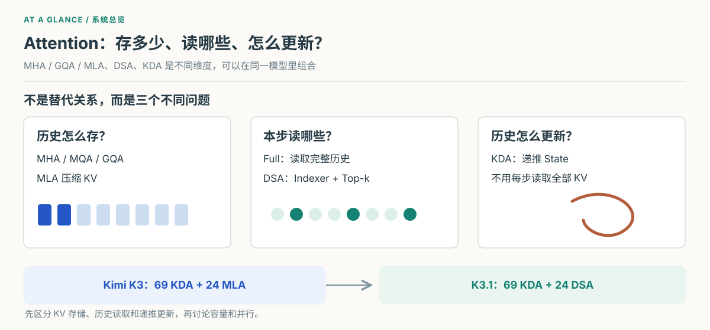
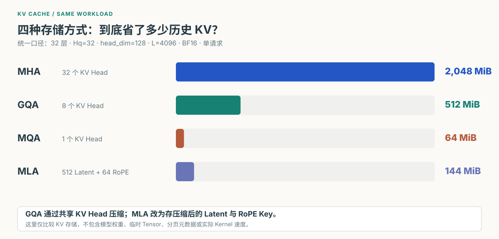
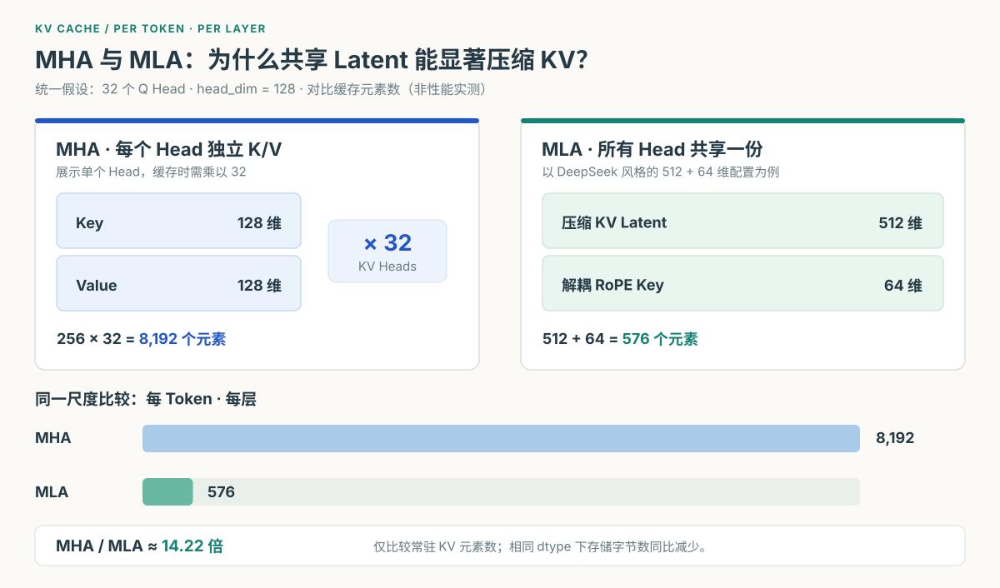
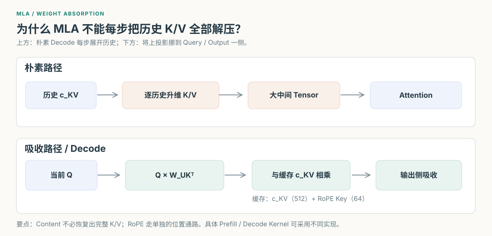
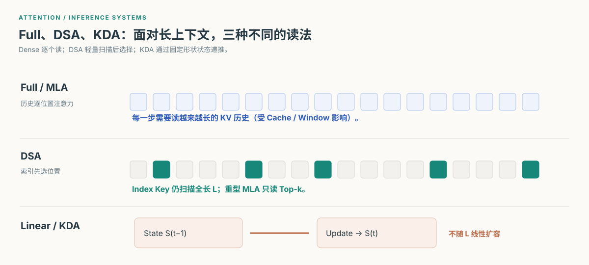
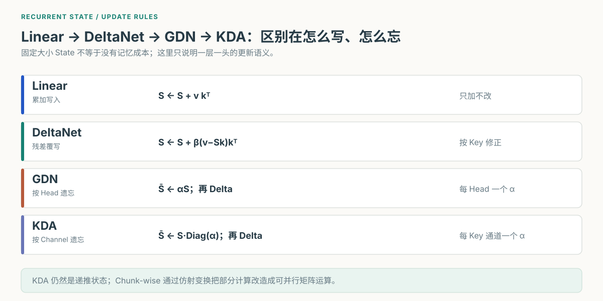
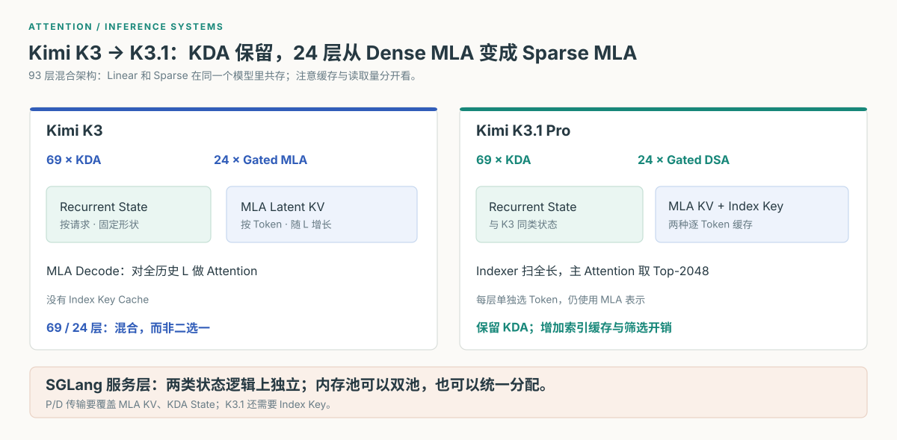

最近从手写 MHA、GQA 一路看到 MLA、Linear Attention、KDA 和 DSA，最困惑的地方并不是某一个公式，而是**它们似乎都在优化长上下文，却又能同时出现在同一个模型里**。例如 Kimi K3 有 69 层 KDA 和 24 层 MLA；K3.1 又在保留 KDA 的同时把那 24 层变成带 Indexer 的 DSA。MLA、KDA 和 DSA 到底是什么关系？

我后来发现，问题出在分类方式：**有的方案决定一份历史要存成什么形状，有的决定这次 Query 访问哪些历史位置，还有的直接改变历史信息的更新方式**。把它们强行画成一条从 MHA 进化到 KDA 的链，就会越来越乱。

**先说结论：** Attention 的优化并不是一条“新机制替代旧机制”的进化树。MHA → MQA/GQA 通过**共享 KV Head**减少存储；MLA 把 KV 压成共享的 **Latent + RoPE Key**，再通过权重吸收避免反复解压；DSA 用 Indexer 选取需要读取的历史；KDA 则用不断更新的 **Recurrent State** 代替逐 Token 保存全部 KV。以 32 层、4096 Token、BF16 的统一示例计算，MHA 的 KV Cache 为 2 GiB，GQA-8 为 512 MiB，MQA 为 64 MiB，而采用 512+64 维配置的 MLA 为 144 MiB。**这是一笔存储账，不是性能加速倍数**；真正决定服务吞吐的，还包括访存、Kernel、DP-A、DCP 和状态管理。

  

*速览图 · 注意力机制三条轴：存储、读取和更新不是同一个维度。*

这篇文章想沿着一个 Decode 请求往下看：历史信息怎么存、怎么读，最后又如何被 SGLang 一类推理引擎调度和分配显存。我们之前讨论过的 KV Cache、TP/DCP、Prefix Cache、Speculative Decode 和 Kimi K3/K3.1，也能放回同一张图里。

## 1. 从一次 Decode 开始：为什么会有 KV Cache？

理解 Attention 前，可以先把它放回完整 Transformer Block：典型 Pre-Norm Decoder 层会执行 **x ← x + Attention(Norm(x))**，再执行 **x ← x + FFN(Norm(x))**。前者决定当前 Token 如何读取历史，后者对得到的 Token 表示做逐位置非线性变换。**MLA 主要优化的是前者的 KV 表示，不是把 FFN 变成 MoE。** FFN 如何由 SwiGLU 发展到 DeepSeekMoE、EP 与 MegaMoE，单独放在 [《从 FFN、SwiGLU 到 DeepSeekMoE》](/blog/2026/11/20/ffn-swiglu-deepseekmoe-megamoe/) 里详细讲解。

传统 Self-Attention 可以写成：

~~~text
Q = X · Wq,   K = X · Wk,   V = X · Wv
Attention(Q, K, V) = softmax(QKᵀ / sqrt(d_head)) · V
~~~

Prefill 处理输入序列，之后 Decode 逐步生成 Token。对于第 t 个 Token，它的 Query 需要使用前面历史的 K/V。如果每步都重算所有旧 Token 的投影，代价太大，于是引擎缓存已经算出的 K/V，只在本步追加新的 K/V。

~~~text
history KV:  (K₀,V₀), (K₁,V₁), ... , (Kₜ₋₁,Vₜ₋₁)
new Qₜ ────────────────读取历史─────────────────→ Attention
new KV:                                      (Kₜ,Vₜ) → append
~~~

这里马上就出现两个不同的问题：

**容量问题：**上下文 L 越长，长期保存的 KV 越多；并发 C 越高，通常还要乘上更多请求。

**访存问题：**若使用 Full Attention，新 Query 每步都要读越来越长的历史 KV；吞吐和 TPOT 可能受显存带宽、Kernel、并行通信等制约。

所以以下机制不是都在“省 Attention 计算”：有些缩小缓存，有些只减少当前步要读取的历史，还有些改变状态表示本身。

先把容易混在一起的四条优化路线分开：

| 优化方向 | 改变的对象 | 典型方法 | 对推理系统的直接影响 |
| --- | --- | --- | --- |
| **存储表示** | 每个历史 Token 留什么 | MQA/GQA 共享 Head、MLA 低秩 KV；KV 量化 | 降低 KV 容量与部分历史读取带宽 |
| **访问范围** | 当前 Query 读取哪些历史 | Full、SWA、DSA / Top-k | 降低主 Attention 访问量；可能增加索引开销 |
| **状态更新** | 历史是否仍逐 Token 保存 | Linear、DeltaNet、GDN、KDA | 改为固定形状的 Recurrent State，与长度解耦 |
| **硬件实现** | 相同计算怎样落到 GPU | FlashAttention、PagedAttention、专用 MLA Kernel | 降低 HBM IO、显存碎片、调度或 Kernel 开销 |

这几条路线可以组合：**GQA + FlashAttention** 并不冲突，**MLA + DSA** 也不是两种互斥模型。如果只细分“Softmax Attention 怎么压缩历史表示”，还可以按**跨 Head 共享（MQA/GQA）、沿特征通道压缩（MLA）、跨层共享或复用**三个方向理解；跨层复用涉及不同 Transformer 层之间的架构约定，不是继续减小 `Hkv` 就能得到。这里还要分清，FlashAttention 通过分块与 Online Softmax 减少中间 Attention Matrix 的 HBM 读写，**不会因此自动把 Full Attention 的数学计算量从二次降为线性**；PagedAttention 则主要改变 KV 的分页存储和管理方式，不等于一种新的 Attention 数学公式。

## 2. MHA、MQA、GQA：保留多少个 KV Head？

  

*图 1 · 先分清维度，再讨论模型。MHA/GQA/MQA、MLA、DSA 和 KDA 并非一条互斥的进化树。*

先用一个简化结构理解 Head 共享。假设有 **8 个 Q Head**：MHA 给它们各自配 8 份 K/V，MQA 让 8 个 Q Head 共用 1 份，GQA 则把 8 个 Q Head 分成若干组（例如每 4 个 Q 共用 1 个 KV Head）。注意**Q Head 并没有被砍掉**，变化的是历史里要保存多少组 K/V。

  

*图 2 · Head 共享是**缓存侧**的改变；Q Head 数和输出投影仍然保留。*

设 Q Head 数为 `Hq`、KV Head 数为 `Hkv`、Head 维度为 `dh`、历史长度为 `L`，单元素字节数为 `b`。普通 KV Cache 的大小为：

~~~text
KV bytes / token / layer = 2 × Hkv × dh × b
KV bytes (all layers)    = B × L × N_layers × 2 × Hkv × dh × b

MHA: Hkv = Hq
GQA: 1 < Hkv < Hq，且 Hq 能被 Hkv 整除
MQA: Hkv = 1
~~~

前一个系数 2 是因为 **K 和 V 各存一份**。为了给它一个直观的显存量级，我们固定一组教学参数：32 层、32 个 Q Head、`dh=128`、单条 4096 Token 请求、BF16（每元素 2 Bytes），只变化 `Hkv`：

| 方案 | Q Head | KV Head | 整模型 KV Cache | 相对 MHA |
| --- | ---: | ---: | ---: | ---: |
| MHA | 32 | 32 | **2 GiB** | 100% |
| GQA-8 | 32 | 8 | **512 MiB** | 25% |
| MQA | 32 | 1 | **64 MiB** | 3.125% |

  

*图 3 · 一组**统一假设下的理论容量**，不是某个模型或某张 GPU 的实测结果。MLA 的 144 MiB 会在下一节推导。*

为什么容量下降还能改善 Decode？因为在单 Token 的 **Full Attention** 中，每层的 Query 通常仍需要访问历史 KV。假设全部缓存都必须从 HBM 读取，用 **2 TB/s 理论带宽**粗算，2 GiB、512 MiB、64 MiB 的理想读取时间下限分别约为 **1.07 ms、0.27 ms、0.034 ms**。这是整个 32 层 KV 数据的一次读取量级，**不包括权重读取、实际 Kernel 访存、计算与跨卡通信**，更不能直接转换成真实 TPOT。

这里的收益与代价也需要分开看：共享 KV Head 降低了 KV 投影输出、缓存写入和后续历史读取量，但 Q Head 的数量、Softmax 和输出聚合并没有随 `Hkv` 同比例消失。更少的独立 KV 表示也可能影响模型质量，**不是简单把现有 Checkpoint 的 `num_key_value_heads` 改小就能无损升级**。原始 [GQA 论文](https://aclanthology.org/2023.emnlp-main.298/) 给出了从 MHA Checkpoint 转换并通过 Uptraining 适配的方案（实验采用原预训练计算量约 5% 的继续训练预算）。

之前手写 GQA 时最容易混淆的，是 `repeat_kv`：**缓存更新在前，计算时映射在后**。缓存只保留 `Hkv` 组；Eager 实现用 `repeat_interleave` 可以临时展开，面向 GQA 的高效 Kernel 则可直接按组索引，不需要永久复制历史 KV。这也是“计算中看见 32 个 K Head”不代表“KV Cache 真的存了 32 份”的原因。

### 从最小示例手写 MHA / GQA / MQA

先别急着看完整 forward。我们只用很小的维度：B=1、T=3、hidden=8、Q Head=4、head_dim=2。

假设 KV Head=2，**4 个 Q Head 和 2 个 KV Head 的映射关系**就是：

~~~text
Q Head :   Q0   Q1  |  Q2   Q3
                \  /        \  /
KV Head:         KV0         KV1

group_size = q_heads / kv_heads = 4 / 2 = 2

MHA: q_heads=4, kv_heads=4 → 每个 Q 各有一组 KV
GQA: q_heads=4, kv_heads=2 → 两个 Q 共用一组 KV
MQA: q_heads=4, kv_heads=1 → 四个 Q 共用一组 KV
~~~

代码中下面三个变化最关键：

~~~text
① Projection + Reshape：从 [B, T, hidden] 得到
   Q: [B, 4, T, 2]
   K: [B, 2, T, 2]
   V: [B, 2, T, 2]

② repeat_interleave(2, dim=1)：计算时的逻辑映射
   Q: [Q0, Q1, Q2, Q3]
   K: [K0, K0, K1, K1]
   V: [V0, V0, V1, V1]

③ Attention
   scores = Q @ Kᵀ            → [B, 4, T, L]
   weights = softmax(scores)  → [B, 4, T, L]
   output = weights @ V       → [B, 4, T, 2]
~~~

这里的 L 是**当前可以访问的历史 Token 总数**。一次性 Prefill 时 L=T；增量 Decode 时，传给 forward 的 T 可以是 1，但它仍要访问缓存里已有的 L-1 个 Token。

接下来把代码写成六个清楚的步骤，故意使用非常小的 Tensor Shape；结构与前面 MHA/GQA 公式一致。**前四步决定注意力怎么算，第②步的缓存与第⑤步的 Causal Mask 是为了支持正确的自回归推理。**

~~~python
import math
import torch
from torch import nn

class GQA(nn.Module):
    def __init__(self, dim=8, q_heads=4, kv_heads=2):
        super().__init__()
        assert dim % q_heads == 0
        assert q_heads % kv_heads == 0

        self.q_heads = q_heads
        self.kv_heads = kv_heads
        self.head_dim = dim // q_heads       # 8 / 4 = 2
        self.group_size = q_heads // kv_heads  # 4 / 2 = 2

        self.q_proj = nn.Linear(dim, q_heads * self.head_dim, bias=False)
        self.k_proj = nn.Linear(dim, kv_heads * self.head_dim, bias=False)
        self.v_proj = nn.Linear(dim, kv_heads * self.head_dim, bias=False)
        self.o_proj = nn.Linear(q_heads * self.head_dim, dim, bias=False)

    def split_heads(self, t, heads):
        # [B, T, heads * d] → [B, heads, T, d]
        B, T, _ = t.shape
        return t.reshape(B, T, heads, self.head_dim).transpose(1, 2)

    def forward(self, x, cache=None):
        B, T, _ = x.shape

        # ① 线性投影：本次输入的 T 个 Token 产生新 Q/K/V
        q = self.split_heads(self.q_proj(x), self.q_heads)   # [B, 4, T, 2]
        k_new = self.split_heads(self.k_proj(x), self.kv_heads)  # [B, 2, T, 2]
        v_new = self.split_heads(self.v_proj(x), self.kv_heads)

        # ② 历史 KV：先拼接并缓存“真实的 kv_heads”，不要先 repeat
        if cache is None:
            k_all, v_all = k_new, v_new
        else:
            if "k" in cache:
                k_all = torch.cat([cache["k"], k_new], dim=2)
                v_all = torch.cat([cache["v"], v_new], dim=2)
            else:
                k_all, v_all = k_new, v_new
            cache["k"], cache["v"] = k_all, v_all  # [B, 2, L, 2]

        # ③ 计算时把两个 Q 头映射到同一组 K/V（教学写法）
        k = k_all.repeat_interleave(self.group_size, dim=1)  # [B, 4, L, 2]
        v = v_all.repeat_interleave(self.group_size, dim=1)

        # ④ QKᵀ：每个 Q Head 算自己的 Attention Score
        L = k.size(2)
        scores = (q @ k.transpose(-2, -1)) / math.sqrt(self.head_dim)
        # scores: [B, 4, T, L]

        # ⑤ Causal Mask：第 i 个 Token 不能看见它后面的 Token
        old_len = L - T
        q_pos = old_len + torch.arange(T, device=x.device)[:, None]  # [T, 1]
        k_pos = torch.arange(L, device=x.device)[None, :]            # [1, L]
        scores = scores.masked_fill(k_pos > q_pos, float("-inf"))

        # ⑥ softmax 后加权求和，再把 Head 拼回 hidden
        weights = torch.softmax(scores, dim=-1)
        out = weights @ v                                   # [B, 4, T, 2]
        out = out.transpose(1, 2).reshape(B, T, -1)        # [B, T, 8]
        return self.o_proj(out)                            # [B, T, 8]

# 同一段代码，仅修改 kv_heads 就能切换三种结构
torch.manual_seed(0)
x = torch.randn(1, 3, 8)  # 1 个请求，3 个 Token，每个 8 维

for hkv in (4, 2, 1):
    model = GQA(dim=8, q_heads=4, kv_heads=hkv).eval()
    with torch.no_grad():
        full = model(x)              # 一次性处理 3 个 Token
        cache = {}
        first = model(x[:, :2], cache)  # Prefill 前 2 个 Token
        last = model(x[:, 2:], cache)   # Decode 第 3 个 Token
        joined = torch.cat([first, last], dim=1)

    print(hkv, tuple(cache["k"].shape),
          torch.allclose(full, joined, atol=1e-6))

# 4 (1, 4, 3, 2) True   → MHA
# 2 (1, 2, 3, 2) True   → GQA
# 1 (1, 1, 3, 2) True   → MQA
~~~

观察这段代码，三种配置的 **Q Shape 完全不变，变化的只有真实 KV 的 Head 数**。

另外，建议把 Causal Mask 作为独立知识点理解。它判断的是“**当前 Q 对应原序列中的哪个位置**”，因此增量 Decode 时不能简单对 T×L 矩阵直接使用普通上三角 Mask：

~~~text
一次性 Prefill，T=3，L=3：
       K0 K1 K2
  Q0    ✓  ×  ×
  Q1    ✓  ✓  ×
  Q2    ✓  ✓  ✓

Prefix 已有 2 个 Token，再 Decode 1 个，T=1，L=3：
       K0 K1 K2
  Q2    ✓  ✓  ✓
~~~

这也是旧版代码里 old_len = L-T 的作用：让新增的 Q 从**整条历史中的正确位置**开始判断可见性，而不是误当成位置 0。

**注意这仍是教学实现：**为了直观看到分组，它物理执行 repeat_interleave；实际 FlashAttention 等高性能实现可以直接处理 GQA 映射。缓存用 torch.cat 也会重复分配、复制历史，生产引擎通常改用分页 KV Cache（Paged KV）；RoPE、QK-Norm 和独立配置的 head_dim 也被省略。理解顺序建议是 **Projection → Head Mapping → Attention → Causal Mask → KV Cache**，不要一开始就把五件事混在一起。

原始 [GQA 论文](https://aclanthology.org/2023.emnlp-main.298/) 还讨论了如何把 MHA Checkpoint 通过均值池化和 Uptraining 转成 GQA，这是训练/模型改造技术，不是上线时直接修改 kv_heads 就能无损获得的能力。

## 3. MLA：和 GQA 省 KV 的思路有什么不同？

GQA 减少**完整 K/V 的 Head 数**；MLA（Multi-head Latent Attention）换一个问题：**能不能不在缓存中保存每个 Head 的完整 K/V，而只保留可被各个 Head 共同使用的压缩表示？**

  

*补充图 · 先把每 Token、每层的缓存拆开：MHA 保存 32 份完整 K/V，MLA 缓存共享的 512 维 Latent 和 64 维解耦 RoPE Key。8,192 / 576 ≈ 14.22 倍是**元素数与同精度缓存大小之比**，不是吞吐加速倍数。*

以 DeepSeek-V2 风格的设置为例，一个 Token 先生成低维 `c_KV`（512 维），各个 Head 的 Content K/V 可以由 `c_KV` 通过不同的上投影获得；另有一小份**解耦 RoPE Key**（64 维）单独携带位置相关信息。于是缓存不再按 `2 × Hkv × dh` 计，而按 `512 + 64 = 576` 个元素计：

~~~text
c_KV = h × W_DKV                  # 下投影，只存这一份共享 latent
K_content,h = c_KV × W_UK,h       # 各 Head 的 Content Key
V_h         = c_KV × W_UV,h       # 各 Head 的 Value
K_rope      = RoPE(h × W_KR)      # 独立的共享位置 Key

MLA cache / token / layer = (512 + 64) × bytes_per_element
                         = 576 × 2 = 1152 Bytes（BF16）
~~~

仍然沿用上一节 **32 层、4096 Token、单请求**的教学负载，得到 `4096 × 32 × 576 × 2 = 144 MiB`。这相当于 MHA 的约 **1/14.2**、GQA-8 的约 **28.1%**。如果只用容量换算，它还相当于 `576 / (2×128) = 2.25` 个普通 KV Head；但这只是**元素数量的类比**，不是说 MLA 真有 2.25 个 Head，也不是“必然比 GQA 快四倍”。这里混用了教学模型的层数与 DeepSeek 风格的 MLA 配置，**并不是 DeepSeek-V2 整机缓存测量**。

### 为什么只缓存 Latent 还不够？Weight Absorption 才是关键

如果每个 Decode step 都把全部 L 个历史 `c_KV` 升维还原成完整 K/V，再进行 Attention，那么虽然**常驻缓存**变小了，却会在计算过程中反复制造 `O(L)` 的大中间 Tensor。以本例的 32 个 Head、128 维、L=4096 为例，单层还原出的 K/V 合计就约 **64 MiB**，还要支付额外的上投影计算和中间访存。仅仅“先压缩再解压”并不足以兑现长上下文 Decode 的效率优势。

MLA 利用**矩阵乘法结合律**重排了这两条计算路径。以下用行向量和某一个 Head `h` 表示，不考虑 RoPE 位置分量：

~~~text
K_j,h = c_j × W_UK,h

score_h,j = q_h × K_j,hᵀ
          = (q_h × W_UK,hᵀ) × c_jᵀ
                ↑
        先变换当前 Query，再直接读取历史 latent

V_j,h = c_j × W_UV,h
out_h = Σ_j attention_h,j × V_j,h
      = (Σ_j attention_h,j × c_j) × W_UV,h
                ↑
        先在 latent 空间聚合，最后只升维一次
~~~

前者把固定的 `W_UK,h` 吸收到了 Query 一侧，后者让 `W_UV,h` 与输出投影按 Head 的块结构组合。**不同 Head 的 Attention 权重仍然不同**，不是把所有 Head 的聚合结果粗暴混成一份。这样便可以省掉“对所有历史 Token 反复恢复完整 K/V”的关键路径。

  

*图 4 · Weight Absorption 的意义是**避免每一步 O(L) 的 K/V 重建**，而不是简单把两个 GPU Kernel 合在一起。*

### 为什么 RoPE 要拆成独立的 64 维？

上面的吸收能提前计算，是因为 `W_UK,h` 是对所有历史位置都相同的固定权重。而 RoPE 会对不同位置施加**不同的旋转**：若把 RoPE 直接施加在完整 K 上，这个随位置变化的运算会夹在 Query 与待吸收的 Key 上投影之间，无法再通过一份预先合成好的固定权重消除。

DeepSeek MLA 因而把 **Content 与 Position 解耦**：Content Score 在压缩空间中计算，RoPE Score 使用额外缓存的 64 维共享位置 Key。两部分相加后仍然使用 Softmax。付出每 Token 每层额外 64 个缓存元素，就避免了每步重建全部历史 Content K。

这也说明 **MLA 不是 Linear Attention**：Dense MLA 仍然对有效历史计算 Softmax，只是每条历史记录更紧凑；它并未将所有历史压缩进一个与长度无关、每步持续更新的单一 State。**Prefill 与 Decode 的算子最优实现也不一定相同**：Prefill 中大量 Query 同时计算，未吸收形式有时更便于利用高效矩阵 Kernel；Decode 则更看重减少历史 KV 的重建和读取。

### 从 MLA 到 DP-A：为什么 Attention 不继续按 Head 做 TP？

MLA 压缩 KV 后还有个分布式推理的问题：**多个 Q Head 共享同一份 latent KV**。普通 TP 可以切 Q Head 和模型权重，却不一定能跟着切开这份共享历史。在 TP-only MLA 中，不同 Attention TP Rank 可能各自保存**同一个请求的全部 latent KV**，导致 KV 重复占用 HBM，并限制能容纳的 Batch。

这正是 **DP-A（Data-Parallel Attention，也称 DP Attention）** 的主要动机。它不是传统的“复制完整模型、每份独立执行所有层”的 DP，而是**只让 Attention 部分按照请求做数据并行**：不同 Attention Rank/组分别处理自己的请求并维护自己的 KV。这样，请求 A 的 KV 不必在负责请求 B 的 Attention Rank 上再存一份；各 Rank 还可以独立处于 Prefill、Decode 或 Idle 状态。

[SGLang v0.4 官方博客的 DP Attention 章节](https://www.lmsys.org/blog/2024-12-04-sglang-v0-4/#data-parallelism-attention-for-deepseek-models)就是从 MLA 的共享 KV 导出这一设计的；后续 [SGLang 96×H100 大规模 EP 部署博客](https://www.lmsys.org/blog/2025-05-05-large-scale-ep/)进一步说明了它如何与 MoE 并行配合。这里要强调：**MLA 让 DP-A 特别有价值，但 DP-A 并非只能用于 MLA。**

然而 DeepSeek、Kimi 这类模型还有 MoE。**Attention 使用 DP-A，不意味着每个 GPU 都保存所有 Expert**。MoE 层可以采用 **EP（Expert Parallelism）**：将专家权重分布到 GPU，Attention 之后根据 Router 的专家选择，把 Token Dispatch 到相应 Expert，计算完再 Combine 回原来的请求。这样不同层可以使用不同的数据分布，而不是强迫 Attention 和 Expert 都沿同一个维度切分。

在这条 MoE 路径中，**MegaMoE 是融合执行后端，不是新的并行维度**。例如 [SGLang 的 DeepSeek-V4.1 工程博客](https://www.lmsys.org/blog/2026-10-24-dsv41-deepinfer/)介绍了将 Token Dispatch、Expert GEMM 与 Combine 融合到一个 Kernel 的实现。需要区分的是：EP 决定专家分布与 Token Routing；MegaMoE 决定这部分计算/通信如何执行和重叠。

  

*图 5 · Attention 走 DP-A、MoE 走 EP；MegaMoE 优化 MoE 执行路径，而非替代 EP。*

这也解释了为什么 DP-A 不只是数学上的并行配置，还涉及真实请求的路由与调度。我在 [《SGLang DP Health：一次没有报错的吞吐退化，根因却在请求路由》](/blog/2026/11/18/dp-health-routing-bug/)（[GitHub 原文备份](https://github.com/Phoenix3334/Phoenix3334.github.io/blob/main/_posts/2026-11-18-dp-health-routing-bug.md)） 中记录过：控制面探活错误地改变用户请求的 DP 路由状态，会让 Rank 负载失衡、有效 Batch 缩小，最终拖低吞吐。

### DCP：既然有 DP-A，为什么还要沿 Context 再切一次？

因为 DP-A 解决的是**不同请求该由谁处理**，不是**单个长请求的历史由谁存**。即使一个 Attention Rank 只为自己的请求维护 KV，一条很长的上下文仍可能占满它的缓存空间，Decode 读取整个历史的成本也会随长度增长。

**DCP（Decode Context Parallelism）** 沿 Context/Sequence 维度，将同一条请求的历史 KV 分到多个 GPU。每个 Rank 对自己持有的历史做 Partial Attention，随后交换局部 Output 和 LSE（Log-Sum-Exp），合并出全局结果。

~~~text
TP-only MLA：
  Rank 0：请求 A 的全部 latent KV
  Rank 1：请求 A 的全部 latent KV
  → 同一份历史可能重复存储

DP-A：
  Attention 组 0：请求 A 的 latent KV
  Attention 组 1：请求 B 的 latent KV
  → 按请求分配，各组维护自己的缓存

DP-A + DCP：
  Attention 组 0（请求 A）：
      GPU 0：A 的历史分片 0
      GPU 1：A 的历史分片 1
      → Partial Attention + LSE Merge
  Attention 组 1（请求 B）：
      GPU 2：B 的历史分片 0
      GPU 3：B 的历史分片 1
      → Partial Attention + LSE Merge
  → 先按请求分，再在兼容的组内按历史位置分
~~~

这个理解很接近我们之前说的“DCP 给 DP-A 补长上下文短板”，但更准确的表述是：**DP-A 以请求为单位解决重复 KV 与独立调度；DCP 以历史位置为单位解决单请求的容量与读取压力**。它们是互补策略，DCP 并不依赖一定启用 DP-A。DCP 也不是免费加速：需要 Query 分发或复制、局部结果交换和归一化合并，是否有端到端收益取决于上下文长度与通信开销。

DCP 的并行分组必须满足对应版本的拓扑约束，不能在同一组固定 GPU 上把 DP-A 和 DCP 规模任意相乘。具体的分片映射、LSE 合并和兼容性约束见 [SGLang DCP 实现文档](https://github.com/sgl-project/sglang/blob/main/docs/docs/advanced_features/dcp.mdx)。

我们之前做的 [DCP A2A send packing PR #49455](https://github.com/sgl-project/sglang/pull/49455)，就位于 DCP 部分结果交换的路径。它能明显缩短某个打包 Kernel，却不一定在整条 Decode 关键路径上带来同等幅度的吞吐收益。这恰好体现了**减少 KV 读取量、减少通信时间、改善端到端服务**是三个需要分别验证的目标。

## 4. Full、Sparse/DSA、Linear/KDA：历史究竟怎么被读取？

前面讨论的是缓存**存什么**，现在换一个问题：本步 Query 究竟**读哪些历史**？

  

*图 6 · Full / DSA / KDA 分别改变读取范围和历史状态表示；不是性能实测倍数。*

**Full Attention**：新 Query 可访问所有有效历史位置，读取和注意力工作通常随 L 增长。

**SWA（Sliding Window Attention）**：只允许访问最近的一段固定窗口，以放弃部分远距离直接访问能力换取成本降低。

**DSA（DeepSeek Sparse Attention）**：先用较轻量的 Indexer 扫描历史，选择 Top-k，再对选中的 KV 做主 Attention。它保留了 Softmax，只是缩小主 Attention 的读取集合。不能说它“完全不再扫描全历史”，因为 Indexer 仍然需要打分。

**Linear Attention / KDA**：不再依赖每次 Decode 都重新逐 Token 读取整段 KV，而是随时间不断更新一个固定形状的 Recurrent State。下一步 Query 从这个 State 读取历史聚合结果。KDA 在这个递推框架里结合了门控遗忘与 Delta Rule，因此状态更新并不是简单 KV 平均。

~~~text
Full MLA：
    Qₜ → 读取 L 条 latent KV → Softmax → Output

DSA：
    Qₜ → Indexer 扫描 L 条 Index Key
       → Top-k → 读取 k 条 latent KV → Sparse MLA → Output

KDA：
    State(t-1) + 当前 Token → 更新 State(t)
    Query 从 State(t) 读取 → Output
~~~

DSA 主要减少昂贵的 MLA 数据读取，KDA 改变历史存储和更新范式；它们与 KV 压缩技术并不天然互斥。

### Linear → DeltaNet → GDN → KDA：状态究竟怎么更新？

说“Linear/KDA 不保存完整历史”，还没解释它到底把历史变成了什么。先考虑最简单的线性注意力：使用一个可分解的特征映射 `φ`，利用乘法结合律，把全部历史对 Query 的聚合写成一张固定形状的矩阵 `S`（部分形式另有归一化状态 `z`）：

~~~text
S_t = Σ_{j≤t} v_j · φ(k_j)ᵀ
z_t = Σ_{j≤t} φ(k_j)

o_t = S_t · φ(q_t) / (φ(q_t)ᵀ · z_t)
~~~

与 Softmax 的逐历史 Key/Value 读取不同，`S` 的形状是 **[d_v, d_k]**，**不随已处理 Token 数 L 增长**。这里的“常数复杂度”仅指相对 L 而言，不代表矩阵的大小、每步计算量或并发请求数可以忽略。

但固定容量状态会遇到新问题：新信息不断加入，旧信息什么时候纠正、什么时候遗忘？这促成了 Delta Rule、GDN 与 KDA 的演进。

| 机制 | 当前步怎么处理旧 State | 关键变化 |
| --- | --- | --- |
| **普通线性累加** | `S ← S + v kᵀ` | 只累加，缺少纠错与主动遗忘 |
| **DeltaNet** | `S ← S + β(v−Sk)kᵀ` | 先读出旧预测，再写入**残差** |
| **GDN** | `S̄ ← αS`，然后做 Delta 更新 | 每个 Head 用一个标量 `α` 遗忘 |
| **KDA** | `S̄ ← S Diag(α_vec)`，然后做 Delta 更新 | 每个 Key **通道**有独立的遗忘速度 |

  

*图 7 · KDA 没有把 Recurrent State 变得无限大，而是让有限状态具备**更细粒度的遗忘与覆写机制**。*

KDA 的核心更新可以归纳为（`β` 是写门、`α_vec` 是逐通道遗忘门）：

~~~text
S_bar = S_prev × Diag(α_vec)
S_new = S_bar + β × (v - S_bar × k) × kᵀ
~~~

一项负责衰减旧记忆，一项负责写入当前 Key 对应的预测残差。相对于 GDN 的每 Head 一个 `α`，KDA 把遗忘粒度细化为每个 Key 通道，但它仍然面临有限状态的表达能力上限。因此 **Hybrid KDA + MLA/DSA** 可以让多数层以固定状态处理历史，少数层继续直接读取显式的历史 Token。

还有一个 AI Infra 层面的关键问题：**既然 State 逐 Token 递推，Prefill 怎么并行？** KDA 可以把已知当前 Token 的门控和投影准备好，再把状态更新整理为对旧 State 的仿射形式：

~~~text
S_t = S_{t-1} × T_t + H_t
~~~

其中 `T_t` 是由门控和 Key 决定的转移，`H_t` 是新增项。Chunk-wise 算法利用这种结构，将块内部分操作变成矩阵计算；同一请求的块间状态传递仍需处理依赖，而不是“所有 Token 的递推状态都可以同时算完”。这也解释了 [Kimi Linear 论文](https://arxiv.org/abs/2510.26692) 为什么强调专用 Chunk-wise Kernel：**模型表达能力、并行度和状态读写成本必须一起权衡**。

## 5. Kimi K3 → K3.1：为什么同一个模型里既有 KDA 又有 DSA？

Kimi K3 总计 **93 层**，其中 **69 层 KDA + 24 层 Gated MLA**。绝大多数层用 KDA 的递推状态处理历史，一部分层仍通过 MLA 直接访问历史 Token。这类混合结构的思路是让固定状态与显式历史访问各自发挥作用。

到了 Kimi K3.1 Pro，模型仍保留 **69 层 KDA**，但另外 **24 层**由 Dense Gated MLA 变成 **Gated DSA（以 MLA 为基础的 Sparse Attention）**。根据 [Moonshot AI 的官方模型卡](https://huggingface.co/moonshotai/Kimi-K3.1-Pro)，Indexer 为 32 Head × 128 维，Top-k = 2048。每个 DSA 层可以独立挑选当前 Query 更需要的历史位置。

  

*图 8 · K3/K3.1 的结构变化：KDA 没有被 DSA 替代，稀疏化的是另一部分 MLA 层的历史访问。*

~~~text
K3：
  69 个 KDA 层：更新每个请求的 Recurrent State
  24 个 MLA 层：读取全历史 latent KV

K3.1：
  69 个 KDA 层：继续更新 Recurrent State
  24 个 DSA 层：
      Indexer 扫全部 Index Keys
      → 选 Top-2048
      → 主 MLA 只读选中 latent KV
~~~

所以 **DSA 并不取代 MLA 的 KV 表示**，反而是在 MLA 旁边新增了一个 Indexer，以及由此产生的新缓存。这个变化从模型结构一路影响到显存规划。

### 为什么 K3.1 做 Sparse Attention，常驻 KV Cache 可能反而更大？

因为 **存储占用和每步读取带宽并不等价**。

在 [vLLM K3.1 Day-0 文章](https://vllm.ai/blog/2026-11-04-kimi-k31-pro) 的 FP8 口径下，每个 DSA 层每 Token 保存：

~~~text
MLA latent = 512 + 64 = 576 bytes
Index Key  = 128 bytes + 4 bytes scale = 132 bytes

K3     : 24 × 576 = 13,824 bytes / token
K3.1   : 24 × (576 + 132) = 16,992 bytes / token
~~~

也就是说，同为 FP8 缓存时，**K3.1 多出 3,168 bytes/token 的 Index Key 常驻开销**，却可能显著减少本次 Decode 实际读取的 latent KV：

~~~text
K3 Dense MLA 读取： 约 576 × L bytes / 层

K3.1 DSA 读取：    约 132 × L + 576 × min(2048,L) bytes / 层
                    ↑ Indexer       ↑ 主 MLA
~~~

例如 L=128K，按这套简化模型，Dense MLA 约读取 75.5 MB，DSA 的 Index Key 加选中 latent 约 18.5 MB，**数据读取量约为前者的四分之一**。但这不意味着 E2E TPOT 自动快四倍：Top-k 的计算、DCP 通信、KDA、MoE、CUDA Graph、Overlap 以及调度都会影响最终收益。缓存还可以对 latent 与 Index Key 分别采用 NVFP4、MXFP4 等压缩格式，容量比较必须标注具体数据类型。

## 6. KV Cache 和 Recurrent State：为什么服务端需要两种状态管理？

这是我觉得最能把 Attention 理论和 AI Infra 联系起来的地方。

在 Dense Attention 中，KV Cache 基本是**按 Token 追加**：新 Token 来了，追加一页新的历史；已经存在的 KV 通常不再原地修改。KDA 则维护**按请求分配、每步会被更新**的 Recurrent State。KDA 的状态还可能包含短卷积（Short Conv）所需的历史。

| 维度 | MLA/DSA KV 与 Index Key | KDA Recurrent State |
| --- | --- | --- |
| 分配粒度 | 按历史 Token 或 Page | 按活动请求 / 状态槽位 |
| 随上下文长度增长 | 通常线性增长 | 单份当前 State 形状固定 |
| 随并发增长 | 通常增长 | 活动请求越多，状态副本越多 |
| 更新 | Append | 原地更新 / Checkpoint |
| Prefix Cache | 可共享已经计算的 KV 页 | 需恢复对应前缀位置的 State |
| 推测解码 | 保证已验收的 KV 正确提交 | 还需保证失败分支的 State 回退 |
| P/D 分离 | 传递 paged KV / Index Key | 传递 KDA State |

[SGLang K3 Day-0 工程文章](https://www.lmsys.org/blog/2026-07-27-kimi-k3-day0-support) 给出了很直观的量级：在其 TP8 等指定条件下，69 层 KDA 的一份请求 State 约 **54 MB**，而跨 24 层的 MLA KV 是**按 Token 分配的小块**。这是该配置的参考值，不是所有精度和并行配置都相同。

于是混合模型可能出现一种很不符合传统直觉的情况：

~~~text
MLA KV Pool：还可以容纳很多 Token
KDA State Pool：已经没有新的活动请求槽位

结果：即使 KV Usage 不高，新的请求也不一定能 Admission
~~~

理解并发上限时，应当同时看：

~~~text
有效并发 ≤ min(
    KV Pool 支持的请求数,
    KDA State 支持的请求数,
    Runtime / Scheduler / 其他内存资源限制
)
~~~

这里还有一个很重要的区分：**“存在两种逻辑状态”不代表“所有框架都用两个独立物理内存池”。** SGLang 的 K3 Day-0 资料描述过 KDA State Pool 与 MLA KV Pool 分开预留造成的容量不匹配，也讨论统一分配方案；vLLM K3.1 的实现则把 MLA latent、Index Keys 和 KDA State 按 Block 打包进共享布局。具体策略必须以对应版本源码为准。

无论内存怎样合并，语义上的差异仍在：KDA State 是可变的，不能像只读历史 KV 那样直接被多个请求共享使用。Prefix Cache 命中时，除找到历史 KV 外，还需要对应位置的 **State Checkpoint**。SGLang 的方案包括 Copy-on-Write、Snapshot、Donate 等状态操作。Speculative Decoding 里又涉及失败分支的 State 恢复；ReplaySSM 则通过重放较小的中间数据，避免给每个候选步骤复制巨大的状态。

因此混合架构的容量问题并不只是“KV Cache 有多少 GB”，还要看状态槽位、前缀快照、状态复用和回滚机制。

## 7. K3.1 怎样组合 DSA、DCP、DP-A 与 P/D 状态传输？

前面的 MLA 部分已经解释了 DP-A 与 DCP 的分工。到了 K3.1，DSA 又加入了一个新维度：**DP-A 决定由哪组 Attention Rank 承接请求，DCP 决定历史 KV 在哪些 Rank 上，DSA 决定当前 Query 实际选中哪些历史 Token。**

因此，同一条请求的 Sparse MLA 可以沿着如下流程执行：

~~~text
Request A → DP-A Attention Group
           → 各 DCP Rank 扫描自己持有的 Index Keys
           → 交换候选，形成 Global Top-2048
           → 读取本地选中的 latent KV
           → Partial Sparse Attention + LSE Merge
           → 输出到 MoE Router
           → EP Experts → Combine
~~~

这里的 KDA 层又是另一类执行对象：**Recurrent State 是按请求更新的固定形状状态**，不天然使用 MLA KV 的 Context 分片方式。因此 K3/K3.1 在 P/D 分离时需要传输多种状态，而不是只搬一个传统 KV Cache：

~~~text
K3 Prefill → Decode：
  MLA Latent KV + KDA Recurrent State（及必要的 Conv 状态）

K3.1 Prefill → Decode：
  MLA Latent KV + DSA Index Keys + KDA Recurrent State
~~~

[SGLang Kimi K3 Cookbook](https://github.com/sgl-project/sglang/blob/main/docs/cookbook/autoregressive/Moonshotai/Kimi-K3.mdx)说明 P/D 状态传输覆盖 Paged MLA KV 与 KDA Recurrent State；K3.1 还需要保持 DSA Index Key 的一致性。到这里，模型架构与 Runtime 的关系就比较清楚了：**算子决定怎么计算，Attention/Context/Expert 并行决定工作分给谁，KV 与 Recurrent State 管理决定请求能否正确地继续执行。**

## 8. 回到推理工程，看到模型配置应该先问什么？

如果现在再打开 SGLang 的模型配置与 Runtime，我会按照下面的顺序排查，而不是只看用了哪个 Attention 名字：

- **MHA/MQA/GQA**：先看 Hq、Hkv、head_dim 和 KV Cache 每 Token 的实际字节数；不要把 repeat_kv 的逻辑展开当作常驻缓存。
- **MLA**：检查 latent 维度、RoPE Key、Weight Absorption、TP 下是否复制，以及 DCP 是否沿历史分片。
- **DSA**：检查 Indexer 扫描长度、Top-k、Index Key 缓存、Global Top-k 通信和 Sparse Attention 的关键路径。
- **KDA/Linear**：检查 Recurrent State 的并发槽位、Prefix Cache Checkpoint、Spec Decode 回滚、P/D 传输和状态池占用。
- **K3/K3.1 混合服务**：同时核算 Token 级 KV 与 Request 级 State。前者可能限制最长上下文与 token capacity，后者可能先决定可接纳的并发。

最终，Attention 不是只决定模型如何计算注意力分数。它还决定推理引擎要存什么、如何调度内存、把哪些状态传到其他节点，以及端到端性能究竟卡在哪里。

**MHA/GQA 是 KV 头共享问题；MLA 是压缩表示问题；DSA 是稀疏读取问题；KDA 是递推状态问题。Kimi K3/K3.1 则把这些看似独立的概念放进了同一套可运行的系统。**

---

## 9. FlashAttention、FlashMLA、FlashKDA：模型定义不变，Kernel 怎样适配硬件？

前面几节讨论的是 **模型采用什么注意力或状态更新机制**。现在再往下走一层：当模型已经确定使用 Full Attention、MLA/DSA 或 KDA，GPU/NPU 上的 Kernel 应该怎样执行，才能减少数据搬运、提高计算单元利用率？

这里必须把三个层次分开：

| 层次 | 代表技术 | 主要改变什么 | 是否改变模型定义 |
| --- | --- | --- | --- |
| **模型 / 注意力机制** | MHA、GQA、MLA、DSA、KDA | KV 表示、历史访问范围或 Recurrent State 更新规则 | 会改变模型采用的计算机制或状态表示 |
| **Kernel / 算子实现** | FlashAttention、FlashMLA、FlashKDA | Tile、循环顺序、数据布局、指令流水、片上存储与并行映射 | 目标是保持既定算子语义，不重新定义模型机制 |
| **Runtime / 分布式执行** | TP、DCP、EP、PP | 工作分配、状态放置、通信和局部结果合并 | 不改变模型定义，但会改变执行与通信路径 |

所以你可以把它理解为：**MLA、KDA 主要回答“模型怎么算、历史如何表示”；FlashAttention 一类工作回答“既定计算怎样更高效地落到硬件上”。** 更严谨地说，这不只是物理层面的改动，而是 IO-aware 的分块算法与硬件感知的执行调度。它们保持数学目标和模型语义，但会改变计算顺序；浮点加法顺序变化也可能带来很小的数值差异。

### 9.1 FlashAttention：不保存完整 Attention Matrix，而是边算边归约

标准 Attention 的表达式没有变化：

~~~text
Attention(Q, K, V) = softmax(QKᵀ / √d) V
~~~

朴素实现容易显式生成完整的 Score Matrix 和 Probability Matrix。对一个长度为 `S` 的序列，这些中间矩阵的规模会随 `S²` 增长；它们被写入 HBM、再读回来，产生大量不必要的数据搬运。**FlashAttention 的关键不是把 Full Attention 的二次计算量变成线性，而是避免把完整的中间矩阵反复写回 HBM。**

它把 Q、K、V 切成 Tile。以一个 Q Tile 为例，Kernel 将 Q Tile 和当前 K/V Tile 搬到片上存储，计算局部 Score，再用 Online Softmax 更新当前的最大值、归一化因子和输出累加器；随后丢弃当前 Score Tile，继续处理下一块 K/V。

~~~text
Q Tile ─────────────────────────────────────────────┐
                                                    │ 保留在片上
                                                    ▼
KV Tile 0 → QKᵀ → Online Softmax → 更新 O 累加器
KV Tile 1 → QKᵀ → Online Softmax → 更新 O 累加器
KV Tile 2 → QKᵀ → Online Softmax → 更新 O 累加器
   ...                                              │
                                                    ▼
                                          归一化并写回 Output

不再物化完整的 [Sequence_Q, Sequence_KV] Score / Probability Matrix
~~~

Online Softmax 为什么能够做到这一点？对每一行 Score，维护三个量：当前最大值 `m`、指数和 `l`，以及未归一化的输出累加器 `u`。新 Tile 到来时，更新为：

~~~text
m_new = max(m_old, rowmax(S_tile))
alpha = exp(m_old - m_new)
P = exp(S_tile - m_new)

l_new = alpha * l_old + rowsum(P)
u_new = alpha * u_old + P @ V_tile
output = u_new / l_new
~~~

每次都把历史累加结果缩放到新的最大值基准下，因此不需要一次性看到全部 Key，也能得到与全量 Softmax Attention 数学等价的结果。这里的 `P` 只对应当前 Tile，而不是整条序列的概率矩阵。

从实现路线看，**FlashAttention-2** 重点改进并行划分与工作分配；**FlashAttention-3** 面向 Hopper GPU 的异步执行特性；**FlashAttention-4** 则使用 CuTeDSL，面向 Hopper 与 Blackwell。它们不是新的模型架构，而是同一 Attention 语义在不同 GPU 特性上的 Kernel 设计。具体架构支持仍需按各版本 README 核对，不能把 FA3/FA4 当作所有 GPU 都通用的实现。

### 9.2 Tile、循环顺序与 SRAM：为什么不是越大越快？

分块大小不是一个孤立的超参数，它同时决定数据复用、矩阵乘法效率、循环次数和片上资源占用。以 `BLOCK_M` 个 Query、`BLOCK_N` 个 Key/Value 为例：

| 设计选择 | 可能的收益 | 可能的代价 |
| --- | --- | --- |
| 增大 `BLOCK_M` | 一个 Q Tile 可覆盖更多 Query，增加 Q 的复用 | Q 与输出累加器占用更多寄存器 / Shared Memory，可能降低 Occupancy |
| 增大 `BLOCK_N` | KV Tile 更大，循环次数减少，矩阵乘法更容易形成高效工作块 | 单次 Score Tile 和 KV 缓冲更大，可能挤压片上空间或造成寄存器溢出 |
| 减小 Tile | 单个 CTA 资源占用较低，容易并行铺开 | 循环与调度开销增多，数据复用变差，可能让矩阵单元吃不饱 |

**循环顺序决定复用谁。** 如果一个 Q Tile 留在片上，循环遍历多个 KV Tile，Q 可以被重复使用；如果换一种循环组织，让 KV Tile 服务多个 Q Tile，则可能提高 KV 的复用，但要考虑多个 Q Tile 的驻留、输出累加器数量和调度复杂度。哪种更好，取决于 Prefill/Decode、序列长度、Head Dimension、因果 Mask、数据类型和目标硬件。

**SRAM 容量决定同时能留下多少中间数据。** GPU 上通常要具体看 Register 与 Shared Memory；昇腾 AI Core 则要看 UB、L1、L0 等不同层级，不能把它们简单视作一个统一的 SRAM 池。Tile 太大可能让每个 CTA 占用过多片上资源，导致同时驻留的 CTA 变少；Tile 太小又可能让数据重复搬运和循环开销占主导。真正的目标是在数据复用、计算吞吐、Occupancy 与流水深度之间找到平衡。

这也是为什么 Kernel 调优不能只看 FLOPs。需要同时观察 HBM/L2 流量、Shared Memory、寄存器、Occupancy、访存等待、矩阵单元利用率和 Kernel 时间。**Tile 选型必须跟着硬件资源预算和实际 Workload 走，而不是照搬别的 GPU 或 NPU 的参数。**

### 9.3 FlashMLA：为 MLA / DSA 的数据表示和访问模式做专用 Kernel

FlashMLA 不是一种新的 Attention 数学机制，也不是 MLA 的替代品。它是围绕 MLA/DSA 的 KV 表示、稀疏索引和执行特点实现的高性能 Kernel 库。模型仍然按照 MLA 或 DSA 的定义计算；Kernel 负责把 Latent、RoPE Key、选中的 KV、量化格式和 Attention 归约映射到硬件。

它需要处理的并不只是一个 `QKᵀ`：

~~~text
MLA / DSA 模型定义
      │
      ├── Latent KV + RoPE Key
      │
      ├── DSA Indexer / Top-k（稀疏路径）
      │
      ▼
FlashMLA Kernel
      ├── 按索引读取 KV / 处理 FP8、FP4 Cache
      ├── Tile 化 QK 与 Value 聚合
      ├── Online Softmax / 输出累加
      └── 按目标 GPU / NPU 组织访存与流水
      │
      ▼
Attention Output
~~~

DeepSeek 的 [FlashMLA 仓库](https://github.com/deepseek-ai/FlashMLA)同时包含稀疏 Attention Prefill/Decode Kernel、Dense Attention Kernel，以及融合 Norm、RoPE、Attention 和 Cast 的实现。其 2026 年 9 月 30 日更新还发布了面向 Ascend 950 的稀疏 Attention Kernel 与技术报告。需要注意版本边界：当前 README 的 NVIDIA 路径面向 SM100/SM103，并要求 CUDA 13.1+、PyTorch 2.10+；同一轮更新移除了 Hopper 与早期模型支持，并调整了 FP8/FP4 KV Cache 格式。Ascend 路径则要求 Ascend 950 与相应 CANN 版本，**不能据此推断 910B/910C 可以直接使用当前分支**。部署前必须核对模型、硬件、Cache 格式和代码版本。

### 9.4 FlashKDA：优化的是 KDA 的分块递推，不是 Softmax Attention

FlashKDA 需要单独理解：**KDA 本身是带门控和 Delta Rule 的 Recurrent State 更新机制，不是标准的 QKᵀ + Softmax Attention。** FlashKDA 并没有把 KDA 改造成另一种数学机制，而是把既定的 KDA 更新过程组织成更适合 GPU 的 Chunk-wise Kernel。

以 FlashKDA v1 的设计为例，它使用 `CHUNK = 16`，并将工作拆成两个 Kernel：

~~~text
K1 · Token-parallel
  Gate 激活 / 归一化 / Decay
  构造 L、Mqk 并完成小矩阵求逆
             │
             ▼
K2 · Head-parallel
  按 Chunk 顺序执行 Delta Rule Recurrence
  输出投影 / 更新并累积 Recurrent State
~~~

为什么不把所有步骤塞进一个大 Kernel？因为 K1 的 Token-parallel 工作并行度较高，而 K2 的递推阶段并行度相对低。早期单 Kernel 设计会被递推阶段的较低并行度限制，让一部分 SM 空闲。FlashKDA v1 将两段拆开后，维护者报告相对早期单 Kernel 原型取得至少 15% 的端到端 Kernel 路径提升，并能分别调优两个阶段。这个数字是其技术报告中的实现对比，不等于所有模型、GPU 或线上服务都能获得 15% 提升。

Chunk 大小也不是越大越好。FlashKDA 的技术报告选择 16，考虑了门控指数的数值范围、`16 × 16` 矩阵求逆成本，以及将计算映射到 MMA 指令的方式。它还通过 Shared Memory 生命周期复用提高 K1 Occupancy，并用寄存器内转置减少 K2 中间 Shared Memory 往返。可以看到，**即使模型递推公式不变，Chunk Size、Kernel 切分、寄存器和 Shared Memory 的分配也会明显改变执行效率。**

当前 [FlashKDA](https://github.com/MoonshotAI/FlashKDA) 要求 SM90+、CUDA 12.9+ 和 PyTorch 2.4+，并可作为 `flash-linear-attention` 的 KDA Backend 自动分发。它有自己的 Kernel API 与参数约束，不能仅凭“模型使用 KDA”就假设任意 KDA 实现会自动走到 FlashKDA。

### 9.5 把 Online Softmax 放回两个不同的位置：LM Head Sampling 与 DCP

Online Softmax 是一种稳定的分块归约方法，但它会出现在不同阶段，不能因为名字相同就把它们当成同一个 Kernel。

**第一处：LM Head 之后的 Sampling。** Transformer 最后一层输出 Hidden State，LM Head 将它投影成词表维度的 Logits；随后才进行 Temperature、Softmax、Top-k/Top-p 和采样：

~~~text
最后一层 Hidden State [B, H]
          │
          ▼
LM Head Projection
          │
          ▼
Logits [B, V]
          │
          ▼
Temperature：logits / T
          │
          ▼
Softmax（沿 Vocabulary 维度 V）
          │
          ▼
Top-k / Top-p / Sampling
~~~

在你做的 Triton-Ascend Sampling 路径里，Temperature 与 Online Softmax 融合，处理的是 **LM Head 产生的 Vocabulary Logits**。这里的归约维度是词表 `V`，目标是减少独立 Kernel、中间概率张量的读写和重复访存；它不是在计算 Query 对历史 Key 的 Attention，也不能直接称作 FlashAttention。两者复用的是稳定 Softmax 的分块思想，处理的张量、归约轴和所在阶段都不同。

**第二处：SGLang DCP 的跨 Rank LSE Merge。** DCP 将同一请求的 Context/KV 分散到多个 Rank。每个 Rank 先对本地 KV 分片计算局部 Attention Output `O_r` 和对应的 `LSE_r`，随后用 Log-Sum-Exp 把局部结果合并为全局 Attention：

~~~text
Rank 0: Local KV → Partial Attention → O₀, LSE₀
Rank 1: Local KV → Partial Attention → O₁, LSE₁
Rank 2: Local KV → Partial Attention → O₂, LSE₂
                         │
                         ▼
                Cross-Rank LSE Merge
                         │
                         ▼
                 Global Attention Output
~~~

若每个 Rank 的局部输出已经按自己的局部 Softmax 归一化，则全局合并可以写成：

~~~text
LSE = logsumexp(LSE₀, LSE₁, ..., LSEᵣ)

O = Σᵣ exp(LSEᵣ - LSE) · Oᵣ
~~~

这不是把多个 Rank 的 Output 直接做平均，而是根据每个分片的归一化因子重新加权。它在数学上恢复了对所有 Context 分片一起做 Softmax Attention 的结果。这里的 LSE Merge 属于**分布式 Attention 的归约与通信阶段**，与单卡 FlashAttention 的 Tile 内 Online Softmax 使用同一类 Log-Sum-Exp 数学工具，但它还要承担跨 Rank 通信成本。

### 9.6 最后把它们放在一张图里

~~~text
模型机制：决定计算什么
  MLA / DSA ── 保存什么 KV、读取哪些历史
  KDA       ── 怎样递推更新 Recurrent State

Kernel：决定单个设备怎样高效执行
  FlashAttention ── Dense Attention 的 IO-aware 分块
  FlashMLA       ── MLA / DSA 的专用数据布局与 Attention Kernel
  FlashKDA       ── KDA 的 Chunk-wise State Update Kernel
  Triton Sampling── LM Head Logits 上的 Temperature + Online Softmax

Runtime：决定多设备怎样协同
  DCP ── Context 分片、局部 Attention、跨 Rank LSE Merge
~~~

因此，**FlashAttention、FlashMLA、FlashKDA 不是与 MLA、KDA 并列的新模型结构，而是把既定模型机制映射到 GPU/NPU 的工程实现。** 真正值得分析的，是数学语义是否保持、数据搬运减少了多少、片上资源是否足够、通信是否进入关键路径，以及 Kernel 的局部收益最终有没有反映到服务吞吐和延迟上。

这也把前面几篇内容连起来了：第 06 篇的显存访问量告诉我们数据从哪里来，第 07 篇的 Online Softmax 告诉我们如何分块归约，第 08 篇的 Kernel 执行排布则回答 Tile、循环顺序、寄存器和 SRAM/片上存储怎样决定实际性能。**模型公式只是起点，数据如何流动、计算如何排布，才决定它能否在真实硬件上高效运行。**

## 参考阅读

> **阅读说明：**如果 GitHub Pages 在当前网络下暂时打不开，可以直接阅读这篇文章的 [GitHub Markdown 原文](https://github.com/Phoenix3334/Phoenix3334.github.io/blob/main/_posts/2026-11-19-attention-from-gqa-to-kimi-k31.md)。

- [SGLang v0.4 · Data Parallelism Attention for DeepSeek Models](https://www.lmsys.org/blog/2024-12-04-sglang-v0-4/#data-parallelism-attention-for-deepseek-models)
- [SGLang · Deploying DeepSeek with P/D Disaggregation and Large-Scale EP](https://www.lmsys.org/blog/2025-05-05-large-scale-ep/)
- [SGLang · More Than DeepInfer（DP Attention、EP、MegaMoE）](https://www.lmsys.org/blog/2026-10-24-dsv41-deepinfer/)
- [SGLang · Decode Context Parallelism 设计与实现](https://github.com/sgl-project/sglang/blob/main/docs/docs/advanced_features/dcp.mdx)
- [Transformer · Attention Is All You Need（2017）](https://arxiv.org/abs/1706.03762)
- [MQA · Fast Transformer Decoding: One Write-Head is All You Need（2019）](https://arxiv.org/abs/1911.02150)
- [GQA · Ainslie et al. (EMNLP 2023)](https://aclanthology.org/2023.emnlp-main.298/)
- [DeepSeek-V2 · Multi-head Latent Attention 与 Decoupled RoPE（2024）](https://arxiv.org/abs/2405.04434)
- [Gated Delta Networks · GDN（2024）](https://arxiv.org/abs/2412.06464)
- [DeepSeek-V3.2 Sparse Attention / Transformers](https://huggingface.co/docs/transformers/en/model_doc/deepseek_v32)
- [Kimi Linear 技术报告（arXiv）](https://arxiv.org/abs/2510.26692) · [MoonshotAI 官方代码与 PDF](https://github.com/MoonshotAI/Kimi-Linear)
- [Moonshot AI · Kimi K3 官方技术博客](https://www.kimi.com/en/blog/kimi-k3)
- [Moonshot AI · Kimi K3.1 Pro 模型卡](https://huggingface.co/moonshotai/Kimi-K3.1-Pro)
- [SGLang / LMSYS · K3 Day-0 与状态管理](https://www.lmsys.org/blog/2026-07-27-kimi-k3-day0-support)
- [SGLang · Kimi K3 Cookbook](https://github.com/sgl-project/sglang/blob/main/docs/cookbook/autoregressive/Moonshotai/Kimi-K3.mdx)
- [vLLM · K3.1 Pro Day-0（Indexer、Cache 布局与 DCP）](https://vllm.ai/blog/2026-11-04-kimi-k31-pro)
- [LightSeek · K3.1 Sparse Attention 工程实践](https://lightseek.org/blog/tokenspeed-kimi-k3-1)
- [FlashAttention · IO-Aware Exact Attention 与官方 Kernel](https://github.com/Dao-AILab/flash-attention) · [原始论文](https://arxiv.org/abs/2205.14135)
- [FlashMLA · DeepSeek 官方 MLA / DSA Kernel](https://github.com/deepseek-ai/FlashMLA) · [Ascend 950 Kernel 技术报告](https://github.com/deepseek-ai/FlashMLA/blob/main/docs/20260930-ascend-prefill-deep-dive-zh.md)
- [FlashKDA · Kimi Delta Attention Kernel](https://github.com/MoonshotAI/FlashKDA) · [FlashKDA v1 技术报告](https://github.com/MoonshotAI/FlashKDA/blob/master/docs/20260420-flashkda-v1-deep-dive.md)
- [FlashKDA · flash-linear-attention Backend Integration](https://github.com/fla-org/flash-linear-attention/pull/852)
