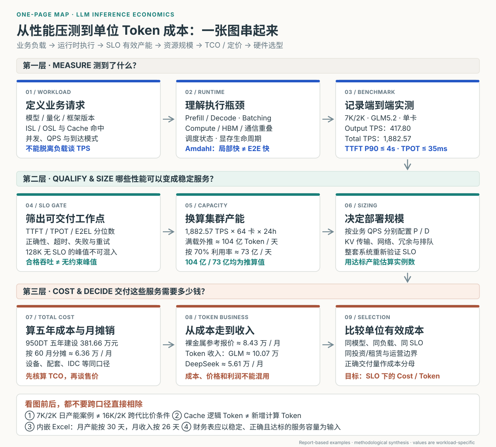
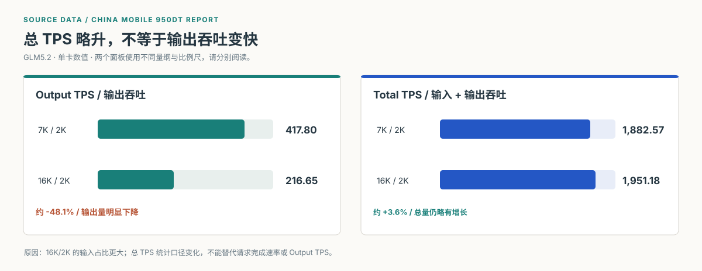
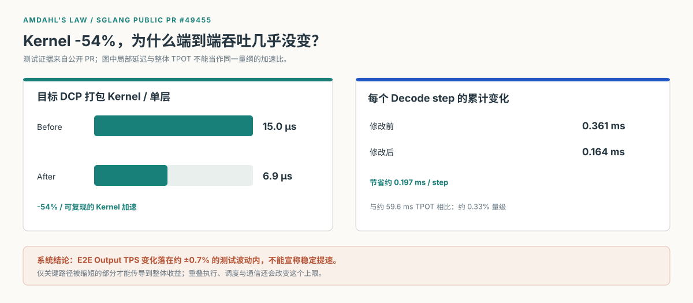
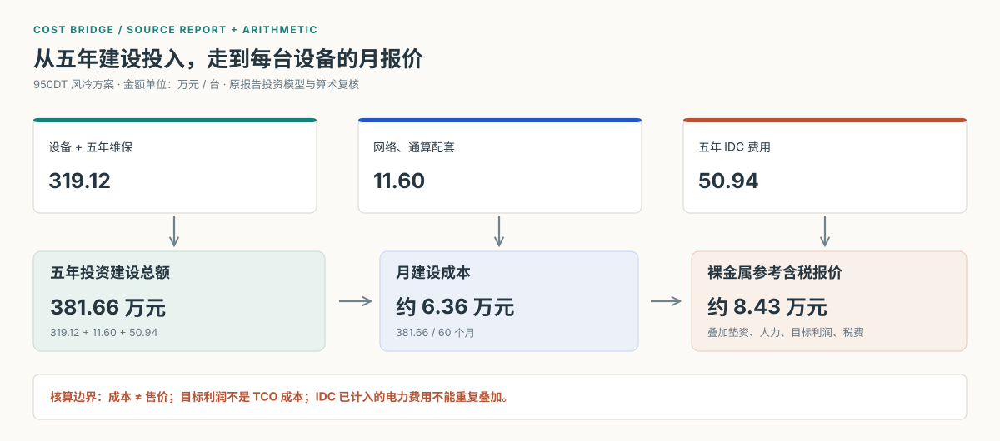
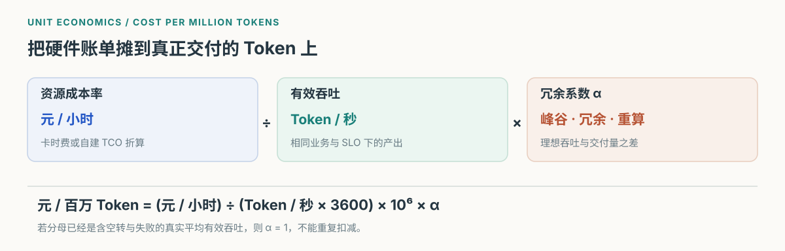
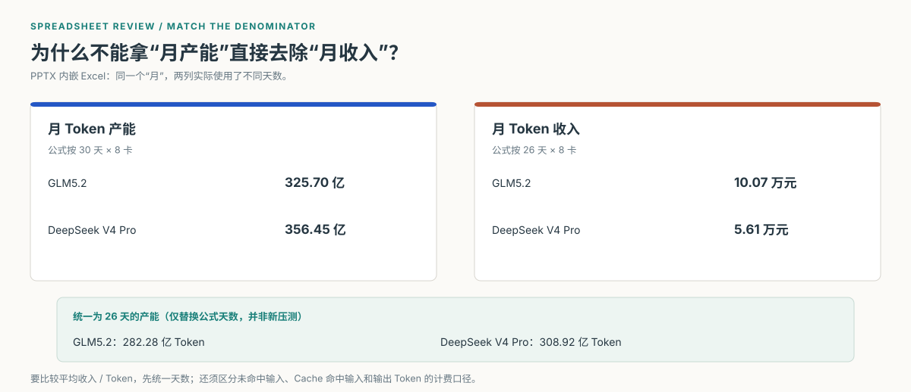

拿到一份推理压测报告，我们通常先看吞吐：每秒生成多少 Token，开了多少并发，换一张卡又快了多少。调优时也类似，Nsight 里一个 Kernel 少了几微秒，直觉上就觉得系统应该更快。

可当问题从“这个配置跑得怎么样”变成“要为一项业务部署多少资源”时，仅靠这些数字就不够了。**同样一台机器，长输入和短输入的吞吐不是一回事；同样的吞吐，延迟不达标就不能拿来承接业务；即使服务能力相同，设备与运营成本不同，最终每百万 Token 的成本也不同。**

之前读 [Databricks 的 LLM Inference Performance Engineering](https://www.databricks.com/blog/llm-inference-performance-engineering-best-practices)，我更多在理解 *为什么* 一个推理服务会快或慢：Prefill、Decode、Batching、显存带宽与并行策略怎样影响请求表现。再看 [NVIDIA 的推理 Benchmark 与 TCO 分析](https://developer.nvidia.com/blog/llm-inference-benchmarking-how-much-does-your-llm-inference-cost/)，问题就从性能归因延伸到了资源规划：**先在延迟约束内找出可交付的吞吐，再计算达到目标流量需要多少实例，最后才谈成本。** 再往后读 vLLM、Splitwise 和 DistServe，才发现 KV 管理、P/D 分离与 Goodput 并不是孤立的推理技巧：它们最终都会改变同一张容量与成本账单。

最近看到 [中国移动《昇腾 950DT 性能测试与经营效益测算汇报》（2026 年 10 月）](https://docs.google.com/presentation/d/1yk4OFibvnZds7NOBnzHpepghzqd-MmUv/edit?slide=id.p1#slide=id.p1)，这条链路恰好有了一组具体数字：报告从实测 TPS 出发，估算集群 Token 产能，对比几代硬件的投入产出，又通过 PPTX 内嵌的 Excel 算出五年成本、裸金属报价和 Token 运营收入。

这份材料最近被不少技术文章解读为一次“买方验货”：参与测试的是运营商的规划、客户、算力及产品运营等部门，关心的不只是模型跑分，而是这套设备能否满足现网时延、能替换多少存量资源，以及最终能不能算清经营账。这个视角很值得借鉴。但测试仍在华为研发中心进行，**买方组织的现场测试，不等于不受环境影响的独立实验室认证，也不等于现网长期稳定性已经验证。**

与其逐页摘录结论，不如顺着一个问题往下算：**如果真的要部署一套推理服务，怎么判断它能交付多少业务，以及值不值得投入？**

  

*图 1 · 从 Benchmark 到 SLO 有效产能，再到单位 Token 成本。*

整篇文章围绕这三个环节展开：**先确认性能数据测量了什么，再判断哪些吞吐可以稳定交付，最后把资源规模和运营成本放在统一口径里比较。**

## 1. 读懂一张压测表：吞吐首先取决于请求长什么样

这次测试的组织方式很有意思。2026 年 10 月 10 日，中国移动规划技术部、政企客户部、算力运营中心、产品运营中心、数智化部及南京分公司组成联合团队，到华为练秋湖研发中心做现场测试。报告写明了 **64 卡 950DT 超节点、灵衢互联、Atlas 950 PoD、vLLM、P/D 分离和 aisbench**，也交代了 GLM5.2 使用 W4A4C8、DeepSeek V4 Pro 使用 W4A8C8。测试负载选了知识库、内容分析和超长上下文三类场景，长上下文又单独测了一组 90% Prefix Cache 命中率。

把报告第 2 页的四组测试全部放在一起，比只挑“最高 TPS”更能看出问题：

| 请求长度 / 条件 | GLM5.2 输出 / 总 TPS | DeepSeek V4 Pro 输出 / 总 TPS | P90 时延约束 |
| --- | ---: | ---: | --- |
| 7K / 2K | 417.80 / 1,882.57 | 280.91 / 1,264.62 | TTFT ≤ 4s；TPOT ≤ 35ms |
| 16K / 2K | 216.65 / 1,951.18 | 161.18 / 1,450.98 | TTFT ≤ 6s；TPOT ≤ 35ms |
| 128K / 1K | 13.95 / 1,800.51 | 11.68 / 1,497.68 | **无时延限制** |
| 128K / 1K，Cache 90% | 95.49 / 12,319.71 | 81.67 / 10,536.11 | **无时延限制** |

单位为 tokens/s，数值按报告中的**单卡等效统计**记录。注意，这张表有两种不同实验：前两行是在时延约束下找吞吐，后两行则只追求最大吞吐。因此“128K Cache 最高 12,319.71 TPS”不能直接替代在线服务的 SLO 达标性能。原 PPT 中 GLM5.2 的 Cache 行 Output TPS 是 **95.49**，而近期流传的个别解读写成 85.49；这里以原表为准。

这张表乍看有点反直觉：输入从 7K 变成 16K，**输出 TPS 从 417.80 降到 216.65，几乎减半，总 TPS 却从 1,882.57 略微升到 1,951.18**。难道输入更长反而跑得更快？

不是。关键在于总 TPS 的统计口径。对于 7K/2K 的请求，每生成 2K 输出，逻辑上还处理了 7K 输入，因此输入加输出的 Token 总量约为输出的 4.5 倍；而 16K/2K 对应的倍数是 9。报告两组总吞吐与这个比例基本吻合。**总 TPS 变高，可能只是请求里输入 Token 的占比变高，并不能直接说明生成效率提高。**

  

*图 2 · 原报告实测。两侧纵向比较，分别采用独立标尺。*

这也把我们带回推理系统最基础的两个阶段。Prefill 负责处理输入上下文，决定用户多久能看到第一个 Token；Decode 则在之后逐步生成输出。TTFT（Time to First Token）包括排队和 Prefill 等首 Token 前的开销，TPOT（Time per Output Token）描述后续生成速度。两者共同影响一次请求从进入系统到输出完成的体验。

因此，评价服务能力时，不能只保留一个 TPS。至少要知道请求的 ISL/OSL、Input TPS、Output TPS、请求完成速率，以及 TTFT/TPOT 的分位数。Databricks 的性能工程讨论与 NVIDIA 的 [Benchmark 指标介绍](https://developer.nvidia.com/blog/llm-benchmarking-fundamental-concepts/) 都指向同一个问题：**性能数字只有和工作负载放在一起，才有可比较的含义。**

读懂统计口径只是第一步。下一步才是：这样的速度能不能稳定用于生产？

## 2. 从“每秒多少 Token”到“每天能交付多少产能”

报告给出 GLM5.2 在 7K/2K 场景的单卡总吞吐 1,882.57 TPS。沿着这个数字向上推，集群规模就从单卡变成了日产能：

~~~text
单卡满载一天：1,882.57 × 86,400 ≈ 1.63 亿 Token
64 卡满载一天：1.63 亿 × 64 ≈ 104 亿 Token
再按报告采用的 70% 利用率：104 亿 × 70% ≈ 73 亿 Token
~~~

这几步计算不复杂，却有不同的含义：**1,882.57 TPS 是指定测试条件下的测量结果；104 亿是它持续运行一整天的外推值；73 亿又增加了利用率假设。** 三者不能都称为“实测产能”，更不能直接当作每天真正售出的 Token。

报告据此提出 **64 卡 950DT 的有效日产能可相当于现网约 400 卡 910B**。我更愿意把它称作*运营商在指定场景下的资源替换估算*：64 卡这一边给出了从 7K/2K TPS 到 73 亿/天的外推过程，而 400 卡 910B 那一边没有在同一页完整列出模型、负载、时延及利用率条件。它值得用作容量规划的参考，但不是“每张 950DT 在所有场景下都顶 6.25 张 910B”的普遍结论。

为什么要做这种区分？因为负载增加通常能改善 Batching，让设备同时处理更多请求，但达到一定并发后，排队和尾延迟也会升高。NVIDIA 的思路是先画出**吞吐—延迟曲线**，把不满足 SLO（Service Level Objective，服务等级目标）的点排除，再在达标区域中寻找持续吞吐较高、还有一定余量的工作点。峰值 TPS 是性能边界，**SLO 下的稳定吞吐才适合进入容量规划**。

报告里还有个更鲜明的对照。在 128K 输入 / 1K 输出的长上下文场景下，GLM5.2 单卡总 TPS 从 1,800.51 提升至 12,319.71，前提是 Prefix Cache 命中率达到 90%，按表面数值计算约为 **6.84 倍**。这不是设备突然多了六倍计算能力，而是大量历史前缀已经算过，后续请求能复用它们的 KV Cache，减少重复 Prefill。更准确地说，这组实验改变了**可复用的工作量比例**，并不意味着计算核心或显存带宽提升了 6.84 倍。Cache 的有效复用还取决于前缀内容、块级匹配、缓存容量、淘汰策略及请求到达模式。

更重要的是：**报告明确指出这两组 128K 测试没有设置 TTFT/TPOT 约束，测的是最大吞吐。** 它们能够说明 Cache 对特定负载的价值，但不能不经验证就与前面的 7K/2K、16K/2K 达标吞吐混在一起，直接作为生产业务的可售容量。

到这里又出现一层区别：请求携带的**逻辑 Token 数量**，不等于设备新增计算过的 Token 数量；如果涉及商业计费，还要区分缓存命中的输入与未命中输入分别如何收费。这三个数量在容量和经营模型中承担不同角色。

实际部署往往还采用 P/D 分离。此时单独测 Prefill 的 input tok/s 和 Decode 的 output tok/s，可以帮助估计各自需要多少实例，但不能把两种不同口径的 TPS 直接相除得出资源配比。需要先依据业务的输入/输出长度分布把它们换算为可承接的请求速率，再加入 KV 传输、排队、显存和冗余，最后以端到端测试确认 TTFT/TPOT 仍然满足要求。

这里可以把 **Goodput** 引进来。普通吞吐说的是服务每秒处理多少工作，而 Goodput 关心的是**在约定 TTFT、TPOT 和成功率下真正完成了多少合格请求**。[DistServe（OSDI 2024）](https://www.usenix.org/conference/osdi24/presentation/zhong-yinmin)正是用 TTFT/TPOT 共同约束下的单位 GPU 最大请求率来评价分离式部署：在论文实验条件下，相对对照系统最多可服务 **7.4 倍请求量**，或在相同请求规模下满足更加严格的 SLO。这个结果不能直接理解成现实运营成本下降 7.4 倍，但它解释了为什么 **Goodput 比无约束峰值更适合作为容量规划的分母**。

所以从压测数据到部署规模，中间至少隔着两个问题：**这条吞吐曲线的哪些点真正满足服务要求？这些达标工作点在完整 P/D 系统里还成立吗？**

## 3. 为什么系统层面要看瓶颈，而不是只盯一个 Kernel

上面把单卡吞吐外推成了集群产能，但这有一个隐含前提：测到的吞吐是正确、稳定、可复现的。如果某个 rank 分配不到足够请求，或者异步执行偶尔产生错误输出，计算表再精确也无法保证真实产能。

这也是 Databricks 最佳实践和日常推理排障能够接上的地方。推理系统可能卡在不同位置：小 Batch 的 Decode 经常受权重读取和显存带宽限制；大 Batch 或 Prefill 可能更接近计算瓶颈；MoE 的 All-to-All、跨设备通信及同步又可能占据关键路径。**Roofline** 用计算强度帮助理解“算力上限”和“带宽上限”之间的关系；Databricks 讨论的 **MBU（Model Bandwidth Utilization）** 则尝试衡量模型推理对可用显存带宽的利用程度。

但找到慢 Kernel 还不是结束。要决定优化是否值得做，还得问：**它在整个请求链路中占多少时间？**

这里可以用 **Amdahl 定律（阿姆达尔定律）** 理解：

~~~text
整体加速比 S = 1 / [(1 - f) + f / s]

f：原来总耗时中能被优化的部分占比
s：这部分自身的加速倍数
~~~

即使把某个 Kernel 加速很多，只要它本来只占总耗时的一小部分，端到端收益就很有限。如果它与别的计算或通信重叠、没有落在关键路径上，最终收益还可能更小。

这不是纯理论问题。我在公开的 [SGLang PR #49455](https://github.com/sgl-project/sglang/pull/49455) 里优化过 DCP A2A 的发送打包 Kernel：Nsight Systems 记录的单层时间由 **15.0 μs 降到 6.9 μs**，约减少 54%；24 个相关层累计到每个 Decode step，大约减少 **0.197 ms**。可是，同一 PR 的端到端 Output TPS 对照变化落在约 **±0.7% 的运行波动**里，不能据此认定吞吐显著提升。

把 0.197 ms 与当时约 59.6 ms 的 TPOT 粗略对比，只有约 **0.33%** 的量级。这里还暂时假定节省的时间全部处在关键路径；现实里有 CUDA Graph、通信重叠和多请求调度，结论只能更谨慎。这个例子让我更明确地理解：**Microbenchmark 证明局部优化发生了，Profiler 帮助解释它处于什么路径，端到端 Benchmark 才负责回答服务有没有真正受益。**

  

*图 3 · 局部 Kernel 加速与端到端服务收益并不是一回事。*

也并非所有产能问题都来自算子。我在 [《SGLang DP Health：一次没有报错的吞吐退化，根因却在请求路由》](/blog/2026/11/18/dp-health-routing-bug/) 中复盘过一个例子：探活请求干扰了真实用户共用的 DP 路由状态，导致部分 rank 负载失衡、有效 Batch 下降，最终影响吞吐。对应的修复是 [SGLang PR #35721](https://github.com/sgl-project/sglang/pull/35721)。另一个例子是 [《SGLang 异步 PP 静默输出错误：一次跨 CUDA Stream 的生命周期竞态》](/blog/2026/11/18/pp-stream-lifetime-bug/)：通信 Stream 接收的 Tensor 在 Forward Stream 消费前，其显存可能被提前复用，造成静默输出错误，修复见 [PR #47614](https://github.com/sgl-project/sglang/pull/47614)。前者说明**调度状态会影响实际能跑多满**，后者说明**算得再快，结果不正确也不算有效交付**。

把这三个例子放在一起，系统优化的目标就清楚了：**缩短真正的关键路径，维持合理的有效 Batch，并保证请求结果正确。** 只有当这些变化反映在可持续、符合 SLO 的端到端容量上时，下一步的设备成本比较才有意义。

从论文的角度看，[vLLM / PagedAttention（SOSP 2023）](https://arxiv.org/abs/2309.06180)在其评测条件下实现了相对 FasterTransformer、Orca 等基线 **2–4 倍**的吞吐提升，并保持相近时延。其核心不是让每个 GEMM 都快 2–4 倍，而是改善 KV Cache 的内存管理，使更多请求可以稳定组成 Batch。**理论上，固定成本下 Goodput 增加会降低单位请求或 Token 成本；实际降幅仍取决于瓶颈是否转移、冗余、流量与新增开销。** 这是下一节成本模型要解决的事。

## 4. 11 倍的吞吐从哪里来？系统效率比纸面算力更值得研究

文章里最容易让人记住的是“950DT 比 910B4 快 11 倍”。这个数字并非凭空出现：报告第 3 页以 GLM5.2、16K/2K 负载为参考，给出了下面一组单台 8 卡设备的对比。

| 指标（原报告口径） | 950DT | 910C | 910B4 |
| --- | ---: | ---: | ---: |
| 单卡 FP16 理论算力 | 425 TFLOPS | 560 TFLOPS | 280 TFLOPS |
| 单卡 E2E 总吞吐 | 1,951 TPS | 483 TPS | 169 TPS |
| 单台 E2E 总吞吐 | 15,608 TPS | 3,864 TPS | 1,352 TPS |
| 单台五年建设成本 | 381.6 万元 | 292.2 万元 | 96.6 万元 |
| 每月建设成本摊销 | 6.36 万元 | 4.87 万元 | 1.61 万元 |

一个很有意思的对照是：**950DT 标出的单卡 FP16 算力只有 425T，低于 910C 的 560T；但在报告的推理场景下，单卡总吞吐反而约为后者的四倍。** 这并不违反计算原理。FP16 理论算力只是某一种运算精度下的峰值上限，量化推理的实际工作会受到模型、算子实现、KV 访存、MoE 通信、并行拓扑、调度和 Batch 等共同影响。把不同精度或不同部署条件的峰值数字直接当作模型推理性能，本身就容易误判。

如果借用最近流传的“用非摩尔补摩尔”这个说法，我觉得它更值得从**系统级效率**来理解，而不是简单说“靠堆卡弥补单芯片”。950DT 的技术路线涉及更多内存和互联资源的协同：华为[官方的 Atlas 950 SuperPoD 介绍](https://www.huawei.com/cn/news/2026/7/atlas-950-superpod)披露了最大 1,024 卡、256 TB 全局统一内存编址及 3 μs RTT 等平台级规格；[华为云的产品说明](https://support.huaweicloud.com/resmgmt-modelarts/resmgmt-a5_0002.html)则给出 950DT 单芯片最高 4 TB/s 访存带宽、96 GB 容量。**这些是平台设计和产品规格，不是这次 64 卡 GLM 推理测试测出来的收益比例。**

从工程角度说，系统级性能究竟怎么转化出来，仍需要继续问：模型采用什么量化？有多少 TP/EP/DP 通信？跨卡互联是否处于关键路径？P/D 分离是否降低了不同阶段的相互干扰？Runtime 是否能够把有效 Batch 维持在合适范围？目前的汇报给出了最终 TPS，却没有提供足以把“四倍收益”逐项拆给每一种因素的消融实验，**所以不能把它全部归功于灵衢，也不能全部归功于 P/D**。

即使不做归因，这组数字已经可以用于一次初步的投资产出比计算。报告的算法是：

~~~text
950DT / 910B4 吞吐倍数 = 15,608 / 1,352 ≈ 11.54
950DT / 910B4 成本倍数 = 6.36 / 1.61 ≈ 3.95

相对单位投资吞吐 = 11.54 / 3.95 ≈ 2.92 倍
~~~

950DT 相对 910C 的同类算法约为 **3.1 倍**。这说明在上述测试点，950DT 的建设投入增长幅度小于其统计吞吐增长幅度。它是一项值得进一步验证的选型线索，却还不是跨全部业务、全生命周期、含全部运行风险的 TCO 优势倍数。尤其需要注意：报告测试页把 GLM5.2 标为 **W4A4C8**，而跨代对比页的脚注使用 **W4A8** 表述，正式横评前应先统一这一点。

### H200 的 86% 应该怎么理解？

报告还给出 H200 单卡吞吐约 2,200 TPS，并认为 950DT 在选定场景下的推理表现约为 H200 的 **86%**。如果用其 7K/2K 的 1,882.57 Total TPS 除以 2,200，确实得到约 **85.6%**；若改用 16K/2K 的 1,951.18，比例就约为 **88.7%**。只改分子所对应的负载，就足以让“百分之多少”发生变化。

更关键的是，报告对 H200 的数字参考了 vLLM 资料并作部署折算，它不是 950DT 与 H200 **同场、同精度、同请求到达模式和同一份测试脚本**完成的直接 A/B。报告还采用 950DT 每月约 8.5 万元、H200 每月约 13 万元的租金假设，讨论前者约三成的价格性能优势；这里的租金同样是报告给定的经济假设，不能被解读成当前市场普遍成交价。

与其急于给出“谁领先”的结论，不如把问题转换成：**同样满足目标 TTFT 和 TPOT 时，哪套部署最终消耗更少资源？** 这个答案比某个单一的百分比更有价值。

## 5. 打开五年账本：TCO 和售价为什么不是一回事？

报告中的 950DT 风冷服务器，五年投资建设成本并不是只拿设备采购价乘个系数，而是由几项实际投入构成：

| 五年成本组成 | 金额（万元/台） |
| --- | ---: |
| 设备及五年维保 | 319.12 |
| 网络、通算配套等 | 11.60 |
| IDC 五年费用 | 50.94 |
| **合计** | **381.66** |

按五年、60 个月摊销，**381.66 ÷ 60 ≈ 6.36 万元/台月**。这就是上一节的成本数字从哪里来。

  

*图 4 · 从五年建设成本到月度裸金属报价，注意区分成本和利润。*

这一步引入了 TCO（Total Cost of Ownership）：一套推理基础设施的成本，不只有设备本身，还可能包括网络与配套、电力、机柜或机房、维护、人力、资金占用和冗余容量。但**先要统一成本边界**。比如原表的 IDC 已按特定功率与服务口径计费，就不能在没核清范围前，又把同一部分电费重复加进去。自建设备折旧与租赁费用也应该放在各自对应的方案里，不能双重计算。

这里还可以多算一笔**能耗账**。报告给出的参考值是 950DT 约 **0.28 kWh/百万 Token**、910B 约 **1.47 kWh/百万 Token**，相差约 5.25 倍。基本公式并不神秘：若知道测量窗口内的平均功率 P（kW）、时间 t（小时）和处理的 Token 数 N，则电耗强度为 **P × t ÷ (N / 1,000,000)**。但要特别小心：两者必须采用一致的 Token 统计方式、功率测量边界、模型与 SLO；单凭这张报告的最终数值还不能完成独立的能耗归因。何况电费是 TCO 的一部分，能耗优势不能和月成本摊销不加辨别地相加。

### 从卡时费到每百万 Token 成本，真正的分母是什么？

有了每月建设成本和有效 Token 产能，现在终于能把二者放进同一个式子。如果按实例租赁计费，先令实例每小时费用为 `R`（元/小时），单位时间真正交付的吞吐为 `Q`（Token/s），那么最直接的公式是：

~~~text
每百万 Token 成本 = R × 1,000,000 / (3,600 × Q)
~~~

这里的 `R` 必须覆盖**计算这个 `Q` 所用的全部实例**。如果按单卡吞吐计算，就用单卡费率；如果用一整台 8 卡服务器的吞吐，就应该放入整台服务器的费用，而不能用“单卡价格 ÷ 整机吞吐”。

为了从**理想满载吞吐**推算真实成本，还经常引入一个资源冗余系数 `α`：

~~~text
实际单位成本 ≈ 理想满载单位成本 × α
α = 理想满载 Token 产能 / 实际有效交付 Token 产能  ≥ 1
~~~

说白了，设备的钱付了整整一小时，但有效 Token 不一定能持续打满一小时。这里面有几类典型的折损：**峰谷波动**造成空转，**高峰预留和 P/D 资源配比失衡**让部分设备长期吃不满，**请求抢占、重算与失败重试**又消耗了算力却没有对应的成功交付。对照这些问题，资源冗余系数反映的正是“标称产能”到“真实产出”之间的距离。

  

*图 5 · 单位 Token 成本公式。分母的工作负载、SLO、计时边界与分子的成本周期必须一致。*

但千万别把折损算两次：**如果 `Q` 已经是包含排队、低利用率、错误重试后按整段计费时间统计的实际平均 Goodput，冗余系数就应取 1。** 只有分母拿的是理论满载或理想达标点时，才需要另外折算空转和冗余。Goodput 既可以用请求/s，也可以按同一个请求长度分布换算成有效 Token/s；混用两种口径也会把成本算错。

就用前面的中国移动数字复算一次，不额外构造一组硬件 Benchmark。GLM5.2 在 **7K/2K** 条件下，单卡总吞吐 **1,882.57 TPS**；按 8 卡服务器算，约为 **15,060.56 Total TPS**。报告中每台服务器的月投资建设成本摊销约 **6.36 万元**。若假定这一个测试点能够在每月 **30 天 × 24 小时**持续维持，则：

~~~text
理想 30 天 Token 产能
= 1,882.57 × 8 × 3,600 × 24 × 30
≈ 390.37 亿个逻辑总 Token

仅建设成本摊销 / 百万总 Token
= 63,600 元 ÷ (390.37 亿 / 100 万)
≈ 1.63 元 / 百万 Token
~~~

如果沿用报告**同一 7K/2K 场景**的 70% 产能利用率作为简单线性假设，`α = 1 / 0.7 ≈ 1.43`，该比值会变为 **约 2.33 元 / 百万逻辑总 Token**。

**1.63 元和 2.33 元都不是实际生产结算价，也不是完整 TCO。** 它们只包含报告已有的月建设成本、固定负载的 Total TPS 和不同利用率假设；还没有充分处理长时间稳定性、其他成本项及可售 Token 的区别。但这已经清楚展示了为什么：同样一台设备，压测结果相同，**利用率不同，单位产出成本也会不同**。

### P/D 分离为什么也可能改变成本，而不仅是 TTFT？

如果 Prefill/Decode 的工作形态不同，硬把两阶段塞进相同资源池，就可能出现资源结构不匹配：一边计算单元紧张，另一边的带宽或者显存容量成为瓶颈。分离式部署允许分别选择硬件、并行方式和实例数量，从而把闲置能力变成可用容量。

[Splitwise（ISCA 2024）](https://www.microsoft.com/en-us/research/publication/splitwise-efficient-generative-llm-inference-using-phase-splitting/)在论文工作负载和成本模型下报告：一种配置相对基线实现 **1.4 倍吞吐、同时降低 20% 成本**；另一种配置在相同功率及成本预算下实现 **2.35 倍吞吐**。这是论文特定集群设计的结果，并不等于现实中的任何 P/D 分离都天然省钱。它还引入 KV 状态跨实例传输、网络成本、控制面调度、故障恢复和容量弹性的问题。

因此，P/D 分离优化的不是单一指标，而是整条成本链：

~~~text
阶段分离 → 更匹配的 P/D 资源配置 → 更高的 SLO 达标产能
          ↘ KV 传输、网络、运维与空闲池的额外成本
最终比较：同一工作负载和服务要求下的单位有效成本
~~~

这个视角也有助于理解为什么某次独立 P/D 压测很漂亮，生产部署仍不一定更便宜：两个资源池的有效负载能否同时饱和，以及多出来的资源和链路开销有多大，都必须进账。

接下来，报告问了一个经营问题：如果把整台服务器作为裸金属出租，月租应该卖多少？

它在约 **6.36 万元/月**建设摊销上，加入约 **0.76 万元**垫资成本、**0.19 万元**人力分摊，以及约 **0.64 万元**目标利润，形成约 **7.95 万元/月**的综合测算口径，再考虑税费得到约 **8.43 万元/台月**的建议含税报价。

~~~text
6.36（建设摊销）
+ 0.76（垫资）
+ 0.19（人力）
+ 0.64（目标利润）
≈ 7.95 万元/月

按报告税费口径换算
≈ 8.43 万元/台月（裸金属建议报价）
~~~

这里最容易混淆的是最后两步：**6.36 万是成本分摊，8.43 万是参考销售报价；0.64 万目标利润不是已经发生的 TCO 支出。** 如果把成本、报价、利润混为一谈，再计算“每百万 Token 成本”，结果自然会偏。

到这儿，我们已经能估算“用资源要花多少钱”。但如果不出租整台机器，而是由运营商自己提供模型 API、按照 Token 收费，商业结果会不会变？

## 6. 同样一台服务器，为什么卖不同模型的 Token，收入差这么多？

这是我认为这份汇报最有意思的一部分：它把**服务能力**接到了**真实业务的计量与定价**。

整机出租主要看设备月租是否覆盖投入；按 Token 收费，则必须先回答客户实际用什么模型、发什么长度的请求，以及什么时候使用。输出 Token、普通输入 Token、Cache 命中输入 Token 的定价可能不同，不能直接把 Total TPS 乘一个统一价格。

### 为什么 API 要把输入、输出与缓存 Token 分开定价？

到这一步，计价方式就不只是市场策略了，也反映了模型执行的资源结构。**Prefill** 要并行处理输入上下文，往往受到计算吞吐、Attention 访存和长上下文规模的共同影响；**Decode** 持续生成新 Token，权重读取、KV Cache 带宽和批内并发更加关键。这里的“Prefill 偏计算、Decode 偏访存”只是常见工作点的近似，不能当作所有模型和 Batch 下的定律。

再加上请求长度分布不同，统一的 Token 单价会掩盖大量差异。读一次很长的材料、只生成几句摘要，和给出短提示后连续生成上千 Token，对 P/D 的资源占用截然不同；而重复前缀命中缓存后，逻辑输入 Token 依旧存在，却不需要把相同 Prefill 重新做一遍。因此对外 API 通常至少区分**未命中输入、缓存命中输入、输出**，某些平台还单独设置缓存写入和批量优惠。

举三个截至 **2026 年 11 月 20 日**可以在官方文档查到的价格例子（美元 / 百万 Token，**仅用于说明计价结构，并非原 950DT 报告采用的 GLM/DS 模型价格**）：

| API 模型与计价情景 | 普通输入 | Cache 读取输入 | 输出 |
| --- | ---: | ---: | ---: |
| [OpenAI GPT-5.5](https://developers.openai.com/api/docs/models/gpt-5.5) · 标准文本 | $5.00 | $0.50 | $30.00 |
| [Claude Sonnet 4.5](https://platform.claude.com/docs/en/build-with-claude/prompt-caching) · 基础价/缓存命中 | $3.00 | $0.30 | $15.00 |
| [DeepSeek Flash](https://api-docs.deepseek.com/quick_start/pricing/) · 峰时价 | $0.30 | $0.006 | $1.20 |

这张表的真正信息不是谁便宜，而是**同一家模型的输入与输出单价可以差好几倍，缓存输入又可能远低于未命中输入**。Claude Sonnet 4.5 的 5 分钟缓存写入价格还按普通输入的 **1.25 倍**计算，提醒我们：缓存读取便宜，不代表创建和维护缓存完全免费。OpenAI 的 GPT-5.5 超过 272K 输入长度时另有更高的长上下文价格分档；DeepSeek 的峰时/闲时价格也不同，闲时按其当前官方定价为峰时的 50%。上述价格随版本和时间变化，应以使用当天官方页面为准。

进一步看，Batch API 把“可延后处理”换成较低的计费价格；错峰定价把需求引导到闲置时间；Prefix Caching 则利用前缀复用降低重复计算。这三种折扣看起来都叫“便宜”，实际上解决的分别是**实时性要求、峰谷利用率与重复计算**。

如果从自建服务的角度估算一条请求的成本，不能仅将整台设备的 Total TPS 和一个平均单价相除。更合理的是分别统计输入未命中量、缓存读取/写入量、输出量，再联系 P/D 的实例成本率、吞吐、KV 驻留和实际到达模式；商业侧的收入计算则按对应计费规则求和。**API 的售价不是提供商的实际成本**，不能拿平台输出 Token 价格直接和自己的理想满载计算成本相减，把差值叫作“利润”。

为此，报告把一天的流量分为 **7 小时忙时（90% 使用率）**和 **11 小时闲时（60% 使用率）**。对于 GLM5.2，它还把四类负载按 **30% / 30% / 30% / 10%** 加权；DeepSeek V4 Pro 则采用另一组业务比例 **40% / 30% / 10% / 20%**。四类场景分别是 7K/2K、16K/2K、128K/1K 和带 90% Cache 命中的 128K/1K。

有了每类请求的吞吐、时间占比和价格，Excel 才能估算月产能与收入。报告中的结果是：

| 原报告经营测算 | GLM5.2 | DeepSeek V4 Pro |
| --- | ---: | ---: |
| 月 Token 产能 | 325.70 亿 | 356.45 亿 |
| 折扣后月收入 | 约 10.07 万元 | 约 5.61 万元 |

这里出现了一个很好的反例：**DeepSeek 的统计 Token 产能更大，预测收入却更低**。差别不是一句“哪种卡快”能解释的，而是模型价格、输入与输出结构、缓存命中、业务分布和销售折扣共同作用的结果。报告据此更看好其假设下的 GLM5.2 Token 运营收入，而不是宣称某个模型在所有市场和负载下都更赚钱。

不过，如果想用这张表算出可靠的平均售价或盈亏平衡点，就必须真的看一遍 Excel 公式。

### 一个很值得保留的公式复核

PPT 正文写的是每月按 **26 个工作日**测算。我检查内嵌的经营工作表后发现，**月 Token 产能**相关公式使用 **30 天**，而**月收入**公式使用 **26 天**；实际折扣单元格采用 **50%**，工作表中另有一处说明保留着“80%”的旧表述。

  

*图 6 · Excel 公式复核：先统一时间周期，再讨论单位 Token 经济性。*

这意味着不能直接用“10.07 万元 ÷ 325.70 亿 Token”倒推平均收费单价，因为分子和分母并不是同一个核算周期。如果仅把产能公式统一成 26 天，其他参数保持原样，那么 GLM5.2、DeepSeek 对应的 Token 产能分别约为 **282.28 亿**和 **308.92 亿**。这是依据报告公式进行的周期统一复算，**不是新的硬件实测**。

报告还给出了 GLM5.2 月销量约 **272.5 亿 Token**可以接近裸金属收入的测算。这样的临界点同样依赖产能与收入采用一致的天数、业务混合、计费类别和税费口径，不能把原表数字直接拿去替代另一组业务的收入预测。

顺着这一处小小的“26 天 / 30 天”差异再回头看 TCO，我觉得最重要的不是某个结果精确到小数点后几位，而是**每个数字背后的时间、负载、成本与计费单位必须对得上**。尤其是 128K 最大吞吐没有 SLO 约束，把它用于商业产能预测之前，仍应验证长上下文业务实际承诺的延迟要求。

因此，算力经济性至少有三道不同的问题：机器的**单位有效 Token 成本**是多少；对外**每类 Token 如何定价**；真实客户用量能不能让**收入覆盖成本并达到目标回报**。TPS 只是这套模型最上游的一个输入。

## 7. 为什么现网横评里，峰值最高的硬件不一定排第一？

这是整份材料最后一个很好的呼应。报告第 5 页还有一张现网多平台评测表，其中同一 Qwen 场景的结果与综合评分并不完全一致：

| 平台 | 综合评分 | 表中 Qwen 单卡 TPS | 工程侧需要关注的因素 |
| --- | ---: | ---: | --- |
| 昇腾 910B4 | 89.53 | 471 | 测试覆盖完整、报告称已有 P/D 部署经验 |
| 摩尔线程 S5000 | 76.84 | 916 | 大 EP 支持，首 Token 延迟需进一步优化 |
| 阿里 PPU 1.0 | 67.37 | 1,113 | 单卡数字突出，但报告称大 EP 尚未落地、软件需另购 |
| 沐曦 C550 | 63.46 | 755 | CUDA 生态适配是优势，成本与时延仍需权衡 |

这张表不能直接拿来给芯片品牌做普适排名。设备卡数、测试覆盖和模型适配程度不全相同；报告展示了部分评分和推荐结论，但没有提供足够完整的评分模型让外部读者逐项复核。它真正值得学习的是**采购者的决策顺序**：模型能够运行只是最低门槛，分布式并行是否能稳定上线、软件迁移要花多少精力、SLO 是否达标，都会影响设备的实际价值。

这也能联系到一次更大规模的采购背景。根据 [2026 年 10 月 28 日公布的中国移动 2026—2027 年人工智能超节点集采中标候选人信息](https://finance.sina.com.cn/roll/2026-10-29/doc-iniwwpnu6095322.shtml)，相关项目采购规模为 **20,480 卡**，并配套 RoCE 交换机与存储，公开报道的候选人报价约 **117 亿元**。这说明超节点选型已经是大规模工程问题；但**中标候选人公示不等于全部设备交付、部署验收或生产效果已经实现**，也不能仅凭采购总规模倒推本次 64 卡测试对应的最终商业收益。

因此，报告中的“950DT 64 卡可替代一定规模的现网 910B”最好理解为*容量规划假说*，而不是已经验证的平替结论。从厂家实验室结果真正走向运营商机房，还需要复测长时间稳定性、真实流量与 Cache 分布、故障恢复、调度抖动、网络和机房能耗，才能把峰值指标换成稳定的成本分母。

我的理解是，**系统性能、可交付性和经济性是三道连续的门槛**：第一道解决“算得快”，第二道解决“上线以后仍然能稳定服务”，第三道才是“投入能不能被实际业务消化”。

如果把 NVIDIA 的 Benchmark/TCO 方法、Databricks 的性能工程建议，以及这份 950DT 测算合在一起，我会按下面的顺序组织一次算力评估：

1. **定义业务**：固定模型、精度、ISL/OSL 与 Cache 分布，明确 TTFT/TPOT、错误率和请求到达模式。
2. **测量服务**：在不同并发、QPS 和并行配置下得到吞吐—延迟曲线，留下版本、Profiler 和重复测试证据。
3. **规划容量**：只使用满足 SLO 的稳定工作点，估算 P/D 实例数，再以完整服务验证网络、KV 传输、冗余与排队。
4. **核算经济性**：将设备或租金、IDC、供电、维护等放进同一周期，用有效交付 Token 而非名义峰值计算单位成本；要经营 API 时，再单独算价格、售出率与 ROI。

这种方法并不绑定某一家芯片厂商。跨 NVIDIA GPU、昇腾 NPU 或其他加速平台时，真正要统一的是**负载、服务目标、数据口径和成本边界**，而不是强行让不同硬件拥有一样的峰值 FLOPS。

回过头看我做过的 SGLang 性能分析和 Runtime 排障，它们主要解决的是这条链路前半段的问题：性能数字为什么变化、是否可信、优化能不能真正影响端到端服务。中国移动的这份报告把后半段补充得很具体——从同一模型、同一负载的性能测试，到单卡与集群产能外推，再到五年成本、不同模型的价格与售出率。最近的公众号解读强调了“买方验货”和“系统级收益”，这两个视角确实有启发，但对我更重要的是**不只看报告的结果，还能复核它每一步如何计算**：例如 H200 参照值是否同口径、64 卡对 400 卡的替换是否已经有匹配基准、Excel 的 30 天与 26 天是否一致。只有把这些边界弄清楚，吞吐数据才能真正支撑成本决策。

**我现在更愿意把推理性能工程理解为：不是追求某个最好看的数字，而是用可信的系统性能，支撑一套可解释的资源与成本决策。**

---

## 参考资料

- [vLLM · Efficient Memory Management for Large Language Model Serving with PagedAttention（SOSP 2023）](https://arxiv.org/abs/2309.06180)
- [Splitwise · Efficient Generative LLM Inference Using Phase Splitting（ISCA 2024）](https://www.microsoft.com/en-us/research/publication/splitwise-efficient-generative-llm-inference-using-phase-splitting/)
- [DistServe · Disaggregating Prefill and Decoding for Goodput-optimized LLM Serving（OSDI 2024）](https://www.usenix.org/conference/osdi24/presentation/zhong-yinmin)
- [OpenAI · GPT-5.5 API 定价（2026-11-20 查阅）](https://developers.openai.com/api/docs/models/gpt-5.5)
- [Anthropic · Claude Prompt Caching 定价（2026-11-20 查阅）](https://platform.claude.com/docs/en/build-with-claude/prompt-caching)
- [DeepSeek · Models & Pricing（2026-11-20 查阅）](https://api-docs.deepseek.com/quick_start/pricing/)
- [华为 · 昇腾 950 超节点真机发布与架构规格（2026 年 7 月）](https://www.huawei.com/cn/news/2026/7/atlas-950-superpod)
- [华为云 · Atlas 950 SuperPoD / 昇腾 950DT 规格](https://support.huaweicloud.com/resmgmt-modelarts/resmgmt-a5_0002.html)
- [中国移动超节点集采公示相关报道（2026 年 10 月）](https://finance.sina.com.cn/roll/2026-10-29/doc-iniwwpnu6095322.shtml)
- [Databricks · LLM Inference Performance Engineering: Best Practices](https://www.databricks.com/blog/llm-inference-performance-engineering-best-practices)
- [Databricks · Reliable LLM Inference at Scale](https://www.databricks.com/blog/reliable-llm-inference-scale)
- [NVIDIA · LLM Inference Benchmarking: Fundamental Concepts](https://developer.nvidia.com/blog/llm-benchmarking-fundamental-concepts/)
- [NVIDIA · LLM Inference Benchmarking: How Much Does Your LLM Inference Cost?](https://developer.nvidia.com/blog/llm-inference-benchmarking-how-much-does-your-llm-inference-cost/)
- [中国移动 ·《昇腾 950DT 性能测试与经营效益测算汇报》（2026 年 10 月，含 PPTX 内嵌 Excel）](https://docs.google.com/presentation/d/1yk4OFibvnZds7NOBnzHpepghzqd-MmUv/edit?slide=id.p1#slide=id.p1)
- [SGLang PR #49455 — DCP send packing](https://github.com/sgl-project/sglang/pull/49455) · [#35721 — DP Health routing](https://github.com/sgl-project/sglang/pull/35721) · [#47614 — PP stream lifetime](https://github.com/sgl-project/sglang/pull/47614)
