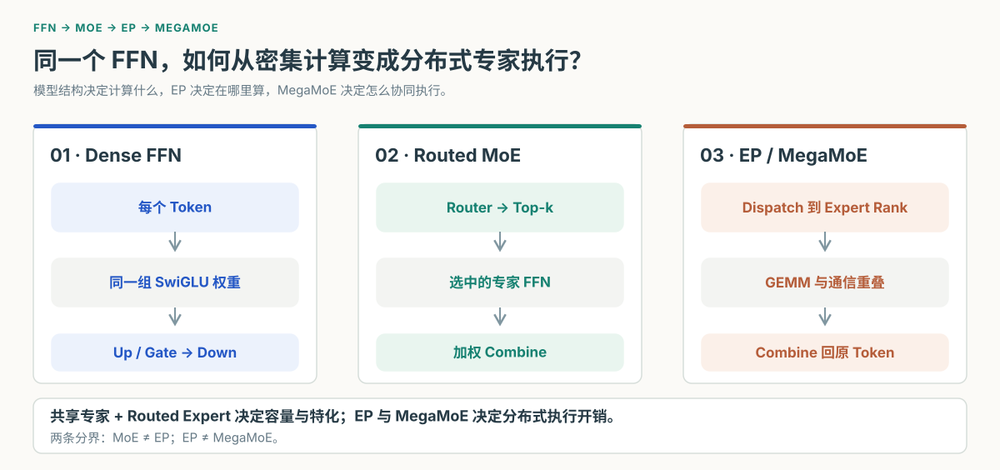
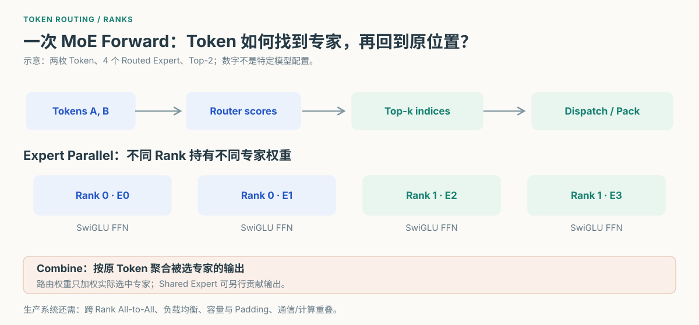
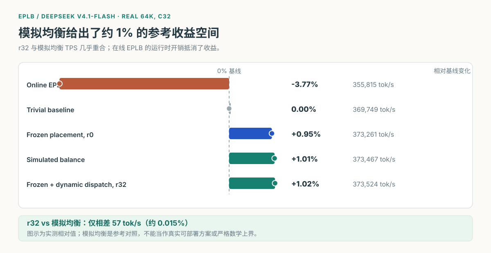

从前面的 [Attention / MLA / KDA](/blog/2026/11/19/attention-from-gqa-to-kimi-k31/) 继续往下看，Transformer Block 的另一半是 **FFN**。学习 CS336 时，只要理解 SwiGLU 的 Gate、Up、Down 三个 Linear，就可以写出 Dense FFN；但到了 DeepSeek、Kimi 这类万亿级 MoE，为什么还要把 FFN 切成细粒度 Expert、设置 Shared Expert、把 Routed 路径压到 Latent Space，然后让不同 GPU 之间做 EP Dispatch？

更重要的是，模型侧的路由负载均衡与推理 Runtime 的 EPLB 经常被混为一谈。我在 DeepSeek-V4-Pro、V4.1-Flash 上做过 EPLB / MegaMoE 受控对照，一开始看到专家负载不均，直觉就是「把 Expert 放得更均匀就会更快」。实测却多出一道必须解释的因果链：**Logical Expert 的 Token 计数 → Physical Rank 的负载 → Grouped GEMM 的有效工作量与通信 → 真正的关键路径 → 端到端 TPS。**

**先说结论：** Fine-Grained MoE 把一个大专家的中间维拆细，增加专家组合；Shared Expert 让公共变换不再由 Routed Expert 重复学习；LatentMoE 把 Routed Expert 的输入/输出通路压到低维空间，直接降低 EP 数据载荷与专家权重宽度；Aux Loss、Aux-Free Bias 和 Quantile Balancing 改变**如何选择 Logical Expert**；EPLB 则在 Router 之后改变 **Logical Expert → Physical Rank/Replica** 的映射；MegaMoE 决定**如何融合执行这些专家计算与通信**。

本文会一直追到真实压测。V4.1-Flash 的实测对照里，**模拟均衡 +1.01%、离线冻结 r0 +0.95%、离线 r32 + Dynamic Dispatch +1.02%**，三者几乎触到同一个约 +1% 的参考收益区间；而**在线 EPLB −3.77%**。这不代表「均衡没有价值」，而是说明我们必须先测出**在当前 Kernel / 负载下，改善负载实际能兑现多少端到端收益**。模拟均衡是诊断用的参考对照，不能直接部署替换真实 Router。

  

*图 1 · 从数学模型到分布式执行，不能把三层优化当成同一件事。*

## 1. 先把 FFN 放回 Transformer Block

一个 Pre-Norm Decoder Block 可以抽象成：

~~~python
# x: [B, S, D]
x = x + attention(norm_1(x))
x = x + ffn(norm_2(x))
# 形状仍然是 [B, S, D]
~~~

Attention 的 Query 读取其他位置的 Key/Value，因而具有跨 Token 信息交互；FFN 则对每个 Token 的向量**独立应用同一组权重**，不会再额外扫描历史 Token。虽然其输入可以是 [B, S, D]，但 FFN 的大矩阵乘法常把前两维合并成 N=B×S 个 Token，因此实质是 [N, D] 经投影到 [N, D_ff] 再回到 [N, D]。

MLA 优化的主要是 **Attention 的历史 KV 表示与读取**；FFN/MoE 关注的则是 **Token 当前经过哪些权重、多少矩阵计算及如何分布式执行**。所以 MoE 不是另一种 MLA，EP 也不是 DCP 的别名。

## 2. Dense FFN 为什么演化成 SwiGLU？

基本 FFN 是两个线性层，中间有激活函数：

~~~text
FFN(x) = W_down · activation(W_up · x)
        D → D_ff → D
~~~

没有激活函数时，两个线性映射仍然可以合成为一层；激活函数提供非线性表达能力。

SwiGLU 引入 Gate 分支，常见写法为：

~~~text
gate   = SiLU(W_gate · x)
up     = W_up · x
hidden = gate ⊙ up
y      = W_down · hidden
~~~

这里 ⊙ 表示逐元素乘法。Gate 不一定是 0/1 开关：SiLU 可以产生连续的正负数、放大或缩小特征。注意不带 Bias 的 SwiGLU 参数量为：

~~~text
W_gate: D × D_ff
W_up:   D × D_ff
W_down: D_ff × D

Total = 3 × D × D_ff
~~~

因此处理 N 个 Token 的三次 Linear，矩阵乘法的 FLOPs 量级约为 **6 × N × D × D_ff**（一次乘加按 2 FLOPs），之外还有 SiLU 与逐元素乘法。要看具体工作点：短序列或大 Token Batch 时 FFN GEMM 往往很重要；长上下文 Prefill 时 Attention 的二次项也可能占主要计算量。不能把某份 CS336 样例的 FFN FLOPs 占比当成所有模型的固定常数。

可以用最小 PyTorch 代码把三路投影看清楚：

~~~python
import torch
import torch.nn as nn
import torch.nn.functional as F

class SwiGLU(nn.Module):
    def __init__(self, d_model: int, d_ff: int):
        super().__init__()
        self.gate_proj = nn.Linear(d_model, d_ff, bias=False)
        self.up_proj = nn.Linear(d_model, d_ff, bias=False)
        self.down_proj = nn.Linear(d_ff, d_model, bias=False)

    def forward(self, x: torch.Tensor) -> torch.Tensor:
        gate = F.silu(self.gate_proj(x))
        up = self.up_proj(x)
        return self.down_proj(gate * up)

x = torch.randn(2, 16, 128)
assert SwiGLU(128, 256)(x).shape == x.shape
~~~

这段代码保持了 CS336 讲解中 W1/Gate、W3/Up、W2/Down 的数学关系，使用 PyTorch 现成 Linear 只为了减少样板代码；如果要真正按 CS336 Assignment 1 手搓，还需把 Linear 的参数创建和矩阵乘法也自己实现。

## 3. MoE 不是让所有 Token 运行所有 FFN

假如 Dense 模型只有一组 SwiGLU，每个 Token 都使用这套权重。MoE 则包含多组不同参数的 Expert。对典型 Top-k Routed MoE，Router 先产生 Token 对各专家的分数，只选择 k 个，再加权合并它们的结果：

~~~text
scores = Router(x_t)
expert_ids = TopK(scores, k)

routed_output = Σ gate_i,t × Expert_i(x_t)
                i ∈ expert_ids
~~~

Top-k 选择与权重归一化在不同模型里可能不同；不是所有 MoE 都用同一种 Softmax 或路由方式。

  

*图 2 · 图中 4 个 Expert、Top-2 只是教学示例，不是特定 DeepSeek 模型配置。*

MoE 的核心优势是**总参数量可大幅增长，每个 Token 只激活一部分专家权重和计算**。但未激活专家的权重仍要放在某些设备的显存或存储层中，所以“激活参数小”不意味着“总权重无需占显存”。

下面手写一个便于验证 shape 的小型 Routed + Shared MoE：

~~~python
class SimpleMoE(nn.Module):
    def __init__(self, d_model, d_ff, num_experts, top_k):
        super().__init__()
        assert 1 <= top_k <= num_experts
        self.top_k = top_k
        self.router = nn.Linear(d_model, num_experts, bias=False)
        self.experts = nn.ModuleList([
            SwiGLU(d_model, d_ff) for _ in range(num_experts)
        ])
        self.shared = SwiGLU(d_model, d_ff)

    def forward(self, x):
        shape = x.shape
        flat = x.reshape(-1, shape[-1])
        scores = self.router(flat).softmax(dim=-1)
        weights, indices = scores.topk(self.top_k, dim=-1)
        weights = weights / weights.sum(-1, keepdim=True)

        out = torch.zeros_like(flat)
        for expert_id, expert in enumerate(self.experts):
            token_ids, slots = torch.where(indices == expert_id)
            if token_ids.numel() == 0:
                continue
            values = expert(flat[token_ids])
            out.index_add_(
                0, token_ids,
                values * weights[token_ids, slots].unsqueeze(-1)
            )
        return (out + self.shared(flat)).reshape(shape)

x = torch.randn(2, 8, 128)
moe = SimpleMoE(128, 256, num_experts=4, top_k=2)
assert moe(x).shape == x.shape
~~~

这段代码表达 Router → Token-to-Expert Dispatch → Expert FFN → Combine 的**数学语义**；实际生产系统不会这样逐 Expert 循环 Python 和使用大量动态索引，而是使用 Packing、Grouped GEMM、All-to-All 及融合执行。这里的简化权重归一化和 Shared Expert 也**不是对 DeepSeek-V3 的精确复刻**。

## 4. DeepSeekMoE：细粒度解决知识杂糅，Shared Expert 解决公共知识冗余

[DeepSeekMoE（ACL 2024）](https://aclanthology.org/2024.acl-long.70/)给出两项互补的架构设计，分别针对粗粒度 MoE 的 **Knowledge Hybridity**（一个大专家被迫混学太多无关模式）和 **Knowledge Redundancy**（多个 Expert 重复学共同功能）。

### 4.1 Fine-Grained Expert Segmentation 到底切了哪一维？

切的是 **FFN 的中间维度 M**，不是 Token 的 Hidden Size H，也不是把一个 Token 的向量切成几段送给不同 Rank。

~~~text
粗粒度：
    N 个 Routed Experts × 每个 Expert 的中间维 M
    每个 Token 激活 K 个 Expert

细粒度（粒度倍数 m）：
    mN 个 Routed Experts × 每个 Expert 的中间维 M/m
    每个 Token 激活 mK 个 Expert
~~~

对标准 SwiGLU FFN 而言，单个 Expert 的权重规模近似为 **3HM**。在这个理想化切分下：

~~~text
总 Expert 参数：
  (mN) × 3H × (M/m) = N × 3HM

每 Token 激活的 Expert 参数与主要 FLOPs：
  (mK) × 3H × (M/m) = K × 3HM
~~~

因此**同参数预算、同激活 GEMM 计算预算**下，专家的组合能力增加。例如 16 个 Expert 选 2 个，可能的 Expert 组合为 C(16,2)=120；若分成 64 个小 Expert、选 8 个，则有 C(64,8)=4,426,165,368 种组合。**组合数变大不自动代表模型精度提升**，但给了 Router 更细的选择粒度。

这也带来推理开销：一个 Token 激活更多 Expert，意味着更多逻辑 Dispatch/Combine 项、分组 GEMM 段和潜在 Padding。因此我们不能只从模型精度看细粒度，还要问 **M-block、Token Packing、EP 消息数能否处理得足够高效**。

### 4.2 Shared Expert Isolation：为什么要永远运行一条 FFN？

把少数 Expert 变成始终激活的 Shared Expert，使它们学习公共变换，Routed Expert 负责差异化部分。

~~~text
x ──→ Shared Expert（不参与 Routed Top-k）────────────┐
│                                                     +
└──→ Router → Top-k Routed Expert → Weighted Combine ┘
                              ↓
                         MoE 输出 [N,H]
~~~

Shared Expert 不是免费的：它每个 Token 都运行，也占用显存。在 EP 部署时，共享专家可以采用与 Routed Expert 不同的 TP/复制策略。**EPLB 通常主要处理 Routed Expert 的物理放置，并不等于会把 Shared Expert 一起迁移。**

DeepSeekMoE 的细粒度和 Shared Expert 两项设计是模型结构；到了 DeepSeek-V3、V4 系列，还会叠加路由分组、负载平衡和具体的 EP Runtime。

进一步阅读：[LLM Infra Atlas · 细粒度 MoE](https://llm-infra-atlas.github.io/moe/02_fine_grained/)。

## 5. LatentMoE：细粒度以后，为什么还要压缩 Hidden Width？

**Fine-Grained MoE 切小了 Expert 的中间维 M，但 EP Dispatch 发送的仍可能是满宽 Hidden State H。** 如果 Top-k 增大，逻辑通信量仍然大致随 **Token 数 × Top-k × H × Dtype** 增加。单 Expert 的权重读取也依赖 H × M。

LatentMoE 换了切分维度：保留 Router 对满宽 H 的判断，把 Routed 路径投影成 **较窄的 Latent 向量 ℓ（ℓ < H）**，在低维空间 Dispatch、执行 Experts、Combine，再升维回 H。Shared Expert 仍可在满宽空间独立处理。

~~~text
Token x [H]
 ├── Router(x [H]) ───────────→ Top-k Expert IDs
 ├── Shared Expert(x [H]) ────→ y_shared [H]
 └── Routed Path：
       W_down: [H] → [ℓ]
       EP Dispatch: 发送 [ℓ] 而不是 [H]
       Routed Expert GEMM：ℓ → M → ℓ
       Weighted Combine: [ℓ]
       W_up: [ℓ] → [H]
                ↓
     y = y_shared + y_routed
~~~

所以要明确区分 **MLA 压的是 Attention 的 KV 历史表示**，而 **LatentMoE 压的是 FFN/MoE 当前 Token 的 Routed 数据通路**。这两个 Latent 不是同一个缓存。

### Kimi K3 的 Stable LatentMoE

根据 [LatentMoE 与 Kimi K3 的结构整理](https://llm-infra-atlas.github.io/moe/03_latentmoe/)，K3 采用 **H=7168、Routed Latent ℓ=3584、896 Routed Experts、Top-16、2 个 Shared Experts**。相对于发送 7168 维 Hidden State，Routed Dispatch 的每份 Token 载荷宽度减半；与此同时 Top-k 更大，所以完整 EP 通信是否下降，必须把两者相乘评估。

K3 在 Routed Combine 后、升维前加入 RMSNorm，并通过改进的激活和路由平衡机制稳定训练；这里不要把它写成「DeepSeekMoE 直接等于 K3」，它属于后续的模型架构扩展。

| 维度 | Fine-Grained MoE | LatentMoE |
| --- | --- | --- |
| 切分对象 | Expert 中间维 M | Routed 输入/输出宽 H → ℓ |
| 主要目的 | 提升专家专门化与组合多样性 | 降低 Routed 权重与 EP 每份 Token 载荷 |
| 是否直接降低 A2A 单份 Hidden 宽度 | 否 | 是 |
| 主要代价 | 更多 Expert/Top-k、Padding | Down/Up Projection、低维瓶颈与稳定性约束 |

## 6. 路由负载均衡：Aux、Aux-Free、QB，与 EPLB 不在一个控制层

先把两个映射分开：

~~~text
模型算法：Token → Top-k Logical Experts
                  [路由选择：Aux / Aux-Free / QB]

系统执行：Logical Expert → Physical Expert Slots / GPU Ranks
                  [放置：EPLB / Replica / Dispatch]
~~~

训练时，Router 可能发生 Expert Collapse（大量 Token 挤到少数 Expert）。常见算法侧思路如下：

| 方案 | 调整的对象 | 基本思想 | 特别注意 |
| --- | --- | --- | --- |
| Auxiliary Loss | 训练目标函数 | 对不均匀的专家分配增加惩罚 | 系数太大可能与语言模型主目标冲突 |
| Aux-Loss-Free Bias | Expert 的路由选择偏置 | 对过载 Expert 减小 Bias、欠载 Expert 增大 Bias | Bias 影响 Top-k 选择，实际加权仍按原始 Affinity |
| Quantile Balancing（QB） | Expert 选择 Bias 的求解方式 | 用分位数/阈值估计目标负载，不仅固定步长修正 | 当前 Batch 的更新不能反过来作弊地重选当前 Batch |

DeepSeek-V3 的 Aux-Free Bias 是训练期的负载调节机制，不意味着任意推理输入都会均匀；Kimi K3 将 QB 用于更大规模 Expert 结构。它们主要处理「给 Token 选谁」。

相比之下，**EPLB（Expert Parallel Load Balancing）**在已有 Router 结果上重新考虑「这些 Expert 放到哪张卡，热点是否需要 Replica」。它可以做工作负载感知的冻结布局、为热点建立冗余副本，也可以在线根据一段时间的记录重新放置。只调整放置而不改 Logical Top-k，应保持模型计算语义；但 Replica 和同步需要额外的显存、通信及管理成本。

Runtime 最终不是优化路由 CV 这个数字，而是优化更贴近关键路径的目标：

~~~text
每个 Rank 的执行成本
 ≈ 本地 Expert GEMM / M-block / Padding
   + 不可重叠的 EP 通信
   + 等待其他 Rank 的同步成本

Step 关键路径 ≈ max(各 Rank 的实际完成时间)
                 + 额外的 Runtime 开销
~~~

因此 **Expert Count CV 下降不等于每个 Rank 的 MegaMoE 时延一定同比下降**；比如某些 Kernel 会按固定 Token Cap/形状 Padding，或者通信已经被计算隐藏，减小 Count 并不改变真正执行的 Tile 数。

进一步阅读：[LLM Infra Atlas · 算法侧负载均衡](https://llm-infra-atlas.github.io/moe/04_load_balancing/) 和 [系统侧 EPLB/LPLB](https://llm-infra-atlas.github.io/parallel/05_ep/04_system_load_balancing/)。

## 7. MoE、EP、MegaMoE：从 Token 选择到 GPU 执行路径

| 层次 | 核心决策 | 直接影响 |
| --- | --- | --- |
| MoE 结构 | Shared/Routed、细粒度、Latent Width | 模型容量、激活算力、每 Token 载荷 |
| Router 平衡 | Aux-Free、QB、Group-Limited Routing | Logical Expert 激活分布 |
| EP/EPLB | Expert Placement、Replica、Dispatch | 物理 Rank 负载、通信模式 |
| GPU Kernel | Grouped GEMM、MegaMoE、同步与 Padding | 真实的 Kernel 关键路径 |

典型推理的 Routed 路径：

~~~text
Token Hidden State
  → Router Top-k
  → Expert ID + Token Pack
  → EP Dispatch / All-to-All
  → Expert GEMM1 → SwiGLU → GEMM2
  → Combine / All-to-All
  → 恢复原 Token 顺序
~~~

[DeepGEMM MegaMoE](https://github.com/deepseek-ai/DeepGEMM) 把部分 Dispatch、专家 GEMM、激活和 Combine 协同组织为融合执行路径，让 NVLink 通信与 Tensor Core 计算尽可能重叠。**这不是没有 EP 通信，而是要判断多少通信仍暴露在关键路径上。**

在部分实现里，固定形状、Rank 级 Barrier 和 Padding 能够提升 Kernel 可调度性，却也可能让物理负载均衡的收益弱于原始 Token 数的不均衡程度。接下来两轮实验正是为了验证这一层。

## 8. DSV4-Pro：激进在线 EPLB 为什么显著负优化？

先看较早的一轮 V4-Pro Prefill 主导压测（ShareGPT 实际输入、60K/1、C16），把 **Placement / Replica / 在线更新 / Dispatch Backend** 作为独立实验轴。曾在模拟不均衡请求里看到明显的 Expert Skew，但这还不是收益结论。

在 **REBALANCE_ITERS=10** 的受控矩阵里：

| 实验 Arm | Input TPS（tok/s） | 说明 |
| --- | ---: | --- |
| EPLB off + Static Dispatch + r8 | **93,683** | 本轮相对较快的对照 |
| EPLB on + Dynamic Dispatch + r8 | 87,029 | 在线重排，吞吐下降 |
| EPLB on + Dynamic Dispatch + r0 | 55,219 | 重排开销显著 |
| EPLB on + Static Dispatch + r0 | 54,669 | 同样受在线重排拖累 |
| EPLB on + Static Dispatch + r8 | 52,651 | 本轮最慢 |

96 个正式请求的窗口里触发了 **120–176 次 Rebalance**，Nsight 观察到权重重分发相关 NCCL SendRecv 占到约 **8–10%**。因此这组数据说明的是**过于激进的在线重排很贵**，而不是「所有 EPLB、所有 Static Placement 都会下降约 40%」。

另一轮更低重排频率、冻结布局的实验中，**无冗余 Static Placement 可以由 94,437 提升到 96,711 tok/s（+2.41%）**，且与更均衡的 M-block / MegaMoE 工作形态相符。两轮的负载、重排频率和实验口径不同，不应把这个 +2.41% 与上表直接相减。

这一层验证了一个重要区分：

- **更合理的 Expert Placement 本身可以有收益。**
- **在线维持这套 Placement 的代价可能比收益大得多。**
- **额外 Replica 会改变 Grouped GEMM 形状和显存预算，并不是免费平衡。**

## 9. DSV4.1-Flash：模拟均衡、r32 和真实端到端收益上限

后续 V4.1-Flash 一轮的对照更完整：先用模拟均衡作为**诊断参考**，再测试可以维持原模型语义的 Frozen Placement / Replica，以及在线重排。

**同口径：真实 ShareGPT 64K 输入、C32、TP4 / EP4 / Attention DP4、MegaMoE，v0.5.22-patch-deepinfer。**

  

*图 3 · 模拟均衡是诊断参考对照，不是保证结果精度不变的部署策略，也不构成严格数学上界。*

| 方案 | Input TPS | vs Baseline |
| --- | ---: | ---: |
| Trivial Placement（基线） | **369,749** | — |
| 模拟均衡（诊断对照） | **373,467** | **+1.01%** |
| Offline Frozen Placement，r0 | 373,261 | +0.95% |
| Offline Placement + Dynamic Dispatch，r32 | **373,524** | **+1.02%** |
| Online EPLB | 355,815 | **−3.77%** |

最值得讨论的不是表格最大的数字，而是**对照之间的差距**：

1. **Frozen r0 与模拟均衡非常接近。** 这说明在这轮真实负载下，不增加冗余专家的放置优化，已经能兑现大部分可观察的平衡收益。
2. **r32 比模拟均衡仅高 57 tok/s（约 0.015%）。** 这属于测量波动尺度，不能据此宣称 32 个副本超越了模拟均衡理论上限，更不能说 r32 带来额外 1% 的收益。
3. **更均衡未继续提高吞吐。** 有记录的 Rank 负载 CV 从基线 **0.149**，降到 Frozen r0 的 **0.047**、r32 Dynamic Dispatch 的 **0.033**；Count 分布变好，但额外 E2E 收益没有随之扩大。
4. **Online EPLB 的 −3.77% 是另一种开销。** 动态 Dispatch Backend 与周期性在线重分配 Expert 权重不是一件事，不能因为 r32 使用 Dynamic Dispatch 就把它归入 Online EPLB。

同一主题早期使用 **随机 Token** 的测试里，离线冻结布局曾出现 **+6.5%～8.2%**，在线优化也曾有 +1%～4%；但换成真实 64K 输入后，冻结通常只剩约 +1%，在线反而负优化。**输入分布改变了 Expert Activation，Random Token 的路由不均衡不能直接当成真实服务负载。**

Nsight 结果帮助解释差异：该轮 MegaMoE 相关 Kernel 占被观测 Kernel 时间约 **47.1%**，冻结布局使局部 MegaMoE 时间改善约 1.9%～2.9%，对应的 E2E 收益却只有约 1%；在线方案额外引入多次小调用/迁移操作，侵占了本来要优化的路径。

**因此更准确的工程结论是：在这轮 V4.1-Flash 真实 64K/C32/MegaMoE 口径下，模拟均衡显示的可观察 E2E 收益空间只有约 1%；离线冻结无冗余方案已经基本触顶，r32 没有值得追求的额外增益，而在线重排的运行时成本明显超过所得收益。** 这是该工作点的实测结论，不可外推到所有 Batch、Decode 或其他模型。

## 10. 把 Kernel、EPLB 与 End-to-End TPS 重新串起来

我们已经有了完整的因果链：

~~~text
模型结构（Expert Size、Latent Width、Top-k、Shared）
    ↓
Router 产生 Logical Expert 激活分布
    ↓
EPLB / Replica / Placement 决定 Physical Expert 排布
    ↓
Token Packing + EP All-to-All
    ↓
Grouped GEMM / MegaMoE 的 M-block、Padding 与通信重叠
    ↓
真正不可隐藏的 Step Critical Path
    ↓
TTFT / TPOT / End-to-End Input TPS、Output TPS 与 SLO
~~~

因此应该区分四种完全不同的「上限」：

| 对照 | 它回答什么 | 它不能证明什么 |
| --- | --- | --- |
| Simulated Balance | 路由均衡后，当前系统可能改变多少执行时间 | 不能证明是真实可部署、语义等价的优化 |
| Frozen Placement | 不持续迁移权重时，物理放置可以兑现多少收益 | 不能证明换流量后仍然适用 |
| r8 / r32 Replica | 用额外权重显存能否分担热点 | 不能因为 CV 更低就推断 E2E 必定更好 |
| Online EPLB | 动态适应减去迁移与调度成本后的净收益 | 不能与 Dynamic Dispatch Backend 混为一谈 |

另外，在 [DCP Pack A2A Send 的公开 PR #49455](https://github.com/sgl-project/sglang/pull/49455) 中，目标 Kernel 的单层时间从 15.0 μs 降到 6.9 μs，但完整服务的吞吐收益仍在波动内。它并非 MegaMoE/EPLB，但再次验证同一个判断：**局部优化只有落在未被隐藏的关键路径上，才能按相应比例转化为端到端收益**。

## 11. 回到整条 Transformer Forward

~~~text
Transformer Block
  ├── Norm → Attention：MHA / GQA / MLA / DSA / KDA
  │                  └→ KV Cache / Recurrent State
  │
  └── Norm → FFN：Dense SwiGLU / Routed MoE
                    ├→ Router / Shared Expert
                    ├→ Top-k Routed Expert
                    └→ EP Dispatch → GEMM → Combine
                           └→ MegaMoE 等执行后端

整个系统还要由 Scheduler、显存管理、通信与并行拓扑保证正确交付。
~~~

**Attention 决定怎样访问历史，MoE 决定如何选择当前 Token 要经过的专家，而推理 Runtime 决定这些专家如何映射到物理硬件并在通信与计算之间找到真正的关键路径。** V4.1 的模拟均衡实验提醒我们：不能只问「Expert 有没有被分平」，还必须回答「已经平到哪里，剩下还有多少可兑现的 E2E 收益，以及为此要付出多少运行时成本」。

---

## 参考资料

- [Stanford CS336 · Language Modeling from Scratch（Assignment 1）](https://cs336.stanford.edu/)
- [SwiGLU · GLU Variants Improve Transformer](https://arxiv.org/abs/2002.05202)
- [DeepSeekMoE · Fine-Grained Segmentation / Shared Expert（ACL 2024）](https://aclanthology.org/2024.acl-long.70/)
- [DeepSeek-V3 · Technical Report / Load Balancing](https://arxiv.org/abs/2412.19437)
- [DeepGEMM · MegaMoE](https://github.com/deepseek-ai/DeepGEMM)
- [SGLang · DeepSeek V4 推理 Recipe](https://github.com/sgl-project/sglang/blob/main/docs/cookbook/autoregressive/DeepSeek/DeepSeek-V4.mdx)
- [Attention 演进：MHA/MLA/KDA/DSA](/blog/2026/11/19/attention-from-gqa-to-kimi-k31/)
- [GPU/NPU/CPU 数据搬运与 MegaMoE](/blog/2026/11/20/gpu-npu-cpu-inference-systems/)

- [LLM Infra Atlas · 细粒度 MoE / Shared Experts](https://llm-infra-atlas.github.io/moe/02_fine_grained/)
- [LLM Infra Atlas · LatentMoE / Kimi K3 Stable LatentMoE](https://llm-infra-atlas.github.io/moe/03_latentmoe/)
- [LLM Infra Atlas · Auxiliary / Aux-Free / Quantile Balancing](https://llm-infra-atlas.github.io/moe/04_load_balancing/)
- [LLM Infra Atlas · 系统侧 EPLB、LPLB](https://llm-infra-atlas.github.io/parallel/05_ep/04_system_load_balancing/)
- [LatentMoE · 论文](https://arxiv.org/abs/2601.18089)
