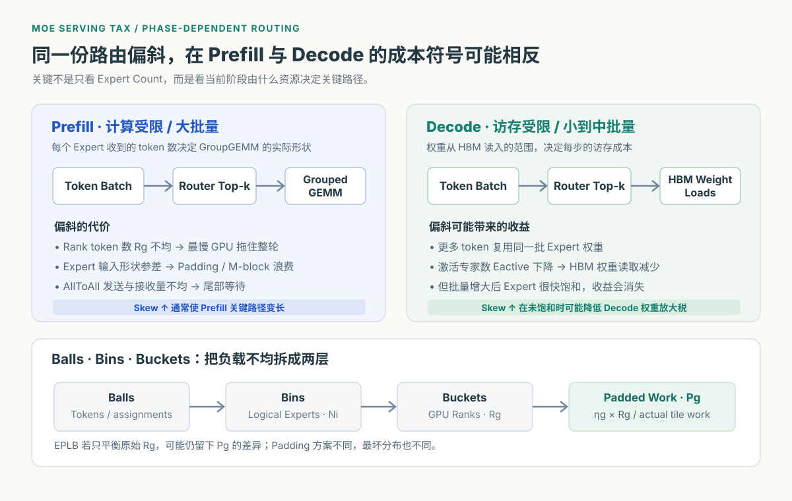

从前面的 [Attention / MLA / KDA](/blog/2026/11/19/attention-from-gqa-to-kimi-k31/) 继续往下看，Transformer Block 的另一半是 **FFN**。学习 CS336 时，只要理解 SwiGLU 的 Gate、Up、Down 三个 Linear，就可以写出 Dense FFN；但到了 DeepSeek、Kimi 这类万亿级 MoE，为什么还要把 FFN 切成细粒度 Expert、设置 Shared Expert、把 Routed 路径压到 Latent Space，然后让不同 GPU 之间做 EP Dispatch？

更重要的是，模型侧的路由负载均衡与推理 Runtime 的 EPLB 经常被混为一谈。我在 DeepSeek-V4-Pro、V4.1-Flash 上做过 EPLB / MegaMoE 受控对照，一开始看到专家负载不均，直觉就是「把 Expert 放得更均匀就会更快」。实测却多出一道必须解释的因果链：**Logical Expert 的 Token 计数 → Physical Rank 的负载 → Grouped GEMM 的有效工作量与通信 → 真正的关键路径 → 端到端 TPS。**

**先说结论：** Fine-Grained MoE 把一个大专家的中间维拆细，增加专家组合；Shared Expert 让公共变换不再由 Routed Expert 重复学习；LatentMoE 把 Routed Expert 的输入/输出通路压到低维空间，直接降低 EP 数据载荷与专家权重宽度；Aux Loss、Aux-Free Bias 和 Quantile Balancing 改变**如何选择 Logical Expert**；EPLB 则在 Router 之后改变 **Logical Expert → Physical Rank/Replica** 的映射；MegaMoE 决定**如何融合执行这些专家计算与通信**。

本文会一直追到真实压测。V4.1-Flash 的实测对照里，**模拟均衡 +1.01%、离线冻结 r0 +0.95%、离线 r32 + Dynamic Dispatch +1.02%**，三者几乎触到同一个约 +1% 的参考收益区间；而**在线 EPLB −3.77%**。这不代表「均衡没有价值」，而是说明我们必须先测出**在当前 Kernel / 负载下，改善负载实际能兑现多少端到端收益**。模拟均衡是诊断用的参考对照，不能直接部署替换真实 Router。

  

*图 1 · 从数学模型到分布式执行，不能把三层优化当成同一件事。*

## 1. 先把 FFN 放回 Transformer Block

一个 Pre-Norm Decoder Block 可以抽象成：

~~~python
# x: [B, S, D]
x = x + attention(norm_1(x))
x = x + ffn(norm_2(x))
# 形状仍然是 [B, S, D]
~~~

Attention 的 Query 读取其他位置的 Key/Value，因而具有跨 Token 信息交互；FFN 则对每个 Token 的向量**独立应用同一组权重**，不会再额外扫描历史 Token。虽然其输入可以是 [B, S, D]，但 FFN 的大矩阵乘法常把前两维合并成 N=B×S 个 Token，因此实质是 [N, D] 经投影到 [N, D_ff] 再回到 [N, D]。

MLA 优化的主要是 **Attention 的历史 KV 表示与读取**；FFN/MoE 关注的则是 **Token 当前经过哪些权重、多少矩阵计算及如何分布式执行**。所以 MoE 不是另一种 MLA，EP 也不是 DCP 的别名。

## 2. Dense FFN 为什么演化成 SwiGLU？

基本 FFN 是两个线性层，中间有激活函数：

~~~text
FFN(x) = W_down · activation(W_up · x)
        D → D_ff → D
~~~

没有激活函数时，两个线性映射仍然可以合成为一层；激活函数提供非线性表达能力。

SwiGLU 引入 Gate 分支，常见写法为：

~~~text
gate   = SiLU(W_gate · x)
up     = W_up · x
hidden = gate ⊙ up
y      = W_down · hidden
~~~

这里 ⊙ 表示逐元素乘法。Gate 不一定是 0/1 开关：SiLU 可以产生连续的正负数、放大或缩小特征。注意不带 Bias 的 SwiGLU 参数量为：

~~~text
W_gate: D × D_ff
W_up:   D × D_ff
W_down: D_ff × D

Total = 3 × D × D_ff
~~~

因此处理 N 个 Token 的三次 Linear，矩阵乘法的 FLOPs 量级约为 **6 × N × D × D_ff**（一次乘加按 2 FLOPs），之外还有 SiLU 与逐元素乘法。要看具体工作点：短序列或大 Token Batch 时 FFN GEMM 往往很重要；长上下文 Prefill 时 Attention 的二次项也可能占主要计算量。不能把某份 CS336 样例的 FFN FLOPs 占比当成所有模型的固定常数。

可以用最小 PyTorch 代码把三路投影看清楚：

~~~python
import torch
import torch.nn as nn
import torch.nn.functional as F

class SwiGLU(nn.Module):
    def __init__(self, d_model: int, d_ff: int):
        super().__init__()
        self.gate_proj = nn.Linear(d_model, d_ff, bias=False)
        self.up_proj = nn.Linear(d_model, d_ff, bias=False)
        self.down_proj = nn.Linear(d_ff, d_model, bias=False)

    def forward(self, x: torch.Tensor) -> torch.Tensor:
        gate = F.silu(self.gate_proj(x))
        up = self.up_proj(x)
        return self.down_proj(gate * up)

x = torch.randn(2, 16, 128)
assert SwiGLU(128, 256)(x).shape == x.shape
~~~

这段代码保持了 CS336 讲解中 W1/Gate、W3/Up、W2/Down 的数学关系，使用 PyTorch 现成 Linear 只为了减少样板代码；如果要真正按 CS336 Assignment 1 手搓，还需把 Linear 的参数创建和矩阵乘法也自己实现。

## 3. MoE 不是让所有 Token 运行所有 FFN

假如 Dense 模型只有一组 SwiGLU，每个 Token 都使用这套权重。MoE 则包含多组不同参数的 Expert。对典型 Top-k Routed MoE，Router 先产生 Token 对各专家的分数，只选择 k 个，再加权合并它们的结果：

~~~text
scores = Router(x_t)
expert_ids = TopK(scores, k)

routed_output = Σ gate_i,t × Expert_i(x_t)
                i ∈ expert_ids
~~~

Top-k 选择与权重归一化在不同模型里可能不同；不是所有 MoE 都用同一种 Softmax 或路由方式。

  

*图 2 · 图中 4 个 Expert、Top-2 只是教学示例，不是特定 DeepSeek 模型配置。*

MoE 的核心优势是**总参数量可大幅增长，每个 Token 只激活一部分专家权重和计算**。但未激活专家的权重仍要放在某些设备的显存或存储层中，所以“激活参数小”不意味着“总权重无需占显存”。

下面手写一个便于验证 shape 的小型 Routed + Shared MoE：

~~~python
class SimpleMoE(nn.Module):
    def __init__(self, d_model, d_ff, num_experts, top_k):
        super().__init__()
        assert 1 <= top_k <= num_experts
        self.top_k = top_k
        self.router = nn.Linear(d_model, num_experts, bias=False)
        self.experts = nn.ModuleList([
            SwiGLU(d_model, d_ff) for _ in range(num_experts)
        ])
        self.shared = SwiGLU(d_model, d_ff)

    def forward(self, x):
        shape = x.shape
        flat = x.reshape(-1, shape[-1])
        scores = self.router(flat).softmax(dim=-1)
        weights, indices = scores.topk(self.top_k, dim=-1)
        weights = weights / weights.sum(-1, keepdim=True)

        out = torch.zeros_like(flat)
        for expert_id, expert in enumerate(self.experts):
            token_ids, slots = torch.where(indices == expert_id)
            if token_ids.numel() == 0:
                continue
            values = expert(flat[token_ids])
            out.index_add_(
                0, token_ids,
                values * weights[token_ids, slots].unsqueeze(-1)
            )
        return (out + self.shared(flat)).reshape(shape)

x = torch.randn(2, 8, 128)
moe = SimpleMoE(128, 256, num_experts=4, top_k=2)
assert moe(x).shape == x.shape
~~~

这段代码表达 Router → Token-to-Expert Dispatch → Expert FFN → Combine 的**数学语义**；实际生产系统不会这样逐 Expert 循环 Python 和使用大量动态索引，而是使用 Packing、Grouped GEMM、All-to-All 及融合执行。这里的简化权重归一化和 Shared Expert 也**不是对 DeepSeek-V3 的精确复刻**。

## 4. DeepSeekMoE：细粒度解决知识杂糅，Shared Expert 解决公共知识冗余

[DeepSeekMoE（ACL 2024）](https://aclanthology.org/2024.acl-long.70/)给出两项互补的架构设计，分别针对粗粒度 MoE 的 **Knowledge Hybridity**（一个大专家被迫混学太多无关模式）和 **Knowledge Redundancy**（多个 Expert 重复学共同功能）。

### 4.1 Fine-Grained Expert Segmentation 到底切了哪一维？

切的是 **FFN 的中间维度 M**，不是 Token 的 Hidden Size H，也不是把一个 Token 的向量切成几段送给不同 Rank。

~~~text
粗粒度：
    N 个 Routed Experts × 每个 Expert 的中间维 M
    每个 Token 激活 K 个 Expert

细粒度（粒度倍数 m）：
    mN 个 Routed Experts × 每个 Expert 的中间维 M/m
    每个 Token 激活 mK 个 Expert
~~~

对标准 SwiGLU FFN 而言，单个 Expert 的权重规模近似为 **3HM**。在这个理想化切分下：

~~~text
总 Expert 参数：
  (mN) × 3H × (M/m) = N × 3HM

每 Token 激活的 Expert 参数与主要 FLOPs：
  (mK) × 3H × (M/m) = K × 3HM
~~~

因此**同参数预算、同激活 GEMM 计算预算**下，专家的组合能力增加。例如 16 个 Expert 选 2 个，可能的 Expert 组合为 C(16,2)=120；若分成 64 个小 Expert、选 8 个，则有 C(64,8)=4,426,165,368 种组合。**组合数变大不自动代表模型精度提升**，但给了 Router 更细的选择粒度。

这也带来推理开销：一个 Token 激活更多 Expert，意味着更多逻辑 Dispatch/Combine 项、分组 GEMM 段和潜在 Padding。因此我们不能只从模型精度看细粒度，还要问 **M-block、Token Packing、EP 消息数能否处理得足够高效**。

### 4.2 Shared Expert Isolation：为什么要永远运行一条 FFN？

把少数 Expert 变成始终激活的 Shared Expert，使它们学习公共变换，Routed Expert 负责差异化部分。

~~~text
x ──→ Shared Expert（不参与 Routed Top-k）────────────┐
│                                                     +
└──→ Router → Top-k Routed Expert → Weighted Combine ┘
                              ↓
                         MoE 输出 [N,H]
~~~

Shared Expert 不是免费的：它每个 Token 都运行，也占用显存。在 EP 部署时，共享专家可以采用与 Routed Expert 不同的 TP/复制策略。**EPLB 通常主要处理 Routed Expert 的物理放置，并不等于会把 Shared Expert 一起迁移。**

DeepSeekMoE 的细粒度和 Shared Expert 两项设计是模型结构；到了 DeepSeek-V3、V4 系列，还会叠加路由分组、负载平衡和具体的 EP Runtime。

进一步阅读：[LLM Infra Atlas · 细粒度 MoE](https://llm-infra-atlas.github.io/moe/02_fine_grained/)。

## 5. LatentMoE：细粒度以后，为什么还要压缩 Hidden Width？

**Fine-Grained MoE 切小了 Expert 的中间维 M，但 EP Dispatch 发送的仍可能是满宽 Hidden State H。** 如果 Top-k 增大，逻辑通信量仍然大致随 **Token 数 × Top-k × H × Dtype** 增加。单 Expert 的权重读取也依赖 H × M。

LatentMoE 换了切分维度：保留 Router 对满宽 H 的判断，把 Routed 路径投影成 **较窄的 Latent 向量 ℓ（ℓ < H）**，在低维空间 Dispatch、执行 Experts、Combine，再升维回 H。Shared Expert 仍可在满宽空间独立处理。

~~~text
Token x [H]
 ├── Router(x [H]) ───────────→ Top-k Expert IDs
 ├── Shared Expert(x [H]) ────→ y_shared [H]
 └── Routed Path：
       W_down: [H] → [ℓ]
       EP Dispatch: 发送 [ℓ] 而不是 [H]
       Routed Expert GEMM：ℓ → M → ℓ
       Weighted Combine: [ℓ]
       W_up: [ℓ] → [H]
                ↓
     y = y_shared + y_routed
~~~

所以要明确区分 **MLA 压的是 Attention 的 KV 历史表示**，而 **LatentMoE 压的是 FFN/MoE 当前 Token 的 Routed 数据通路**。这两个 Latent 不是同一个缓存。

### Kimi K3 的 Stable LatentMoE

根据 [LatentMoE 与 Kimi K3 的结构整理](https://llm-infra-atlas.github.io/moe/03_latentmoe/)，K3 采用 **H=7168、Routed Latent ℓ=3584、896 Routed Experts、Top-16、2 个 Shared Experts**。相对于发送 7168 维 Hidden State，Routed Dispatch 的每份 Token 载荷宽度减半；与此同时 Top-k 更大，所以完整 EP 通信是否下降，必须把两者相乘评估。

K3 在 Routed Combine 后、升维前加入 RMSNorm，并通过改进的激活和路由平衡机制稳定训练；这里不要把它写成「DeepSeekMoE 直接等于 K3」，它属于后续的模型架构扩展。

| 维度 | Fine-Grained MoE | LatentMoE |
| --- | --- | --- |
| 切分对象 | Expert 中间维 M | Routed 输入/输出宽 H → ℓ |
| 主要目的 | 提升专家专门化与组合多样性 | 降低 Routed 权重与 EP 每份 Token 载荷 |
| 是否直接降低 A2A 单份 Hidden 宽度 | 否 | 是 |
| 主要代价 | 更多 Expert/Top-k、Padding | Down/Up Projection、低维瓶颈与稳定性约束 |

## 6. 路由负载均衡：Aux、Aux-Free、QB，与 EPLB 不在一个控制层

先把两个映射分开：

~~~text
模型算法：Token → Top-k Logical Experts
                  [路由选择：Aux / Aux-Free / QB]

系统执行：Logical Expert → Physical Expert Slots / GPU Ranks
                  [放置：EPLB / Replica / Dispatch]
~~~

训练时，Router 可能发生 Expert Collapse（大量 Token 挤到少数 Expert）。常见算法侧思路如下：

| 方案 | 调整的对象 | 基本思想 | 特别注意 |
| --- | --- | --- | --- |
| Auxiliary Loss | 训练目标函数 | 对不均匀的专家分配增加惩罚 | 系数太大可能与语言模型主目标冲突 |
| Aux-Loss-Free Bias | Expert 的路由选择偏置 | 对过载 Expert 减小 Bias、欠载 Expert 增大 Bias | Bias 影响 Top-k 选择，实际加权仍按原始 Affinity |
| Quantile Balancing（QB） | Expert 选择 Bias 的求解方式 | 用分位数/阈值估计目标负载，不仅固定步长修正 | 当前 Batch 的更新不能反过来作弊地重选当前 Batch |

DeepSeek-V3 的 Aux-Free Bias 是训练期的负载调节机制，不意味着任意推理输入都会均匀；Kimi K3 将 QB 用于更大规模 Expert 结构。它们主要处理「给 Token 选谁」。

相比之下，**EPLB（Expert Parallel Load Balancing）**在已有 Router 结果上重新考虑「这些 Expert 放到哪张卡，热点是否需要 Replica」。它可以做工作负载感知的冻结布局、为热点建立冗余副本，也可以在线根据一段时间的记录重新放置。只调整放置而不改 Logical Top-k，应保持模型计算语义；但 Replica 和同步需要额外的显存、通信及管理成本。

Runtime 最终不是优化路由 CV 这个数字，而是优化更贴近关键路径的目标：

~~~text
每个 Rank 的执行成本
 ≈ 本地 Expert GEMM / M-block / Padding
   + 不可重叠的 EP 通信
   + 等待其他 Rank 的同步成本

Step 关键路径 ≈ max(各 Rank 的实际完成时间)
                 + 额外的 Runtime 开销
~~~

因此 **Expert Count CV 下降不等于每个 Rank 的 MegaMoE 时延一定同比下降**；比如某些 Kernel 会按固定 Token Cap/形状 Padding，或者通信已经被计算隐藏，减小 Count 并不改变真正执行的 Tile 数。

进一步阅读：[LLM Infra Atlas · 算法侧负载均衡](https://llm-infra-atlas.github.io/moe/04_load_balancing/) 和 [系统侧 EPLB/LPLB](https://llm-infra-atlas.github.io/parallel/05_ep/04_system_load_balancing/)。

## 7. MoE、EP、MegaMoE：从 Token 选择到 GPU 执行路径

| 层次 | 核心决策 | 直接影响 |
| --- | --- | --- |
| MoE 结构 | Shared/Routed、细粒度、Latent Width | 模型容量、激活算力、每 Token 载荷 |
| Router 平衡 | Aux-Free、QB、Group-Limited Routing | Logical Expert 激活分布 |
| EP/EPLB | Expert Placement、Replica、Dispatch | 物理 Rank 负载、通信模式 |
| GPU Kernel | Grouped GEMM、MegaMoE、同步与 Padding | 真实的 Kernel 关键路径 |

典型推理的 Routed 路径：

~~~text
Token Hidden State
  → Router Top-k
  → Expert ID + Token Pack
  → EP Dispatch / All-to-All
  → Expert GEMM1 → SwiGLU → GEMM2
  → Combine / All-to-All
  → 恢复原 Token 顺序
~~~

[DeepGEMM MegaMoE](https://github.com/deepseek-ai/DeepGEMM) 把部分 Dispatch、专家 GEMM、激活和 Combine 协同组织为融合执行路径，让 NVLink 通信与 Tensor Core 计算尽可能重叠。**这不是没有 EP 通信，而是要判断多少通信仍暴露在关键路径上。**

在部分实现里，固定形状、Rank 级 Barrier 和 Padding 能够提升 Kernel 可调度性，却也可能让物理负载均衡的收益弱于原始 Token 数的不均衡程度。接下来两轮实验正是为了验证这一层。

## 8. MoE Serving Tax：同等激活 FLOPs，为什么推理仍可能慢 2–3 倍？

前面我们从模型结构讲到 Fine-Grained Expert、LatentMoE，再讲到 Router、EPLB 和 MegaMoE。这里引入 MLSys 2026 的论文 **[Demystifying the Mixture of Experts Serving Tax](https://openreview.net/pdf?id=lELxqcgrsN)**（Pratyush Patel、Dayeol Lee、Shintaro Iwasaki、Arvind Krishnamurthy），把这些局部机制放进一个统一的性能坐标系。

论文的核心问题是：**如果 MoE 与 Dense FFN 每个 Token 的激活 FLOPs 相同，为什么 MoE 的实际服务延迟仍然可能高出 2–3 倍？**

答案是：FLOPs 对齐不等于执行形状、权重访问、通信和同步都对齐。MoE 把一个大 GEMM 拆成很多小的 Expert GEMM，还引入了路由、Token 重排、Padding 和 EP AllToAll。稀疏计算省下的 FLOPs，可能被这些系统开销重新吃掉。

先区分论文里的两种 Dense 参照：

| 参照 | 如何构造 | 用来回答什么 |
| --- | --- | --- |
| **DenseFA（FLOP-Aligned）** | 将 MoE 层替换成中间维按 Top-K 放大的 Dense FFN，使每 Token 激活计算量相同 | 假设没有稀疏路由、分组和通信开销，MoE 理想情况下能达到什么性能 |
| **DensePA（Parameter-Aligned）** | 将 Dense FFN 中间维按专家总数 E 放大，使总参数量与 MoE 相同 | 如果每个 Token 都使用全部专家权重，性能会落到什么位置 |

**MoE Tax 定义为相对 DenseFA 的延迟比，而不是云厂商报价比：**

$$
\tau(b) = \frac{T(\mathrm{MoE}, b)}{T(\mathrm{DenseFA}, b)}
$$

\(\tau=1\) 表示达到 FLOP 对齐 DenseFA 的延迟；\(\tau=2\) 表示相同口径下 MoE 的迭代延迟是 DenseFA 的两倍。论文 Figure 1 中 DeepInfra 的价格差异（2.5–10×）是市场定价现象，不能与论文测得的 2–3× 延迟税混为一谈。

### 8.1 七种税源：三项基线开销 + 四项 Token 分布效应

论文把 MoE Tax 拆成七个来源。前三项即使 Token 路由均匀也存在；后四项则由实际 Token 分布调制。

| 类别 | 税源 | 机制 | 主要影响 |
| --- | --- | --- | --- |
| 基线 | Arithmetic Intensity | GroupGEMM 将 Batch 拆给多个 Expert，单个权重能复用的 Token 变少 | Prefill、Decode |
| 基线 | AllToAll Communication | EP 的 Dispatch / Combine 需要跨 Rank 交换数据 | EP 两阶段 |
| 基线 | Ancillary Kernels | Router、Top-k、Align、Aggregation 等额外 Kernel | 通常较小 |
| 分布效应 | Expert Activation | 路由集中时，可能只激活更少的 Expert，减少权重读取 | Decode 可能受益 |
| 分布效应 | Workload Imbalance | 最慢的 GPU 决定 EP 迭代完成时间 | Prefill 受损 |
| 分布效应 | Padding | 每个 Expert 的 Token 数与 GEMM Tile / Block 对不齐 | TP、EP 均可能受损 |
| 分布效应 | Communication Volume | 各 Rank 的 Dispatch / Combine 传输量不均 | 主要损害 Prefill |

这里最值得记住的是：**MoE 的固定成本和 Token 分布效应不是同一件事。** 即使 Expert Count CV 很低，GroupGEMM 的算术强度、AllToAll 的固定成本、Padding 机制也仍然存在；反过来，某种路由倾斜也不一定在所有阶段都更差。

### 8.2 Arithmetic Intensity：为什么 Prefill 与 Decode 会出现两种瓶颈？

设一个 Batch 有 \(m\) 个 Token，Router 对每个 Token 选择 \(K\) 个 Expert，总共实际激活 \(E_{\mathrm{active}}\) 个不同 Expert。

DenseFA 把全部 \(m\) 个 Token 放进一个较大的 Dense FFN；MoE 则把 \(mK\) 个 Token-Expert assignment 分散给 \(E_{\mathrm{active}}\) 个 Expert。平均每个激活 Expert 只处理：

$$
\frac{mK}{E_{\mathrm{active}}}
$$

个 Token。于是 MoE 的 Expert GEMM 算术强度近似只有 DenseFA 的：

$$
\frac{K}{E_{\mathrm{active}}}
$$

这不是说 FLOPs 增加了，而是**同样的计算被切成了更多小矩阵，权重在每个矩阵里被复用得更少**。

- **Prefill：主要受计算吞吐与矩阵形状影响。** 每个 Expert 分到的 Batch 太小，Tensor Core 不容易被充分利用；随着 Batch 增大，Expert GEMM 的形状变好，固定开销也更容易摊薄，所以 Prefill Tax 通常下降。
- **Decode：主要受 HBM 权重读取影响。** 小 Batch 下，每个活跃 Expert 只处理很少 Token，却仍要加载对应的 Expert 权重。MoE 需要加载 \(E_{\mathrm{active}}\) 个 Expert 的权重，而 DenseFA 只需要 K 份等价权重，因此权重放大比例近似为 \(E_{\mathrm{active}}/K\)。

当 Batch 足够大、几乎所有 Expert 都被激活时，\(E_{\mathrm{active}}\to E\)，Decode 的权重放大税就会接近 \(E/K\)，表现得像一个参数量很大的 Dense 模型（DensePA）。

这也解释了论文观察到的 Decode Tax **钟形曲线**：单请求时只触发少数 Expert，税较低；Batch 增大后，活跃 Expert 很快饱和，权重读取量上升，税达到峰值；再继续增大 Batch，计算逐渐追上访存，延迟比开始回落。

#### 用 Roofline 变量把计算区间写出来

论文把单个 Expert 的权重读取时间记为 \(\alpha\)，每个 Token-Expert assignment 的激活 I/O 时间记为 \(\alpha_{act}\)，对应计算时间记为 \(\beta\)，Padding 放大系数记为 \(\eta\)。在 **TP+TP、MoE 与 DenseFA 使用相同 TP 度数**的计算模型中：

$$
T_{\mathrm{FFN},c}
= \frac{1}{n_{tp}}
\max\left(
\alpha K + \alpha_{act}mK,\;
\beta mK
\right)
$$

$$
T_{\mathrm{MoE},c}
= \frac{1}{n_{tp}}
\max\left(
\alpha E_{\mathrm{active}} + \alpha_{act}\eta mK,\;
\beta\eta mK
\right)
$$

两者的差别很直观：DenseFA 加载 K 份等价权重；MoE 要加载实际激活的 \(E_{\mathrm{active}}\) 份权重，而且 Padding 会把有效的 \(mK\) 个 assignment 放大到 \(\eta mK\)。

由此得到三个区间：

| 区间 | 典型阶段 | MoE / DenseFA 的 FFN 时间比 | 主导原因 |
| --- | --- | --- | --- |
| Memory-bound | Decode、小 Batch | 约 \(E_{\mathrm{active}}/K\) | 权重读取量不同 |
| Compute-bound | Prefill、大 Batch | 约 \(\eta\) | FLOPs 对齐，差异主要来自 Padding |
| Transition | 中间区域 | 约 \(\alpha E_{\mathrm{active}}/(\beta mK)\) | MoE 仍受访存限制，DenseFA 已逐渐转为计算受限 |

再乘上 FFN 在整个 DenseFA Forward 中的时间占比 \(f\)，可得到整层模型的延迟税：

$$
\tau
= \frac{T_{other}+T_{MoE}}{T_{other}+T_{FFN}}
= 1 + \left(\frac{T_{MoE}}{T_{FFN}}-1\right)f
$$

其中 \(f=T_{FFN}/(T_{other}+T_{FFN})\)。这意味着：即使 FFN 子层的 MoE Tax 很高，如果 Attention 等非 FFN 部分占据了更大比例，折算到整个 Forward 的税也会变小。长上下文下尤其不能只看 MoE Kernel 的局部倍率。

### 8.3 为什么路由倾斜 Prefill 不喜欢，Decode 却可能喜欢？

  

这篇论文最反直觉的结论是：**同一种 Non-uniform Routing，在 Prefill 和 Decode 的收益符号可能相反。**

**Prefill 看最慢的 Rank。** EP 中所有 Rank 要协同完成一轮 Expert 计算。若 Rank 0 收到很多 Token，Rank 1 收到很少 Token，整体完成时间仍要等 Rank 0。论文用 \(R_g\) 表示 GPU \(g\) 收到的原始 Routed Token 数，均衡情况下每卡平均值约为 \(mK/n_{ep}\)，最慢 Rank 的负载比例可以写成：

$$
\frac{\max_g R_g}{mK/n_{ep}}
$$

这个比例越大，Straggler Tax 越明显。论文在所测配置中观察到，Prefill 的落后者开销可使 MoE Kernel 延迟上升约 40%–80%。

**Decode 看要加载多少份不同的 Expert 权重。** 当 Batch 尚未激活全部 Expert 时，路由集中可能让多个 Token 复用同一批 Expert，减少 \(E_{\mathrm{active}}\)，降低 HBM 权重读取量。此时适度倾斜反而可能降低 Decode 延迟。

但这绝不意味着「Decode 应该无条件制造热点」：Batch 增大后 Expert 会很快饱和，\(E_{\mathrm{active}}\) 不再下降；同时 Padding、通信和质量风险也要单独衡量。

### 8.4 Padding Tax：原始 Token 数不等于真正执行的 GEMM 行数

这是与我们 EPLB 实验联系最紧的一节。

MoE Router 产生的是 Ragged Shape：不同 Expert 收到的 Token 数不同。但 Grouped GEMM 往往需要按 Tile / Block 对齐，因此 Kernel 可能执行一些没有真实 Token 对应的 Padding Row。**真正消耗计算资源的是补齐后的矩阵形状，而不只是有效 Token 数。**

设 GPU \(g\) 上第 \(i\) 个 Expert 收到 \(N_i\) 个 Token，Kernel Block 大小为 \(B\)。论文区分两种补齐方式：

**Blockwise Padding：每个 Expert 独立向上取整。**

$$
P_g^{\mathrm{block}}
= \sum_{i\in E_g}
\left\lceil\frac{N_i}{B}\right\rceil B
$$

这种方式怕 Token 分散：很多 Expert 各自只收到少量 Token，每个 Expert 都可能被补到一个完整 Block。论文指出 FusedMoE 与 DeepGEMM 的 Prefill 路径采用这种类型。

**Max Padding：所有 Expert 对齐到同一个最大长度。**

$$
P_g^{\mathrm{max}}
= E_g
\left\lceil\frac{\max_i N_i}{B}\right\rceil B
$$

这种方式怕 Token 集中：一个热点 Expert 的最大 Token 数会抬高所有 Expert 的共同执行维度。论文指出 DeepGEMM Decode 使用这种类型。

两种方式的最坏分布恰好相反：

| Padding 方式 | 最容易浪费的分布 | 直觉 |
| --- | --- | --- |
| Blockwise | Token 分散到很多 Expert，每个 Expert 都不够一个 Block | 每个 Expert 各自补齐 |
| Max Padding | Token 集中到少数 Expert，最大值很高 | 所有 Expert 被同一个最大值拉高 |

因此，**Padding 开销取决于 Token 分布与 Kernel 补齐机制的交互，不是简单的「越均匀越好」或「越倾斜越好」。** 论文在所测 Prefill 场景中观察到约 15%–25% 的 Padding 开销；Decode 对应影响通常较小，但 Max Padding 的最坏情况仍可能被热点放大。

### 8.5 Balls–Bins–Buckets：Token、Expert、GPU 是两层负载映射

经典 Balls-and-Bins 只研究 Token 被分到 Expert 后的分布，但 EP 系统还有第二层：Expert 又被放置到 GPU。因此论文扩展为：

~~~text
Balls：Tokens
   │ Router Top-k
   ▼
Bins：Logical Experts
   │ Expert Placement / EPLB
   ▼
Buckets：Physical GPU Ranks
   │ Kernel Tiling / Padding
   ▼
实际执行工作量 Pg
~~~

这让我们可以区分两种不均衡：

1. **Expert-level skew：** 每个 Logical Expert 收到多少 Token，即 \(N_i\) 的分布。
2. **GPU-level skew：** 专家放置后，每张卡收到多少原始 Token，即 \(R_g\) 的分布。

在均匀随机路由假设下，批量 \(m\) 中期望激活的 Expert 数为：

$$
\mathbb{E}[E_{\mathrm{active}}]
= E\left(1-\left(1-\frac{K}{E}\right)^m\right)
$$

它随 Batch 增大而快速接近 E。论文还发现，细粒度 Expert 可能加剧 Expert 级别的相对倾斜，但在 Expert 被分配到 GPU 后，多个 Expert 的负载会在 GPU 级别进行平均，GPU 级 skew 不一定同比恶化。相反，论文的模拟显示，加入 DP Attention 的配置可能提高最坏 GPU 负载，因此需要结合 EPLB 等机制观察。

这对我们理解 **DP Attention + EP** 很重要：不能只看 Router 的 Expert 直方图，也不能只看每张卡的 Token 总数；还要把 Expert Placement、Padding 与实际执行形状连起来。

### 8.6 AllToAll Tax：为什么 TP 与 EP 的通信成本不能混为一谈？

在 TP 部署中，MoE 与 DenseFA 可以采用相同的 Tensor Parallel 切分，Attention 后和 FFN 后执行相同形状的 AllReduce。因此在论文的 TP 对齐比较里，通信不是额外的 MoE 专属税源。

在 DP Attention + EP 的部署中，输入 Token 分布在不同 Rank，Router 选出的 Expert 可能位于远端 GPU，需要先做 AllToAll Dispatch，专家计算后再 AllToAll Combine。通信量随 Top-k 扇出 K 增长。

论文对 DeepSeek-V3 的通信量做了一个量级估算：AllToAll 的 API 级 Dispatch Buffer 约为 \(m_g K d_{model}\)，而 AllReduce 的输入规模为 \(m d_{model}\)，前者随 K 线性增长。考虑 Ring AllReduce 每卡实际传输约 \(2(n-1)/n\) 倍输入，以及 AllToAll 中约 \(1/n\) 的本地 Expert assignment 不经过网络，网络传输量之比约为：

$$
\frac{V_{\mathrm{A2A}}}{V_{\mathrm{AR}}}
\approx \frac{K n}{2(n-1)}
$$

当 \(K=8,n=8\) 时约为 **4.6×**。这是论文设定下的网络流量量级估算，不是所有实现、所有精度下的固定延迟比。论文测得单机 H200 上 AllToAll / AllReduce 延迟比在 Decode 约 2×、大 Batch Prefill 约 3–4×；跨两节点则达到约 7–15×，RDMA 互联成为更明显的瓶颈。

另一个细节是 DeepSeek-V3 Dispatch 使用 FP8，而 Combine 使用 BF16，Combine 的单 Token 传输量接近翻倍。论文在每 Rank 128 Token 的测试点观察到，路由分布导致的 p95 Combine 开销约 2.7×，Dispatch 约 1.9×。因此不能只测 Dispatch，也不能默认两段通信完全对称。

### 8.7 DeepEP：把论文里的 AllToAll Tax 落到真实 EP 通信路径

前面讲的是论文对 AllToAll 通信税的抽象建模。落到工程实现，需要看 **DeepEP**。它不是 Router，也不是 Expert GEMM Kernel，而是面向 MoE Expert Parallel 的通信库：根据上游给出的 Top-K 路由结果，完成 Token 的 Dispatch、跨设备传输、接收布局组织，以及 Combine 回传。它把 MoE 不规则的 Token-to-Expert 映射做成专用 GPU 通信路径，而不是简单调用一个固定分块的通用 AllToAll。

先把几个组件的职责分开：

| 组件 | 负责什么 | 不负责什么 |
| --- | --- | --- |
| Router | 计算每个 Token 的 Top-K Expert 及路由权重 | 不负责跨 GPU 搬运 Token |
| DeepEP | Dispatch / Combine、跨 Rank 搬运、通信缓冲与数据布局 | 不执行 Expert FFN 的两层 GEMM |
| DeepGEMM / Grouped GEMM | 执行各 Expert 的矩阵乘与激活 | 不决定 Token 应该发往哪个 Rank |
| EPLB | 调整 Expert Placement / Replica，改变负载落在哪些 Rank | 不替代 Dispatch / Combine 通信 |
| MegaMoE | 在特定执行路径中融合通信与 Expert 计算，形成更紧密的流水 | 不是 DeepEP 的另一个普通 AllToAll API |

普通的 EP 执行链路可以先记成：

~~~text
Router Top-K
    │ 生成 routing map
    ▼
DeepEP Dispatch
    │ Token hidden states + routing metadata
    ▼
目标 Rank 的 Expert 输入布局
    │
    ▼
Grouped GEMM / Expert FFN
    │ Expert 输出
    ▼
DeepEP Combine
    │ 反向传输 + 按原 Token 聚合
    ▼
恢复原始 Token 顺序，进入后续 Transformer
~~~

因此，论文的 AllToAll Tax 对应 DeepEP 路径中的通信成本，但两者不是同一层描述：论文解释为什么通信量、Rank 不均和传输尾部会形成延迟；DeepEP 解释这些数据具体如何被打包、分发、接收和送回。

#### EPV1 Normal：跨节点 RDMA 去重，再通过节点内 NVLink 扇出

结合我们分析的 EPV1 Normal，跨节点路径不是简单地把每个 Token 的每个 Top-K assignment 都独立发一次。它采用两级转发：

1. **Scale-out：** 按目标节点对同一个 Token 去重。同一个 Token 即使命中同一远端节点上的多个 Expert，跨节点 RDMA 通常只需要把这份 Token 数据送到该节点一次。
2. **Scale-up：** 数据到达目标节点后，再通过 NVLink / NVSwitch 分发到节点内真正承载目标 Expert 的 GPU。

可以把路径画成：

~~~text
Source GPU
    │
    │ IBGDA / RDMA
    │ 每个 Token-目标节点只发送一份
    ▼
Destination Node 的 RDMA Receive Buffer
    │
    │ NVLink / NVSwitch
    │ 节点内按 Expert Rank 扇出
    ▼
Target GPU 的 Expert Input
    │
    ▼
Expert GEMM
~~~

EPV1 Normal 基于 NVSHMEM IBGDA。Kernel 会通过 P2P 地址判断目标 Rank 是否处于可直接访问的 NVLink 域：可达时走对端显存访问，不可达时走 IBGDA RDMA。Combine 则沿反方向把 Expert 输出扇入源 Rank，并完成对应的累加。

这会带来一个对 MoE Tax 很重要的测量区别：论文给出的 Top-K 通信量公式适合分析路由扇出的量级，但**不能直接把 Token 数 × Top-K 当作 EPV1 Normal 的跨节点 RDMA 线上字节数**。同一个 Token 命中同一远端节点上的多个 Expert 时，Normal 路径会做节点级去重；真正的 RDMA 字节数应按实际的 (token, destination_node) 对统计，节点内 NVLink 流量则单独核算。否则会把跨节点流量估高，也会把 NVLink 与 RDMA 两个通信域混在一起。

#### Chunk、Channel 与 Head/Tail：Normal 如何把大批量通信做成流水线

Normal 面向 Prefill / 训练的大吞吐场景。它把 Token 按 Chunk 切分，再通过多个 Channel 并行搬运。每条 Channel 使用环形缓冲区，发送端维护 Tail，接收端维护 Head：

- Tail 表示发送端已经推进到哪个槽位；
- Head 表示接收端已经消费到哪个槽位；
- 当 Tail - Head 接近接收环容量时，发送端必须等待接收端释放空间，避免覆盖尚未消费的数据。

这套机制的意义不只是“把数据切小”：它允许发送、接收和消费在不同 Chunk 上流水执行，同时用背压约束缓冲区占用。RDMA 与 NVLink 的反馈成本不同，所以两侧的 Chunk / Ring 深度约束也不能简单视为同一个参数。

我们之前重点讨论的 **rdma_chunk_size** 与 **nvl_chunk_size**，本质上是在调节两个通信域的批量粒度。Chunk 太小，单次传输有效载荷不足，控制、doorbell 和调度开销更难摊薄；Chunk 太大，又可能增加缓冲需求、等待粒度和尾部延迟。因此 Dispatch 与 Combine、RDMA 与 NVLink 都应该分开测，不能用一个“最佳 Chunk”覆盖所有路径。EPV1 Normal 的具体默认值和可调字段还要以所用分支为准，不应把某一版配置当成通用常数。

#### Normal 与 Low-Latency 不是同一条路径简单改小 Chunk

EPV1 还区分 Normal 与 Low-Latency：

| 模式 | 主要目标 | 典型实现取舍 |
| --- | --- | --- |
| Normal | Prefill / 训练的高吞吐 | Chunk 聚合、节点级去重、RDMA → NVLink 两级转发、环形缓冲与 Head/Tail 背压 |
| Low-Latency | Decode 小 Batch 的低延迟 | 更直接的 Token / Top-K 发送路径、静态槽位与双缓冲，减少批量等待和部分控制开销 |

Low-Latency 的直接发送路径不应被理解成 Normal 的“更小 Chunk 版本”：它在数据复制、缓冲区预留和通信次数上有不同取舍。小 Batch 下减少聚合等待可能更重要；大 Batch 下，逐 Token 发送又可能带来更多请求与资源压力。具体选型要看阶段、Batch、Top-K、拓扑和实际通信量。

#### 通信计算重叠：DeepEP 解决的是可流水，不是自动消除通信

DeepEP 的 Dispatch / Combine API 可以通过延迟等待的 Hook 形式，把“发送已提交”和“接收结果可消费”分开。调用方先提交通信，再安排独立计算，最后在真正需要接收结果时等待 Hook。调度正确时，通信等待可以被计算覆盖：

$
T_{step} \approx \max(T_{comm}, T_{compute})
$

而不是机械地变成：

$
T_{step} = T_{comm} + T_{compute}
$

但这只是理想重叠关系，不是打开一个 Hook 就必然获得的收益。实际效果取决于：
- 是否存在足够长、且不依赖待接收数据的计算；
- Hook 的等待点是否放在消费者真正读取数据之前；
- 通信 Kernel 使用了多少 SM，是否与 Expert GEMM 争抢计算资源；
- 双 Microbatch 的切分是否让每个 Expert 的 GEMM 变得过小；
- CUDA Stream、Event 与 Tensor 生命周期是否正确。

这也解释了为什么不能把 Dispatch、GEMM、Combine 的独立耗时直接相加，当作 MegaMoE 的端到端关键路径。要用 Nsight Systems 看真实时间线，区分通信被隐藏的部分和最终暴露出来的等待。

#### DeepEP 与 MegaMoE：一个是通信库，一个是融合执行路径

我们之前讨论的普通执行方式是：

~~~text
DeepEP Dispatch
    → Grouped GEMM / Activation
    → DeepEP Combine
~~~

通信与计算可以通过 Chunk、Hook、双 Microbatch 等方式重叠，但通信和 Expert GEMM 仍然是相对独立的执行阶段。

MegaMoE 则进一步把 Dispatch、Expert GEMM、激活、第二层 GEMM 和 Combine 放进更紧密的融合流水中，利用目标硬件上的对称内存与 NVLink 访问，让搬运和计算以更细的粒度协同推进。它优化的不只是 AllToAll 本身，还包括中间数据落地、Kernel Launch、数据布局转换，以及通信与 GEMM 之间的空隙。

所以二者不能简单归纳成“DeepEP 和 MegaMoE 是两个同类通信库”：

- **DeepEP：** 专用 EP 通信数据面，重点是怎样高效地完成 Dispatch / Combine。
- **MegaMoE：** 融合通信与专家计算的执行路径，重点是怎样减少阶段边界并提高端到端重叠。

这也给我们的压测一个明确的对照思路：比较 DeepEP + Grouped GEMM 与 MegaMoE 时，要固定模型、路由、Batch、并行拓扑和精度；分别记录 Dispatch / Combine、Expert GEMM、数据布局转换与端到端时间。最终比较的是关键路径，而不是只比较某一个通信 Kernel 的峰值带宽。

#### 版本边界：这里讲的是 EPV1，不能与当前 DeepEP V2 混为一谈

上面关于 NVSHMEM IBGDA、Normal 的两级转发、Chunk / Channel、Head/Tail 环形背压，以及 Low-Latency 静态槽位的内容，针对的是我们分析过的 **EPV1 实现**。

DeepEP 上游当前主线已经演进到 V2：官方 README 说明 V2 使用 NCCL GIN，统一高吞吐与低延迟 API，并将 V1 API 和 NVSHMEM 后端从当前主线移除。因此，不能把 EPV1 的 NVSHMEM / IBGDA 数据路径直接套到 V2 的 EPBuffer / GIN 实现上。阅读源码、复现实验或讨论部署时，必须先锁定具体 commit / 分支和 API 版本。

最后要强调：**这篇 MLSys 论文并没有把 DeepEP 当作自己的对比对象，也没有证明 DeepEP 能消除 2–3× 的 MoE Tax。** 这里补充 DeepEP，是把论文的抽象通信税映射到我们实际使用和分析过的 EP 通信实现，帮助判断哪些成本来自路由与数据分布，哪些来自具体通信路径和执行调度。

### 8.8 论文的实测：Prefill 税下降，Decode 税呈钟形

论文的端到端测试覆盖 Mixtral-8x7B、Qwen2-MoE 与 DeepSeek-V3。Mixtral / Qwen2 使用 8×A100，DeepSeek-V3 使用 8×B200；另有 Mixtral / Qwen 的 H200 Kernel microbenchmark，以及 DeepSeek-V3 的 H200 通信 microbenchmark。不同实验平台不能混成一个端到端结论。

| 阶段 / 模型 | 论文报告的代表性结果 |
| --- | --- |
| Prefill · Mixtral / Qwen | 大 Batch 下最低约 1.28×，分别出现在约 1024 / 2048 tokens |
| Prefill · DeepSeek-V3 | Batch 1024 时最低约 1.7× |
| Decode · Mixtral | Batch 1 低至约 1.05×；Batch 32 峰值约 2.08× |
| Decode · Qwen | Batch 32 峰值约 2.57× |
| Decode · DeepSeek-V3 | Batch 128 附近峰值接近 3× |

这些数值说明，**MoE Tax 不只是一个固定的模型属性，它随 Batch、模型稀疏度、并行策略和 Token 分布而变化。** 论文用解析模型复现了 Prefill Tax 下降和 Decode Tax 钟形两种趋势；大多数配置的预测与实测仍有约 10%–30% 差距，因此它更适合定位主导税源，而不是直接当成精确延迟计算器。

### 8.9 论文给出的优化方向：Prefill 与 Decode 应该分开考虑

| 阶段 | 主导税源 | 优化方向 | 需要支付的代价 |
| --- | --- | --- | --- |
| Prefill | Batch Subdivision、Straggler、Padding | Load-aware Placement / Replica、Padding-aware Batching、Router 与 Kernel 协同 | 显存、迁移通信、额外 Padding 或路由复杂度 |
| Decode | Weight Amplification、HBM 权重读取 | 减少活跃 Expert、相似路由请求聚批、量化、适当增加 EP 带宽 | 质量风险、通信开销、GPU 闲置与故障域扩大 |
| 跨阶段 | 两阶段目标冲突 | P/D 分离，分别选择并行策略与负载目标 | 两套服务栈、资源池与模型一致性管理 |

论文还指出几个值得注意的权衡：

- **EPLB / Expert Replication：** 复制热门 Expert 能降低 Prefill 的 Straggler Tax，但也可能增加 Decode 阶段需要访问的不同 Expert 权重，从而加重 Weight Amplification Tax。
- **Fine-Grained Experts：** 更细的 Expert 可能改善某些 GPU 级负载分布，但 Expert 数增加也会放大 Batch Subdivision 和 Padding，需要和目标 EP 规模、Kernel Block 大小联合选型。
- **DP Attention：** 能改变 MoE 侧看到的有效 Batch 与 GPU 负载分布，不应只从 Attention 本身的吞吐评估。
- **双 Batch Overlap：** 通信与计算可以重叠，但若把每个 Microbatch 切得过小，也可能降低 Expert 权重复用，加重 Decode 的权重放大。
- **P/D Disaggregation：** 两阶段瓶颈不同，分离部署后可以分别优化；极端情况下，Decode 甚至可以考虑另一种稠密执行路径，但需要评估输出质量与服务复杂度。

### 8.10 把 Serving Tax 框架放回我们的 EPLB / MegaMoE 实验

这篇论文给我们之前的实验补上了一个更完整的解释框架，但不能把论文的绝对倍数直接套到我们的 B300 / SGLang MegaMoE 环境。

**先看 DSV4.1-Flash 的真实 64K / C32 结果：**

| 方案 | Input TPS | 相对基线 |
| --- | ---: | ---: |
| Trivial Placement | 369,749 | — |
| Simulated Balance | 373,467 | +1.01% |
| Frozen Placement，r0 | 373,261 | +0.95% |
| Frozen + Dynamic Dispatch，r32 | 373,524 | +1.02% |
| Online EPLB | 355,815 | −3.77% |

r32 的 Rank Count CV 更低，但它相对模拟均衡只多 57 tok/s，约 0.015%。这说明在当前工作点上，继续改善计数均衡没有带来可辨识的额外端到端收益。

现在用论文的视角重新看：**CV 只描述某一层的原始计数分布，不等于 Padding 后的执行工作量，更不等于关键路径时延。** 论文指出，传统 EPLB 主要平衡原始 Rank Token 数 \(R_g\)，而真正决定 Prefill 计算时间的还包括补齐后的工作量：

$$
P_g = \eta_g R_g
$$

其中 \(\eta_g\) 由该 Rank 上的 Expert 分布和 Kernel Padding 机制决定。论文因此提出一个更有针对性的方向：**Padding-aware + Activation-aware EPLB**，即在考虑原始 Token 数的同时，也考虑补齐后要执行多少行，以及 Decode 要加载多少个不同 Expert 的权重。

这并不意味着我们已经测出了 V4.1 的 \(P_g\)。当前这组实验记录有 Rank Count CV、TPS 与 MegaMoE Kernel 观测，但不能仅凭 CV 反推出真实 Padding 工作量。要继续验证，下一轮建议补齐：

1. **Expert 级：** 每层每个 Expert 的有效 Token 数 \(N_i\)，以及每批实际激活专家数 \(E_{\mathrm{active}}\)。
2. **Rank 级：** 原始 Token 数 \(R_g\)、补齐后行数 / M-block 数 \(P_g\)、Padding Ratio \(\eta_g\) 与最慢 Rank。
3. **Kernel 级：** MegaMoE 每 Rank 的实际执行形状、完成时间、Barrier 等待，以及通信被隐藏后仍暴露在关键路径上的时间。
4. **通信级：** Dispatch / Combine 的实际字节数、Rank 间最大传输量与 p95 延迟。
5. **阶段级：** 分开测 Prefill 与 Decode，尤其关注 Replica 是否降低 Prefill Straggler，却增加 Decode 的活跃权重集合。

还有一个重要边界：论文的主要测量对象是 vLLM 的 FusedMoE / DeepGEMM 等路径，端到端测试使用 8×A100 和 8×B200，通信微基准另用 8/16×H200；它不是在我们的 B300 + SGLang MegaMoE 上直接测出来的 2–3×。论文的解析模型用于拆分主导税源、解释趋势；它没有把 Compute–Communication Overlap 纳入完整时序模型，预测本身在多数配置下仍有约 10%–30% 误差。因此不能把通信、GEMM 和 Padding 的分项延迟直接相加成 MegaMoE 的端到端时间，也不能替代我们对重叠执行后真实关键路径的测量。

**所以这篇论文对我们的价值不是给出一个新的 EPLB 开关，而是改变 EPLB 的优化目标：从「让 Expert / Rank 的原始计数更均匀」，推进到「让 Prefill 的补齐后关键路径更短，同时不把 Decode 的权重读取成本抬高」。**

## 9. DSV4-Pro：激进在线 EPLB 为什么显著负优化？

先看较早的一轮 V4-Pro Prefill 主导压测（ShareGPT 实际输入、60K/1、C16），把 **Placement / Replica / 在线更新 / Dispatch Backend** 作为独立实验轴。曾在模拟不均衡请求里看到明显的 Expert Skew，但这还不是收益结论。

在 **REBALANCE_ITERS=10** 的受控矩阵里：

| 实验 Arm | Input TPS（tok/s） | 说明 |
| --- | ---: | --- |
| EPLB off + Static Dispatch + r8 | **93,683** | 本轮相对较快的对照 |
| EPLB on + Dynamic Dispatch + r8 | 87,029 | 在线重排，吞吐下降 |
| EPLB on + Dynamic Dispatch + r0 | 55,219 | 重排开销显著 |
| EPLB on + Static Dispatch + r0 | 54,669 | 同样受在线重排拖累 |
| EPLB on + Static Dispatch + r8 | 52,651 | 本轮最慢 |

96 个正式请求的窗口里触发了 **120–176 次 Rebalance**，Nsight 观察到权重重分发相关 NCCL SendRecv 占到约 **8–10%**。因此这组数据说明的是**过于激进的在线重排很贵**，而不是「所有 EPLB、所有 Static Placement 都会下降约 40%」。

另一轮更低重排频率、冻结布局的实验中，**无冗余 Static Placement 可以由 94,437 提升到 96,711 tok/s（+2.41%）**，且与更均衡的 M-block / MegaMoE 工作形态相符。两轮的负载、重排频率和实验口径不同，不应把这个 +2.41% 与上表直接相减。

这一层验证了一个重要区分：

- **更合理的 Expert Placement 本身可以有收益。**
- **在线维持这套 Placement 的代价可能比收益大得多。**
- **额外 Replica 会改变 Grouped GEMM 形状和显存预算，并不是免费平衡。**

## 10. DSV4.1-Flash：模拟均衡、r32 和真实端到端收益上限

后续 V4.1-Flash 一轮的对照更完整：先用模拟均衡作为**诊断参考**，再测试可以维持原模型语义的 Frozen Placement / Replica，以及在线重排。

**同口径：真实 ShareGPT 64K 输入、C32、TP4 / EP4 / Attention DP4、MegaMoE，v0.5.22-patch-deepinfer。**

  

*图 3 · 模拟均衡是诊断参考对照，不是保证结果精度不变的部署策略，也不构成严格数学上界。*

| 方案 | Input TPS | vs Baseline |
| --- | ---: | ---: |
| Trivial Placement（基线） | **369,749** | — |
| 模拟均衡（诊断对照） | **373,467** | **+1.01%** |
| Offline Frozen Placement，r0 | 373,261 | +0.95% |
| Offline Placement + Dynamic Dispatch，r32 | **373,524** | **+1.02%** |
| Online EPLB | 355,815 | **−3.77%** |

最值得讨论的不是表格最大的数字，而是**对照之间的差距**：

1. **Frozen r0 与模拟均衡非常接近。** 这说明在这轮真实负载下，不增加冗余专家的放置优化，已经能兑现大部分可观察的平衡收益。
2. **r32 比模拟均衡仅高 57 tok/s（约 0.015%）。** 这属于测量波动尺度，不能据此宣称 32 个副本超越了模拟均衡理论上限，更不能说 r32 带来额外 1% 的收益。
3. **更均衡未继续提高吞吐。** 有记录的 Rank 负载 CV 从基线 **0.149**，降到 Frozen r0 的 **0.047**、r32 Dynamic Dispatch 的 **0.033**；Count 分布变好，但额外 E2E 收益没有随之扩大。
4. **Online EPLB 的 −3.77% 是另一种开销。** 动态 Dispatch Backend 与周期性在线重分配 Expert 权重不是一件事，不能因为 r32 使用 Dynamic Dispatch 就把它归入 Online EPLB。

同一主题早期使用 **随机 Token** 的测试里，离线冻结布局曾出现 **+6.5%～8.2%**，在线优化也曾有 +1%～4%；但换成真实 64K 输入后，冻结通常只剩约 +1%，在线反而负优化。**输入分布改变了 Expert Activation，Random Token 的路由不均衡不能直接当成真实服务负载。**

Nsight 结果帮助解释差异：该轮 MegaMoE 相关 Kernel 占被观测 Kernel 时间约 **47.1%**，冻结布局使局部 MegaMoE 时间改善约 1.9%～2.9%，对应的 E2E 收益却只有约 1%；在线方案额外引入多次小调用/迁移操作，侵占了本来要优化的路径。

**因此更准确的工程结论是：在这轮 V4.1-Flash 真实 64K/C32/MegaMoE 口径下，模拟均衡显示的可观察 E2E 收益空间只有约 1%；离线冻结无冗余方案已经基本触顶，r32 没有值得追求的额外增益，而在线重排的运行时成本明显超过所得收益。** 这是该工作点的实测结论，不可外推到所有 Batch、Decode 或其他模型。

## 11. 把 Kernel、EPLB 与 End-to-End TPS 重新串起来

我们已经有了完整的因果链：

~~~text
模型结构（Expert Size、Latent Width、Top-k、Shared）
    ↓
Router 产生 Logical Expert 激活分布
    ↓
EPLB / Replica / Placement 决定 Physical Expert 排布
    ↓
Token Packing + EP All-to-All
    ↓
Grouped GEMM / MegaMoE 的 M-block、Padding 与通信重叠
    ↓
真正不可隐藏的 Step Critical Path
    ↓
TTFT / TPOT / End-to-End Input TPS、Output TPS 与 SLO
~~~

因此应该区分四种完全不同的「上限」：

| 对照 | 它回答什么 | 它不能证明什么 |
| --- | --- | --- |
| Simulated Balance | 路由均衡后，当前系统可能改变多少执行时间 | 不能证明是真实可部署、语义等价的优化 |
| Frozen Placement | 不持续迁移权重时，物理放置可以兑现多少收益 | 不能证明换流量后仍然适用 |
| r8 / r32 Replica | 用额外权重显存能否分担热点 | 不能因为 CV 更低就推断 E2E 必定更好 |
| Online EPLB | 动态适应减去迁移与调度成本后的净收益 | 不能与 Dynamic Dispatch Backend 混为一谈 |

另外，在 [DCP Pack A2A Send 的公开 PR #49455](https://github.com/sgl-project/sglang/pull/49455) 中，目标 Kernel 的单层时间从 15.0 μs 降到 6.9 μs，但完整服务的吞吐收益仍在波动内。它并非 MegaMoE/EPLB，但再次验证同一个判断：**局部优化只有落在未被隐藏的关键路径上，才能按相应比例转化为端到端收益**。

## 12. 回到整条 Transformer Forward

~~~text
Transformer Block
  ├── Norm → Attention：MHA / GQA / MLA / DSA / KDA
  │                  └→ KV Cache / Recurrent State
  │
  └── Norm → FFN：Dense SwiGLU / Routed MoE
                    ├→ Router / Shared Expert
                    ├→ Top-k Routed Expert
                    └→ EP Dispatch → GEMM → Combine
                           └→ MegaMoE 等执行后端

整个系统还要由 Scheduler、显存管理、通信与并行拓扑保证正确交付。
~~~

**Attention 决定怎样访问历史，MoE 决定如何选择当前 Token 要经过的专家，而推理 Runtime 决定这些专家如何映射到物理硬件并在通信与计算之间找到真正的关键路径。** V4.1 的模拟均衡实验提醒我们：不能只问「Expert 有没有被分平」，还必须回答「已经平到哪里，剩下还有多少可兑现的 E2E 收益，以及为此要付出多少运行时成本」。

---

## 参考资料

- [Stanford CS336 · Language Modeling from Scratch（Assignment 1）](https://cs336.stanford.edu/)
- [SwiGLU · GLU Variants Improve Transformer](https://arxiv.org/abs/2002.05202)
- [DeepSeekMoE · Fine-Grained Segmentation / Shared Expert（ACL 2024）](https://aclanthology.org/2024.acl-long.70/)
- [DeepSeek-V3 · Technical Report / Load Balancing](https://arxiv.org/abs/2412.19437)
- [DeepGEMM · MegaMoE](https://github.com/deepseek-ai/DeepGEMM)
- [Demystifying the Mixture of Experts Serving Tax · MLSys 2026（OpenReview PDF）](https://openreview.net/pdf?id=lELxqcgrsN)
- [Demystifying the Mixture of Experts Serving Tax · MLSys 2026（论文主页）](https://mlsys.org/virtual/2026/oral/3764)
- [DeepEP · Official Repository / README（当前主线版本说明）](https://github.com/deepseek-ai/DeepEP)
- [SGLang · DeepSeek V4 推理 Recipe](https://github.com/sgl-project/sglang/blob/main/docs/cookbook/autoregressive/DeepSeek/DeepSeek-V4.mdx)
- [Attention 演进：MHA/MLA/KDA/DSA](/blog/2026/11/19/attention-from-gqa-to-kimi-k31/)
- [GPU/NPU/CPU 数据搬运与 MegaMoE](/blog/2026/11/20/gpu-npu-cpu-inference-systems/)

- [LLM Infra Atlas · 细粒度 MoE / Shared Experts](https://llm-infra-atlas.github.io/moe/02_fine_grained/)
- [LLM Infra Atlas · LatentMoE / Kimi K3 Stable LatentMoE](https://llm-infra-atlas.github.io/moe/03_latentmoe/)
- [LLM Infra Atlas · Auxiliary / Aux-Free / Quantile Balancing](https://llm-infra-atlas.github.io/moe/04_load_balancing/)
- [LLM Infra Atlas · 系统侧 EPLB、LPLB](https://llm-infra-atlas.github.io/parallel/05_ep/04_system_load_balancing/)
- [LatentMoE · 论文](https://arxiv.org/abs/2601.18089)
