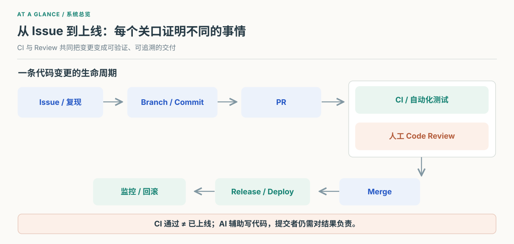
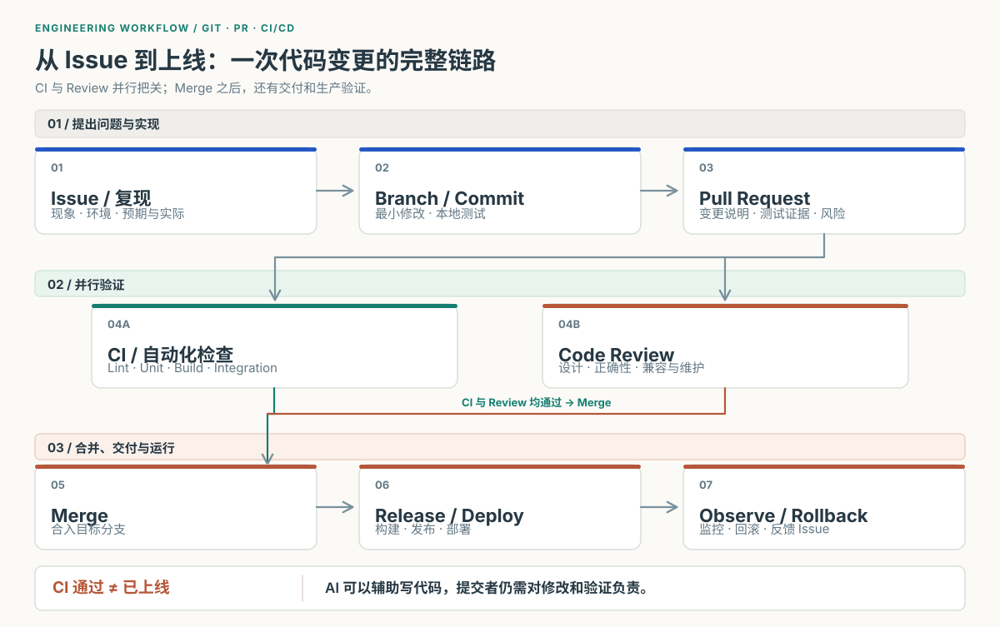
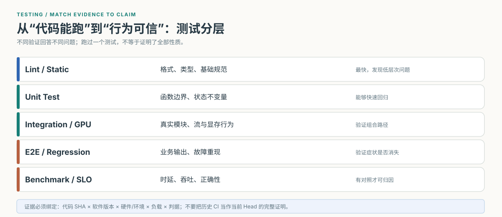
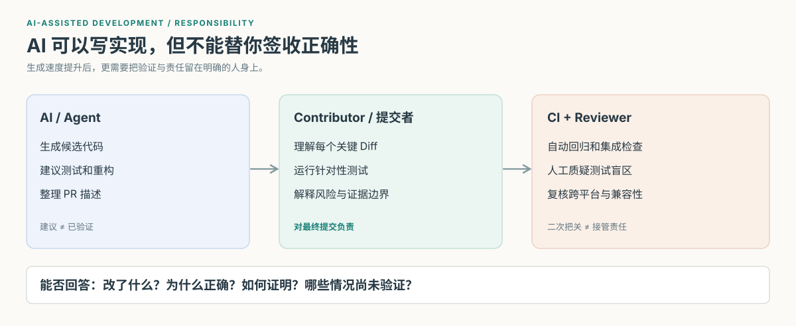

第一次参与开源协作时，我最容易把几个概念揉在一起：找到 Bug 就提 Issue，修改后发 PR，等 CI 变绿，再请 Maintainer Review；等代码 Merge，好像事情就结束了。

但真正参与过几次 SGLang 的 PR 后，会发现这些动作背后是**不同层次的工程保障**：Issue 帮团队共享问题；Git 记录变更；PR 让变更进入公共审查；自动化 CI 保证一组预先定义的检查能重复执行；测试提供可复核的行为证据；Code Review 检查测试之外的设计与风险；Merge、Release 和生产部署又是另外几个关口。

**先说结论：** 一次工程改动并不是“写完代码 → 提 PR → CI 变绿”就结束，而是从 Issue 和复现开始，经过 Git 分支与 Commit、PR、自动化测试和人工 Review，再到 Merge、Release、部署、监控与回滚。**CI 通过只证明配置好的检查通过，不能替代真实 GPU/E2E 验证；Merge 也不等于代码已经上线。** 无论实现由谁编写、是否使用 AI 辅助，提交者都需要解释修改机制、验证证据、风险边界，并对交付负责。

  

*速览图 · 从 Issue 到上线的关键关口；CI 与 Review 是不同的保障。*

尤其在 AI 可以很快生成代码的今天，难点越来越不是“能否写出一段实现”，而是**能否解释这段代码为什么正确、如何验证、适用边界是什么，以及出了问题由谁负责**。

这篇文章先从基础说起，再把真实的 [SGLang PR #35721](https://github.com/sgl-project/sglang/pull/35721)、[#47614](https://github.com/sgl-project/sglang/pull/47614)、[#48404](https://github.com/sgl-project/sglang/pull/48404) 和 [#49455](https://github.com/sgl-project/sglang/pull/49455) 放回同一条工程链路。它们分别体现排障回归、异步正确性、兼容性与 CI、性能归因，刚好回答“这些流程究竟在防什么”。

## 01 · 先把 Git、GitHub、Issue、Commit、PR 分清

**Git 是版本控制工具，GitHub 是围绕 Git 仓库提供托管和协作能力的平台。** Git 关心文件版本、提交历史和分支；GitHub 在此基础上提供 Issue、Pull Request、Code Review、Actions、权限与项目管理等功能。

可以用下面几个对象建立最小心智模型：

| 名词 | 它主要回答什么 | 最常见的误解 |
| --- | --- | --- |
| Repository（仓库） | 代码与版本历史存在哪里？ | 把仓库当作单个文件夹，而忽略 Git 历史 |
| Branch（分支） | 这次修改在哪条开发线上进行？ | 认为分支等于另复制一份项目 |
| Commit（提交） | 哪一组具体变更被记录成一个版本？ | 认为本地保存文件就等于提交 |
| Issue | 发现了什么问题/需求，如何复现和讨论？ | 认为 Issue 必须写完根因才能创建 |
| Pull Request（PR） | 请求将一组 Commit 合入目标分支，供检查和审查 | 认为发了 PR 就已经修改主仓库 |
| Review | 其他人是否认可 Diff 的设计、行为和风险？ | 认为 Reviewer 只检查格式 |
| Merge | 通过某种策略把变更并入目标分支 | 认为 Merge 自动等于发布上线 |

### Fork、origin、upstream 是什么？

在大型开源仓库中，普通贡献者常没有向上游主仓库直接推送的权限。一个典型路径是：

~~~text
sgl-project/sglang            ← upstream：上游主仓库
        |
        └── Fork
              |
              v
Phoenix3334/sglang            ← origin：自己可推送的仓库
              |
              └── fix/xxx     ← 工作分支，包含自己的 Commit
                       |
                       └── PR → sgl-project/sglang:main
~~~

<code>origin</code> 和 <code>upstream</code> 只是本地 Git Remote 的约定名称，不是 Git 强制的权限角色。最关键的是，**PR 指向哪里，以及当前代码所基于的 Base Commit 是谁**。

对第一次贡献一个修复，最小的命令链可以是：

~~~bash
# 仅是示意：先克隆自己的 fork，并登记上游仓库
git clone https://github.com/YOUR_NAME/sglang.git
cd sglang
git remote add upstream https://github.com/sgl-project/sglang.git

# 从上游 main 的最新状态创建工作分支
git fetch upstream
git switch -c fix/my-bug upstream/main

# 修改代码后先检查 Diff，再提交
git diff --check
git diff
git add path/to/source.py path/to/test.py
git commit -m "[Fix] module: explain the change"

# 推送到自己的 fork，随后向上游开 PR
git push -u origin fix/my-bug
~~~

后续代码改动可以继续 Commit 并 Push 到同一个分支，PR 会自动更新。实际仓库可能对 Commit 或 PR Title 有专门规范：**Git 本身不规定必须使用某一种标题格式；仓库的 CI/Lint 或 Maintainer 可以要求。**

## 02 · Issue 与 PR：先把问题描述清楚，再谈修复

  

*图 1 · 一次代码变更的完整生命周期。CI 和 Review 是并行反馈环；Merge 之后仍有 Release、部署和运行时验证。*

Issue 更像一份公开、可讨论的问题记录。一份能让维护者开始行动的 Bug Issue，通常至少要让人知道：**预期行为、实际行为、复现环境、触发步骤，以及影响范围**。如果没有把握根因，可以明确标注假设，不必先下一个错误结论。

例如 [SGLang Issue #35241](https://github.com/sgl-project/sglang/issues/35241) 最初跟踪的是长 Prefill 吞吐偶发塌陷；[PR #35721](https://github.com/sgl-project/sglang/pull/35721) 最终在 DPC 中隔离 Generation-Health 与用户请求的路由状态。这里有一个容易忽略的时间关系：**Issue 可以先记录现象，PR 可以先提出最小修复，后续才逐步积累更强的因果证据**。并不是每个 Issue 一创建就已经知道完整 Root Cause。

更有用的 Issue 不是“这东西坏了”，而是能让其他人据此复现：

~~~text
现象：相同负载下偶发有效 Batch 下降、吞吐异常
环境：版本/Commit、GPU、模型、并行配置、工作负载
证据：异常与正常运行的日志、性能指标、Rank 级行为
最小重现：只改变一个变量，尽量保持其他条件一致
假设：可能与健康检查对请求路由状态的影响有关
边界：哪些现象尚未解释，哪些数据只是相关而非因果
~~~

PR 则从“问题是什么”转换成“**我具体改了什么，为什么认为这样改能解决问题**”。好的 PR Description 通常包含 Motivation、Changes、Tests、风险/兼容性和相关 Issue。提交后，还要持续更新 Description，让它与**当前 Head Commit** 的实际代码保持一致，不能把历史上某个中间版本的结论原样当作最终结论。

Issue 不一定必须先于 PR；简单文档修正也可以直接提 PR。真正重要的是公开记录足以让其他人理解上下文，必要时能找到问题与修复的关联。

## 03 · CI/CD 是什么？它和 GitHub Actions 又是什么关系？

**CI（Continuous Integration，持续集成）** 的目标，是让多人频繁提交的代码能被持续集成、持续检查，从而更早发现回归与冲突。一次 Push 或 PR 更新可以触发 Lint、Unit Test、Build、Integration Test 等自动化任务，自动把检查结果反馈给 PR。

**CD 有两种常用含义**：

- **Continuous Delivery（持续交付）**：持续生成已经过验证、可发布的产物，是否发布到生产通常仍可由人审批。
- **Continuous Deployment（持续部署）**：通过既定门禁后，变更自动进入目标环境。它要求更强的回滚、灰度与可观测性保障。

所以 **CI 通过 ≠ Code Review 完成 ≠ Merge ≠ Release ≠ 已经上线**。某些项目只对 PR 做 CI；有些项目在 Merge 后构建 Nightly，正式 Release 需要手动触发；还有些项目有全自动 CD。它们没有统一模板。

### GitHub Actions 如何运作？

以 GitHub Actions 为例，可以这样记住：

~~~text
GitHub Event（pull_request / push / schedule / workflow_dispatch）
                       |
                       v
Workflow（.github/workflows/*.yml）
                       |
                       v
Jobs（lint / unit / GPU / integration / build）
                       |
                       v
Runner（执行任务的机器或容器）
                       |
                       v
Steps（checkout → install → test → upload logs/artifacts）
                       |
                       v
Status Checks → 回到 PR 页面
~~~

下面是一个**最小教学示例，并非 SGLang 实际 Workflow**：

~~~yaml
name: Minimal CI

on:
  pull_request:
  push:
    branches: [main]

jobs:
  test:
    runs-on: ubuntu-latest
    steps:
      - uses: actions/checkout@v4
      - uses: actions/setup-python@v5
        with:
          python-version: "3.12"
      - run: python -m pip install -r requirements.txt
      - run: python -m pytest tests/unit -q
~~~

<code>on</code> 是触发条件，<code>jobs</code> 定义任务，<code>runs-on</code> 选择 Runner，<code>steps</code> 是具体执行步骤。多个 Job 可以有依赖，也可以并行。一个 GPU 测试 Job 必须运行在有可用 GPU、驱动和环境的 Runner 上；把它写进 YAML 并不会自动获得 GPU。

SGLang 的实际仓库规模更大：[PR Test Base 工作流](https://github.com/sgl-project/sglang/blob/main/.github/workflows/pr-test.yml) 包含多个测试阶段与平台；[Lint 工作流](https://github.com/sgl-project/sglang/blob/main/.github/workflows/lint.yml) 包含 pre-commit 等检查。仓库为了控制昂贵的 GPU CI 资源，还设置了标签/授权与 Gate 逻辑；例如某些 PR 在没有对应 <code>run-ci</code> 标签时，可能在入口检查处停止，**测试矩阵根本没有执行**。这是资源与安全管理，不等于测试断言失败。

## 04 · 测试到底在证明什么？先看证据层级

“测试通过了”不是一个足够精确的描述。要问的应该是：**哪个版本、哪种硬件、什么负载、哪条路径、什么判据通过了？**

  

*图 2 · 测试不是单一的绿色勾号，而是多种不同性质的证据。*

Lint/Static Check 解决格式、规范和部分静态问题；Unit Test 用小输入验证函数、状态转换和边界；Integration Test 检查模块组合；GPU/E2E Test 检查真实硬件和运行链路；Benchmark 量化吞吐、时延与回归。它们不是严格互相替代的层级：某些 GPU Bug 只能靠专门的设备测试重现，而不是“多写几个 CPU 单测”就能覆盖。

### 为什么要写 Regression Test？

修复 Bug 不应只靠“这次跑正常了”，还需要尽可能固定一个会在旧实现失败、在新实现通过的检查：

~~~text
Red：旧实现 + 新回归测试 → 能触发原有缺陷
Green：修复版 + 同一测试 → 通过
Recheck：正常配置也通过，没有误伤原有行为
~~~

这个方法不是每个性能或并发缺陷都能做成 100% 确定性的单测，但至少应把**复现条件、判据和统计边界**固定下来。

[SGLang PR #48404](https://github.com/sgl-project/sglang/pull/48404) 很适合作为一个容易理解的例子。EPLB 的某些 Recorder 配置在启动时能被接受，却会在第一次 Rebalance 时崩溃。修复不是去掩盖下游 Assertion，而是在参数解析阶段拒绝不兼容组合。测试既要覆盖“非法组合被拒绝”，也要覆盖“合法组合仍然可用”。作者还提供了真正启动服务后的 Red/Green 验证：原配置在首次重平衡时报 Assertion；修复后非法配置提前抛出可解释的 ValueError，而合法 <code>stat</code> 模式仍可正常完成 Rebalance。

### 另一个反例：Mock 测试通过，能证明 CUDA 生命周期安全吗？

不能。[PR #47614](https://github.com/sgl-project/sglang/pull/47614) 修复了异步 PP 中接收 Tensor 被 Forward Stream 消费时的显存生命周期问题：<code>record_stream</code> 让 Caching Allocator 知道另一条 Stream 仍在使用这块 Storage。

当时曾有一个 Mock-only 的单测验证“代码是否调用了 record_stream”。Reviewer [明确要求删除它](https://github.com/sgl-project/sglang/pull/47614#issuecomment-6567604516)，理由是：**测试 Mock 调用成功，并不能复现 Caching Allocator 提前复用显存的真实错误**。最终更有说服力的是 B300 上的原始 Before/After、多种 PP/TP 组合下异常请求从 51–98/192 等降到 0/192，以及相关 GPU PP 集成检查。

这并不意味着 Mock Test 没用。Mock 适合验证调度或调用契约，但不能冒充 GPU 异步竞态的真实回归证据。关于这个故障本身，可以继续阅读本站 [《SGLang 异步 PP 静默输出错误》](/blog/2026/11/18/pp-stream-lifetime-bug/)。

## 05 · Code Review 在审什么？为什么 AI 时代更重要？

CI 能重复运行已定义的检查，Reviewer 则需要质疑：**我们写下的检查本身是不是足够？修改范围是不是合理？还有没有更低风险的实现？**

Code Review 不只找 Syntax Bug。它还要看语义、并发与生命周期、异常路径、边界条件、性能证据、跨平台兼容性、可维护性，以及这次 PR 有没有引入不必要的复杂度。

例如 [PR #35721 的 Review](https://github.com/sgl-project/sglang/pull/35721#pullrequestreview-5478523118) 认可整体修复，但认为测试代码过多；之后作者将对应测试从 8 个精简到 6 个，删除 28 行，而保留关键状态不变量。这体现的是**测试覆盖与代码维护成本之间的取舍**，不是测试越长越好。

[PR #48404 的 Review](https://github.com/sgl-project/sglang/pull/48404#issuecomment-6648242828) 发现原有 NPU Recorder 测试继承了与新约束冲突的 <code>--enable-eplb</code>。修复需要同时调整测试配置，保留本应有效的文件 Dump 检查；不能只在 CUDA 环境验证通过，就默认跨 NPU 的行为也完全不受影响。

一次有效的 Review 循环更像这样：

~~~text
PR 提交 → Reviewer 提出可复核的问题
         → Author 定位、解释或修改
         → 补充测试 / 更新实验范围
         → Push 新 Commit / 更新 PR Description
         → 对新的 Head SHA 再检查
         → Maintainer 决定是否批准与合并
~~~

Reviewer 可能不同意作者的方案，作者也可以用证据解释为什么不改；目标不是“对方说什么都照做”，而是**让最终方案有清楚的工程理由**。

### AI 写的代码，到底由谁负责？

  

*图 3 · AI 参与实现并不改变责任归属：提出 PR 的人仍要为最终变更与证据负责。*

AI 工具可以帮助探索源码、生成候选实现、重构代码、补测试、整理 PR 描述；这些能力确实能节省机械劳动。但**“AI 生成了代码”既不是质量证明，也不是出现 Bug 时的免责理由**。CI 没覆盖到的路径、模型输出的语义错误、跨平台回归，都需要提交者主动识别。

我更倾向于用四个问题检验一份 AI 辅助的 PR：

1. **我能独立解释 Diff 吗？** 为什么修改这一行，而不是前后其他位置？是否清楚异常路径和旧行为？
2. **我知道测试在测什么吗？** 是真正运行目标函数/Kernel，还是只验证 Mock 被调用？是否在旧版上失败？
3. **我能准确描述证据边界吗？** 哪个 GPU、哪次实验、哪个 Commit？哪些结果是推测、哪些是测量？
4. **我愿意为这份变更署名并维护吗？** 后续发现回归时，是否知道怎么复现、回滚和修复？还要遵守项目关于 AI 辅助贡献、许可、隐私及保密资料的规则。

**AI 可以是实现者和审查助手，但不是最终责任人。** Reviewer 和自动化 CI 同样属于第二层防线，而不是替提交者接管全部正确性责任。

## 06 · CI 失败了，应该先诊断什么？

看到 GitHub PR 页面一片红色，不该第一反应就是“代码有 Bug”。应先按执行链路分类：

| CI 状态或现象 | 应该怎么理解 | 下一步 |
| --- | --- | --- |
| Lint / Title Check 失败 | 样式或项目贡献规范未满足 | 读具体规则，局部修复 |
| Unit / GPU Test Assertion 失败 | 某个测试观察到不符合预期的行为 | 看堆栈与测试输入，尝试复现 |
| Gate / Label / Permission 失败 | 工作流尚未进入测试阶段 | 查触发条件，按仓库规则申请授权 |
| Runner / Queue / Timeout / Cancelled | 环境或调度未能完成测试 | 区分基础设施异常与真正测试结果 |
| 上游 Main 上也失败 | 可能与当前 Diff 无关 | 在对应 Base 复现，并给出可核实证据 |
| 历史 Commit 的测试通过 | 只能证明那个 Commit/环境的对应测试 | 检查当前 Head 是否改变了受测路径 |

例如 [PR #47614 的讨论](https://github.com/sgl-project/sglang/pull/47614#issuecomment-6567561913) 曾明确区分已通过的 Base/AMD 与 PP 集成测试，以及因缺少标签而没有运行的额外工作流。**没有执行的测试不能写成“失败”，更不能写成“通过”。**

[PR #48404 的 CI 讨论](https://github.com/sgl-project/sglang/pull/48404#issuecomment-6675282168) 则展示了另一件重要的事：遇到 Lint、NPU、AMD 不同平台的红色检查，要逐项确认测试是否真的运行、是否与当前 Diff 相关、能否在 Main 复现。只有先定位失败类型，后续的 Rerun、修复或向 Maintainer 说明才有依据。

这里还要理解 **Base SHA 与 Head SHA**：Base 是要合入的目标分支版本，Head 是作者当前 PR 分支版本；提交、Rebase 或同步上游后，Head 可能变化。因此报告测试时最好同时注明 SHA，避免把上一个版本的全绿状态搬到改过的新版本上。

## 07 · Performance PR：Kernel 快了，为什么还不能写“系统提速”？

正确性 PR 的结论常常是“旧行为错，新行为正确”；性能 PR 还要回答**快了多少、在哪个路径、在什么负载、是否能传导到 E2E**。

以仍在 Review 阶段的 [SGLang PR #49455](https://github.com/sgl-project/sglang/pull/49455) 为例：原来的 DCP A2A Send Packing Kernel 对每个 <code>(batch, head)</code> 启动一个 Triton Program。Kimi-K3 TP8/DCP8 的目标负载下，一层可能出现约 24,000 个 Program，每个搬运量很小。PR 改为按 <code>(batch, peer)</code> 打包，把 Program 数显著减少。

证据被刻意分成三层：

| 验证类型 | 结果 | 能够说明什么 |
| --- | --- | --- |
| 正确性 | BF16/FP8、多个 Shape 的真实 Kernel 输出 <code>torch.equal</code>；27 个测试通过 | Packed Layout 与原始语义一致 |
| Kernel / Nsight | B300 单层约 **15.0 → 6.9 μs（-54%）** | 局部打包开销显著下降 |
| 端到端 Benchmark | 吞吐差异落在约 ±0.7% 运行波动内 | 暂无稳定 E2E 加速证据 |

这里的重点不是“54% 这么大，怎么没有带来明显 TPS 收益”，而是 **Microbenchmark、Profiler 和 Serving Benchmark 测的是三种不同层次**。一个 Kernel 的时间减少，不代表同等时间全部处于关键路径；通信重叠、其他 Kernel、调度、整体 TPOT 都可能稀释局部收益。

如果 PR 描述写成“DCP Kernel 加速 54%，因此模型吞吐加速 54%”，即使所有单测绿色也仍然是错误结论。**认真写性能 PR，要敢于把“端到端还在噪声内”放进 Summary。** 当前 #49455 的 GitHub 状态为 Open，不应把它描述为已合入或已上线。

## 08 · Merge 之后为什么还没完？Release、CD 与回滚

被 Maintainer Approve 且通过所需门禁后，PR 才有资格进入合并流程。仓库可以选择 Merge Commit、Squash Merge 或 Rebase Merge；不同策略影响提交历史，但不会自动改变软件是否正确的事实。

代码进入 <code>main</code> 后，往往还要经过构建与分发。例如对于一个 LLM Inference Runtime，可能需要：

~~~text
PR Merge to main
      ↓
合入后的 CI / Nightly
      ↓
构建 Wheel / Container Image
      ↓
版本标记与 Release Notes
      ↓
Staging / 灰度部署
      ↓
GPU 实际场景与 SLO 监控
      ↓
扩大流量或回滚
~~~

这是典型交付过程的示例，并不表示 SGLang 的每个 PR 都自动走完整条部署链路。

对 GPU 推理系统来说，后续还必须关注 Driver/CUDA/NCCL、模型版本、量化格式、并行拓扑和 CUDA Graph 等兼容条件。某次 GPU 集成测试通过不能代替所有生产配置的验证；线上异常时，监控、日志与可回退的版本号，才让这个流程真正闭环。

也正因为如此，开源贡献者在 PR 中应如实写明：**哪些平台测过，哪些只是源码级检查，哪些还要等待下游环境验证**。Merge 是工程协作的一个里程碑，不是对所有未来场景的永久正确性承诺。

## 09 · 把这些步骤压缩成一个可以复用的习惯

对一项代码变更，我现在更愿意用五个连续问题复盘：

**问题是真的吗？** 有复现条件和最小对照，而不只是一张异常截图。

**修改在哪里？** 能解释关键 Diff、旧行为与新行为，以及为什么修改点应该位于这里。

**什么证据支持它？** 单测能覆盖目标不变量；需要 GPU 的缺陷用 GPU 验证；性能数据区分 Kernel 与 E2E；结果绑定版本和环境。

**别人质疑时能复核吗？** PR 的 Description、Review 回复和 CI 链接能让其他人检查；收到 Review 后真的修改或明确解释，而不是仅回复“已处理”。

**交付之后怎么办？** 当前代码与发布产物、部署环境和监控能否建立联系；出现回归时有没有明确的定位与回滚方式。

从这条链路看，CI/CD 不是“学会几个 GitHub Actions YAML 就结束”。它把自动化、协作、测试、责任与交付整合成一套**让工程变更可解释、可验证、可追踪**的机制。AI 时代代码产出更快，这套机制反而更重要。

---

## 参考资料与真实案例

- [Git 官方文档](https://git-scm.com/doc)；[GitHub · About pull requests](https://docs.github.com/en/pull-requests/collaborating-with-pull-requests/proposing-changes-to-your-work-with-pull-requests/about-pull-requests)
- [GitHub Actions 官方文档](https://docs.github.com/en/actions)；[GitHub · About continuous integration](https://docs.github.com/en/actions/about-github-actions/about-continuous-integration-with-github-actions)
- [SGLang · PR Test Base 工作流](https://github.com/sgl-project/sglang/blob/main/.github/workflows/pr-test.yml)；[Lint 工作流](https://github.com/sgl-project/sglang/blob/main/.github/workflows/lint.yml)
- [Issue #35241](https://github.com/sgl-project/sglang/issues/35241) / [PR #35721](https://github.com/sgl-project/sglang/pull/35721)：DP Health 请求路由与受控实验；[本站完整排障复盘](/blog/2026/11/18/dp-health-routing-bug/)
- [Issue #47613](https://github.com/sgl-project/sglang/issues/47613) / [PR #47614](https://github.com/sgl-project/sglang/pull/47614)：异步 PP 显存生命周期；[关于 Mock-only 测试的 Review](https://github.com/sgl-project/sglang/pull/47614#issuecomment-6567604516)；[本站 PP Stream 文章](/blog/2026/11/18/pp-stream-lifetime-bug/)
- [Issue #48403](https://github.com/sgl-project/sglang/issues/48403) / [PR #48404](https://github.com/sgl-project/sglang/pull/48404)：EPLB 参数兼容性、NPU 回归与 CI 排障
- [PR #49455](https://github.com/sgl-project/sglang/pull/49455)：DCP A2A Kernel，正确性、Nsight 与 E2E 对照

*说明：文中状态与公开测试记录按 2026-11-20 查询到的 GitHub 信息整理。PR 的 CI 状态与合并状态会更新；历史测试结果只对应当时的版本与测试配置。*
