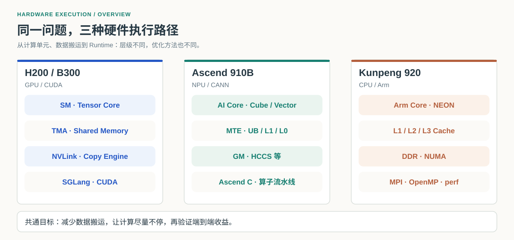
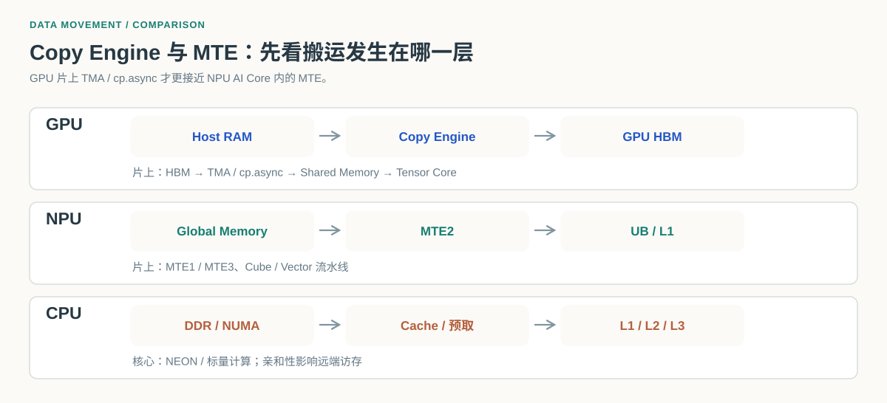
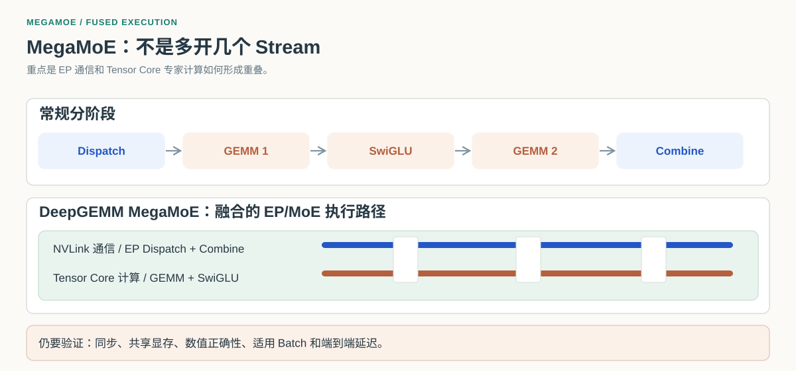

之前学习 CUDA Stream 时，我经常想：**Copy Engine 负责复制，昇腾 910B 的 MTE 也负责搬运，那它们是不是同一个硬件概念？** 再继续看 NVIDIA 的 TMA、Warp Specialization，昇腾的 Double Buffer，以及 SGLang 里的 MegaMoE，就更容易把不同层级的技术混在一起。

这些年我接触过 H200/B300 上的分布式推理和 Kernel Profiling，昇腾上的算子融合，以及鲲鹏 920 上的 HPCG、FFTW 和 NUMA 优化。回过头来看，它们其实都绕不开三个问题：**数据在哪里、怎样搬到计算单元、能不能让搬运与计算重叠。**

**先说结论：** GPU、NPU 和 CPU 都要做“搬数据—计算—写回”，但硬件分工并不相同。NVIDIA 的 **Copy Engine** 主要用于 Host/Device 等数据复制，**TMA、cp.async** 等片上异步搬运机制反而更接近昇腾 **MTE** 的角色；GPU 的 **SM/Tensor Core** 与昇腾的 **AI Core/Cube** 可以做功能类比，而鲲鹏 **Arm Core/NEON** 通过 Cache、SIMD、预取和 NUMA 优化另一种执行模型。**MegaMoE** 又提升到多 GPU 的执行组织层：它融合专家通信与计算，尝试让 NVLink 传输和 Tensor Core GEMM 重叠。真正的优化目标不是某个术语，而是缩短正确、可交付请求的关键路径。

  

*图 1 · 功能类比不是一一对应的硬件结构。*

## 1. 三条执行路径，为什么不能只比 FLOPS？

**H200 与 B300** 都属于 NVIDIA CUDA 平台：H200 是 Hopper（SM90），B300 是 Blackwell Ultra。以官方规格为例，H200 有 141 GB HBM3e、4.8 TB/s 带宽；Blackwell Ultra 官方给出的架构级上限为 288 GB HBM3e、8 TB/s，实际部署还应查看具体 SKU。**HBM 规格和理论 FLOPS 并不直接等于 LLM 的 Tokens/s**，因为 Decode 同时受 KV、权重读取、Batch、Kernel、通信和调度影响。

**昇腾 910B** 则通过 CANN、Ascend C 把计算映射到 AI Core：Cube 负责矩阵运算、Vector 处理向量、Scalar 与其他流水参与控制，MTE 负责 AI Core 内多种数据搬运。GM、UB、L1、L0 之间如何传数据，会直接影响算子的流水效率。不同 NPU 架构版本的 AI Core 组织和接口并不完全一致，不能把某一版本示意图当作所有 910B 实物的精确布线图。

**鲲鹏 920** 是 Arm 服务器 CPU：CPU Core 执行通用指令，NEON 提供 SIMD 向量计算，多级 Cache 和 DDR 供给数据，多路 CPU 还有 NUMA 远端内存的问题。它也承担操作系统、网络、请求调度和加速卡 Host 端准备工作，不能把 CPU 简单视作“没有 Tensor Core 的 GPU”。

| 维度 | H200 / B300 GPU | 昇腾 910B NPU | 鲲鹏 920 CPU |
| --- | --- | --- | --- |
| 算 | SM、Tensor Core、CUDA Core | AI Core、Cube、Vector | Arm Core、NEON |
| 存 | Register、Shared、L1/L2、HBM | UB、L1/L0、GM | Register、L1/L2/L3、DDR |
| 搬 | Copy Engine、TMA、NVLink | MTE、Pipe、GM/UB | Cache、预取、NUMA |
| 编程 | CUDA / Triton / CUTLASS | Ascend C / CANN | C/C++ / MPI / OpenMP |
| Profiling | Nsight Systems / Compute | CANN Profiler / msprof | perf / numactl 等 |

如果只看单卡峰值，容易漏掉软件栈和执行组织。真正应比较的，是**相同模型、精度、输入输出长度与 SLO 约束下的端到端效率**。

## 2. Copy Engine、TMA、MTE、NUMA：搬运发生在什么层级？

先把两个层级拆开：

~~~text
GPU 设备间：
CPU Host RAM ──（DMA / Copy Engine 等）──→ GPU HBM

GPU Kernel 内：
GPU HBM ── TMA / cp.async ──→ Shared Memory → Tensor Core

NPU AI Core 内：
GM ── MTE2 / CopyIn ──→ UB → Vector → MTE3 / CopyOut → GM
                    或 L1 → MTE1 / L0 → Cube

CPU Core：
DDR / NUMA ── Cache / Load / 预取 ──→ Register / NEON
~~~

**DMA 是传输机制，Copy Engine 是硬件引擎**，不能理解成“先完成 DMA 软件步骤，再交给 Copy Engine”。但要理解昇腾 MTE 时，更接近的 GPU 概念通常是 **TMA 和片上异步拷贝**，而不是 Host/Device Copy Engine。

GPU 的 **CUDA Stream** 又是另一层：它组织 Host 提交到 GPU 的有序任务，而不是 Tensor Core 或 TMA 的硬件队列。昇腾的 MTE Pipe 也不是 CUDA Stream 的一对一替代。CPU 的普通 NEON 数组计算主要通过 Load/Store、Cache 和预取取得数据，不能假设每次都是某个独立 DMA Engine 在喂寄存器。

  

*图 2 · 先确认数据传输跨越的是哪一层内存，再谈优化。*

## 3. 双缓冲、Warp Specialization、Cache Blocking，解决的是同一种等待

想象一个算子要处理很多 Tile。假如每块数据都要先完整搬入、再计算、最后写回，计算单元会有大量等待：

~~~text
串行：
搬 Tile0 → 算 Tile0 → 搬 Tile1 → 算 Tile1

流水：
搬运：搬 Tile0 → 搬 Tile1 → 搬 Tile2
计算：           算 Tile0 → 算 Tile1 → 算 Tile2
~~~

**昇腾 Double Buffer** 利用 MTE 与 Vector/Cube 等指令队列的独立性，在两块片上缓冲之间交替使用，让 CopyIn/Compute/CopyOut 有机会重叠。**GPU Warp Specialization** 则用 Producer/Consumer Warp 分工，配合 TMA、异步屏障与 Shared Memory 安排矩阵乘法的流水。这两种方案优化目标相同，但硬件同步、资源预算和 API 不一样。

**鲲鹏的 Cache Blocking、NEON 和 NUMA 亲和性** 没有 Warp，也没有 Tensor Core，却同样在减少“计算核心等数据”的时间：让访问局部性更好、线程与内存更接近、SIMD 指令执行更多有用工作。

最理想的重叠会让稳态 Tile 时间趋向各阶段中最慢的一个，而不是简单相加；但同步、缓冲、占用率、启动/收尾开销都要计入。**双缓冲启用了不等于一定更快，只有 Profiler 能证明等待真的减少。**

## 4. MegaMoE：为什么它不只是融合算子或多 CUDA Stream？

如果还没建立 FFN 的数学基础，可以先看 [《从 FFN、SwiGLU 到 DeepSeekMoE：专家怎么选，GPU 又怎样执行？》](/blog/2026/11/20/ffn-swiglu-deepseekmoe-megamoe/)：它从三组 Linear、Top-k Router 和 Shared Expert 解释 MoE；本节只聚焦 EP 与 MegaMoE 如何映射到多 GPU 硬件执行。

到 MoE 时，问题从片上 Tile 延伸到**跨 GPU 专家的数据交换**。一个 Token 经过 Top-k Router 后，可能要发送到其他 EP Rank，执行 Expert GEMM，再把结果 Combine 回来。常见分阶段路径是：

~~~text
Top-k → EP Dispatch / All-to-All
      → Expert GEMM 1 → SwiGLU → Expert GEMM 2
      → EP Combine / All-to-All
~~~

把这五段依次提交到同一个 Stream，能保证顺序，却不能自动让通信与专家计算重叠。**DeepGEMM 的 MegaMoE** 将 EP Dispatch、Linear1、SwiGLU、Linear2 和 EP Combine 协同融合到一条 Mega Kernel 执行路径，在相应平台上借助对称内存及 NVLink，让通信和 Tensor Core 工作更细粒度地协同推进。核心是**跨 Kernel 边界的数据布局、调度和同步关系改变了**，而不只是减少 Python 调用次数。

  

*图 3 · MegaMoE 是一个执行组织示意，而不是实际 Nsight 的时间比例图。*

这里有三个必须区分的层次：

**Kernel Fusion** 负责减少中间数据、阶段切换和重复读写。**Multi-stream** 可以组织不同 Kernel 的异步执行与依赖。**MegaMoE 的优势**还涉及融合 Kernel 内的 EP 通信、数据消费、Tile 级协同与 Tensor Core 计算。三者不互相排斥，也不等价。

MegaMoE 并**没有取消 EP 或 NVLink 带宽限制**：只要通信比可用于覆盖它的计算时间更长，余下的通信仍然处于关键路径；Expert Skew、Rank 不平衡、同步和共享内存预算同样会限制收益。

而且 **H200 和 B300 并不是同一个 MegaMoE 方案**。SGLang 的 [DeepSeek V4 Recipe](https://github.com/sgl-project/sglang/blob/main/docs/cookbook/autoregressive/DeepSeek/DeepSeek-V4.mdx) 把 Blackwell W4A8/W4A4 路径与 Hopper/H200 实验性全 FP8 路径分开说明，并对运行版本、工作负载和 Token 上限设置条件。不能凭“开启了 MegaMoE”四个字就断言两代硬件的收益相同。

## 5. 放回 SGLang：为什么算子快了，端到端可能没变？

在公开的 [SGLang PR #49455](https://github.com/sgl-project/sglang/pull/49455) 中，我优化了 DCP All-to-All 的 Send Packing：原先过细的 Batch/Head 程序粒度导致大量小程序，修改为 Peer Block 聚合后，B300 nsys 的目标 Kernel 单层延迟由 **15.0 μs → 6.9 μs**，每个 Decode Step 的相关累计时间由 **0.361 ms → 0.164 ms**。但端到端吞吐变化落在实验噪声里。原因不是 Kernel 没有效果，而是它原先只占总执行路径的一部分，且可能被其他通信/计算重叠掩盖。

它与 MegaMoE 针对的层次不同：一个减少 DCP 打包开销，另一个改进 MoE 的通信与专家计算组织。它们都应该先用 Microbenchmark 证明局部收益，再用 Nsight 判断是否处于关键路径，最后用同条件 E2E Benchmark 确认可交付吞吐。

[DP Health 路由故障复盘](/blog/2026/11/18/dp-health-routing-bug/) 又说明了另一个系统瓶颈：GPU Kernel 没变，健康检查污染共享路由状态却会造成 DP Rank 失衡、有效 Batch 缩小。[PP Stream 生命周期复盘](/blog/2026/11/18/pp-stream-lifetime-bug/) 则强调，Event/Wait 管跨 Stream 执行顺序，内存生命周期需要单独保证。**结果已经错误的请求，不是更高的有效吞吐。**

因此优化一台 B300 推理服务器，不只是把 Tensor Core 跑满，还包括正确的 Host、调度、内存与通信状态管理。

## 6. 昇腾 910B 与鲲鹏 920：迁移的是分析方法，不是 API

昇腾软件栈里，我接触过 QK-Norm/RoPE 的 Decode 算子融合、Host Kernel Launch 开销与图回放等优化。其思路和 CUDA 平台相通——减少中间 Tensor 读写、融合短算子、尽可能让计算流水保持忙碌；但应使用 CANN Profiling 查看 MTE、Vector/Cube、Host/Device 的真实时间，不能照搬 CUDA API 或 GPU Profiler 的解释。

鲲鹏 920 上的个人实验则更偏 CPU/HPC：HPCG 中围绕 **NEON、MPI/OpenMP 混合并行与 NUMA 亲和性**做调优，得到约 **38.29 GFLOP/s**；256³ FFTW 的 500 次测试记录从约 **80.97** 提升至 **555.00 GFLOP/s**。这些数字来自不同的 HPC 工作负载，不是 GPU/NPU 与 CPU 的跨架构性能排名。

对 LLM Runtime，这些 CPU 经验仍然有价值：Decode Step 很短时，CPU 端调度、Kernel Launch、Sampling、网络和线程绑定可能成为被 GPU 加速后暴露出来的新瓶颈。**异构推理系统的端到端性能，不属于加速卡一个设备。**

## 7. 我会怎样定位三种架构的性能问题？

| 症状 | 优先看什么 | 工具 |
| --- | --- | --- |
| GPU Kernel 间有大段空洞 | Host Launch、Graph、Scheduler | Nsight Systems |
| GPU HBM / Shared IO 很重 | Tile、访存、Occupancy、Roofline | Nsight Compute |
| MoE 通信在关键路径上 | EP、NVLink、Expert Skew、MegaMoE | nsys + 通信 A/B |
| Ascend CopyIn/Out 占比高 | MTE、UB、双缓冲、Pipe | CANN Profiler |
| CPU 多线程扩展差 | Cache、NUMA、线程亲和性 | perf、numactl |
| 单算子快，E2E 不变 | Amdahl 上限、重叠、测量噪声 | 固定 SLO 的端到端压测 |

真正能够跨平台迁移的，是这条顺序：**先保证正确性 → 找到瓶颈层级 → 做最小组件实验 → 验证系统关键路径 → 回到端到端 SLO 与稳定吞吐**。

## 写在最后

最开始我想找的是一张“GPU 的某个单元等于 NPU 的哪个单元”的对应表，后来发现这种思路过于简单。Copy Engine、TMA 与 MTE 都在搬数据，却不处在同一个硬件层级；Tensor Core、Cube、NEON 都在计算，却服务于不同的执行模型。

从 H200/B300 的 MegaMoE，到 910B 的 MTE 双缓冲，再到鲲鹏 920 的 NUMA 优化，最稳定的主线其实是：**数据如何抵达计算单元，等待能否被重叠，以及优化是否缩短正确请求的端到端关键路径。** 这比背不同芯片的峰值规格更接近 AI Infrastructure 性能工程的日常工作。

---

## 参考资料

- [NVIDIA · H200 产品规格](https://www.nvidia.com/en-us/data-center/h200/)
- [NVIDIA · Inside Blackwell Ultra](https://developer.nvidia.com/blog/inside-nvidia-blackwell-ultra-the-chip-powering-the-ai-factory-era/)
- [NVIDIA · CUDA Programming Guide](https://docs.nvidia.com/cuda/cuda-programming-guide/)
- [Ascend C · Double Buffer 最佳实践](https://www.hiascend.com/document/detail/en/canncommercial/800/opdevg/ascendcbestP/atlas_ascendc_best_practices_10_0033.html)
- [Ascend C · NPU 存储与搬运路径](https://asc.gitcode.com/api/SIMD-API/c_api/data_move_guide/overview/data_path.html)
- [鲲鹏 920 官方资料](https://www.hikunpeng.com/compute/kunpeng920)
- [鲲鹏 NUMA、Cache、NEON 编程指南](https://www.hikunpeng.com/doc_center/source/zh/perftuning/progtuneg/kunpengprogramming_05_0001.html)
- [DeepGEMM · MegaMoE](https://github.com/deepseek-ai/DeepGEMM#mega-moe)
- [SGLang · DeepSeek V4 MegaMoE Recipe](https://github.com/sgl-project/sglang/blob/main/docs/cookbook/autoregressive/DeepSeek/DeepSeek-V4.mdx)
- [SGLang · MegaMoE 实现](https://github.com/sgl-project/sglang/blob/main/python/sglang/srt/layers/moe/mega_moe.py)
- [SGLang PR #49455 · DCP Send Packing](https://github.com/sgl-project/sglang/pull/49455)
