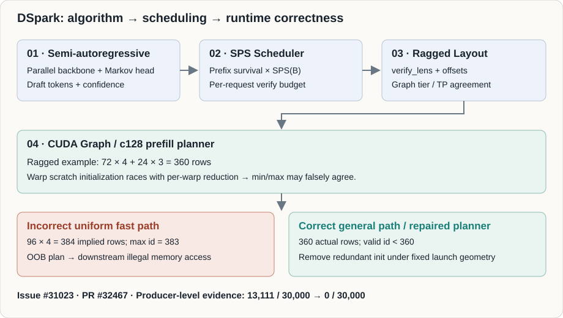

投机解码的目标是让一次昂贵的 Target Forward 产出更多 Token。但我在 B300 上测试 DeepSeek-V4-Pro-DSpark 时遇到的故障，并不是 Draft 猜错了，也不是接受概率计算错误，而是 compact target verification 在 CUDA Graph 的捕获与回放中可能触发非法显存访问（IMA）。

这篇文章想从 DSpark 的算法设计一直追到 GPU Kernel。**SPS 使验证长度动态化，Compact 将这种不规则性传给底层算子，而 CUDA Graph 与异步执行让原本隐藏的正确性缺陷更容易暴露。** 但触发场景不能直接当作根因：后来我在没有 SPS、没有客户端流量的启动捕获中也复现了故障。

*图 1 · 从模型策略、调度决策到 Kernel 执行契约。*

## 1. 投机解码：为什么一次 Forward 可以生成多个 Token？

普通 AR Decode 每轮读取模型权重、访问历史 KV，再生成一个新 Token。低 batch 时，大模型往往受显存带宽而非算力限制；如果一次 Target Forward 能同时处理多个候选位置，就有机会摊薄权重读取和固定开销。NVIDIA 的 [TensorRT-LLM 投机解码技术博客](https://developer.nvidia.com/blog/?p=92847) 从这一思路出发介绍了 Draft 与 Target 的分工。

假设 Draft 提出三个候选 x1、x2、x3，Target 在一次 Forward 中并行计算各个验证位置的分布。在 greedy decoding 的示例中，前两个候选一致，第三个不一致：

~~~text
已有上下文 → Draft:    x1    x2    x3
                        ↓     ↓     ↓
             Target:    x1    x2    y3
                        ✓     ✓     ×
             Commit:    x1    x2    y3
~~~

前缀接受，第一处拒绝后用 Target 的结果继续；若全部接受，还可以产生额外的 bonus token。随机采样时需要相应的接受/拒绝与残差分布采样机制来保持 Target 的输出分布，而非简单比较 argmax。

看实际收益，要同时考虑每轮平均输出 Token 数和每轮成本：

~~~text
AL         = 1 + accepted_draft_tokens / verification_rounds
AR         = accepted_draft_tokens / proposed_draft_tokens
Throughput ≈ total_committed_tokens / total_elapsed_time
~~~

AL（Acceptance Length）衡量一轮生成多少；AR（Acceptance Rate）衡量候选命中比例，两者不能替代端到端吞吐。实际服务还要关注 TPOT、并发、Draft KV 的额外显存以及队列等待。

[SpecDecode-Bench](https://specdecode-bench.github.io/) 在 H100、生产级 vLLM 与多种 workload 上测试发现，随 batch 增大，投机解码收益通常收窄；其分解实验中 verification 占总执行时间约 42%–95%。这不是说高并发一定不适合投机解码，而是说明接受更多 Token 不必然更快。

### 从 EAGLE、MTP 到 DFlash、DSpark

参考 [vLLM 的并行 Draft 技术综述](https://vllm.ai/blog/2026-07-28-speculators-parallel-drafting) 和 [SGLang 的 DFlash / Spec V2 博客](https://www.lmsys.org/blog/2026-06-15-next-generation-speculative-decoding-dflash-v2/)，可以按两个问题组织这条技术路线：候选从哪里来？候选怎样生成？

| 方法 | Draft 的特点 | 主要工程取舍 |
| --- | --- | --- |
| N-gram | 复用上下文中出现过的序列 | 几乎不增加模型计算，但依赖重复模式 |
| 独立 Draft Model | 小模型递归生成候选 | 增加独立权重、KV 与多次 forward |
| EAGLE / EAGLE-3 | 利用 Target hidden features，递归预测 | 提高候选质量，但仍有顺序生成成本 |
| MTP | 利用模型的多 Token 预测模块 | 原生集成便利，具体实现和预测深度依模型而异 |
| P-EAGLE | 在 Target 特征条件下并行预测候选 | 减少 Draft forward 次数 |
| DFlash | Block diffusion 与 Target 特征的 KV injection | 并行生成整个候选块 |
| DSpark | 并行 Backbone、轻量顺序修正及 confidence 调度 | 同时优化生成成本、候选质量与验证预算 |

这些不是严格的互斥分类，也不是后一种方法必然优于前一种；它们是不同的 Draft 与 Verification 设计选择。

### DSpark：为什么还要引入半自回归？

普通自回归 Draft 需要多次执行模型；全并行 Draft 可以一次 Forward 预测多个位置，却缺乏对块内已采样 Token 的显式顺序条件依赖。

[DSpark 论文](https://arxiv.org/html/2607.05147v1) 第 3 节引入半自回归（Semi-Autoregressive）结构：重型 Backbone 并行计算基础 Logits，轻量 Markov Head 按前一个采样 Token 修正当前 Logits。这样把昂贵的 Transformer 计算与轻量顺序依赖拆开。

不过生成得快，不代表所有候选都值得验证。Confidence Head 输出每个位置的条件接受概率 c_j；前缀存活概率 a_j = c_1 × … × c_j。若前三个条件概率分别为 0.8、0.6、0.3，第三个候选真正进入接受前缀的概率只有 0.144。STS 校准让这些预测可以用于期望收益计算，而非仅作为排序分数。

设 R 为活跃请求数，l_i 为第 i 个请求额外验证的候选数：

- B = R + sum(l_i)：本轮 Target 的验证位置总数（包含每个请求的基础位置）。
- tau = R + sum_i sum_{j=1..l_i}(a_ij)：预计本轮生成 Token 数。
- SPS(B)：该验证规模下实测的 Target step rate（steps/s）。

论文的目标是最大化 tau × SPS(B)。线上硬件曲线未必平滑，且异步调度和 CUDA Graph 带来额外限制；第 5.2 节讨论了这些部署约束。实际压测吞吐还包括 Draft、调度及其他开销，不能直接把这个简化目标当作端到端实测结果。

### 从论文的 SPS 到 SGLang 的实测成本表

论文用 SPS(B) 表示硬件 step rate。实际 [SGLang DSpark 官方博客](https://www.lmsys.org/blog/2026-07-06-dspark-sglang/) 给出了可复现实验：在其公开版本中，扫描 running batch 与 verify fraction，通过实测 step time 拟合加性成本模型，供调度器查表。核心是让预算选择依赖当前硬件和服务配置，而不是固定接受阈值。

~~~bash
# Profiling: 按官方博客对应版本启动 DSpark 服务
export SGLANG_RAGGED_VERIFY_MODE=compact
export SGLANG_DSPARK_ENABLE_SPS_RECORD=1
export SGLANG_SIMULATE_ACC_LEN=1.0

# 在服务可用后运行
python3 -m sglang.benchmark.dspark_sps_profiler all
~~~

部署正常服务时，以 `--speculative-dspark-sps-table-path sps_table.json` 加载生成的表。这里是官方示例的核心参数，不是我的历史 B300 全量启动命令；具体 CLI 与 profiling 输出路径以对应版本为准。SPS 表也不能不经验证就跨模型、硬件、并行策略或 backend 复用。

从性能归因看，建议将 Static、Compact 无 SPS（全窗口）和 Compact 有 SPS 三组拆开；另设 Cap-Accept 对照，仅限制可接受窗口而不缩小实际验证计算，用于区分裁剪带来的收益和可能的接受长度损失。

## 2. 从 Static 到 Compact：改变的是执行布局

举一个包含 Anchor 的验证窗口例子。三个请求最大窗口都是 8，但调度器只需要 6、4、2 个位置：

~~~text
Static：每个请求固定 8 个位置（共 24）
R0  A  1  2  3  4  5  6  7
R1  A  1  2  3  4  5  6  7
R2  A  1  2  3  4  5  6  7

Compact：按实际验证长度打包（共 12 个逻辑位置）
R0  A  1  2  3  4  5
R1  A  1  2  3
R2  A  1

verify_lens = [6, 4, 2]
offsets     = [0, 6, 10, 12]
~~~

Compact 必须让 Token 打包、请求边界、Attention metadata、KV 索引和 Graph tier 彼此匹配。物理 Graph 档位还可能需要额外 padding；逻辑有效行数不能因此改变。

这也解释了为什么投机解码发生在 Decode 阶段，却会进入 prefill/extend 类型的 Attention 路径：一次 verification 可以处理多个新增 Query，而不是普通 Decode 的单 Query。Kimi K3 + DCP 的历史测试路径只支持 Static；这属于当时并行与后端的兼容约束，不意味着 DSpark 半自回归结构本身无法运行，亦不能直接把该约束推广到所有版本。

## 3. CUDA Graph 为什么让排障变难？

CUDA Graph Capture 记录一组 GPU 操作，Replay 复用这组操作，降低逐 Kernel launch 的 CPU 开销。动态图形可以通过多个固定容量的 Graph 档位与预分配 buffer 来实现，但每次 replay 的有效 metadata 仍须正确。

CUDA Kernel 的执行是异步的。产生非法索引的 Kernel 和最终报告错误的同步点，未必是同一个位置。我的 [Issue #31023](https://github.com/sgl-project/sglang/issues/31023) 最初记录的是 TP8 compact target-verify 在高并发下的 timing-sensitive IMA：错误可能在后续 CUDA/NCCL 或 copy_done 同步处暴露。随后 [Issue #33356](https://github.com/sgl-project/sglang/issues/33356) 把问题推进到启动时的 Graph Capture。

我把调查分为三个独立契约：

| 契约 | 观察到的问题 | 上游记录 |
| --- | --- | --- |
| 分布式计划一致性 | TP rank 的 verify budget / Graph key 不一致 | #31195 |
| GPU planner 正确性 | 真正 ragged 的输入可能生成越界 plan | #32467 |
| Capture 初始化顺序 | 最后一次 warmup 与 capture 缺少必要完成边界 | #33795、#34286 |

应用 #31195 后，120/120 次 TP8 对照试验的预算、长度及 Graph key 均一致；但仍存在另一类 GPU 侧失败。因此不能把 TP 计划一致性修复当成所有 IMA 的解释。

## 4. 根因：CTA 内部 Shared Memory 的 Write-Write Race

在 [PR #32467](https://github.com/sgl-project/sglang/pull/32467) 中，作者 EanWang211123 定位到 c128 planner 的 `plan_compress_prefill_kernel0`。它根据 extend lengths 的最小值与最大值选择 Uniform fast path 或通用 Ragged 路径。

以公开复现输入为例：

~~~text
extend_lens = [4] * 72 + [3] * 24
实际 ragged rows = 72 * 4 + 24 * 3 = 360
合法 ragged_id  = 0 ... 359
~~~

CTA 内，Warp 0 初始化所有 warp scratch slots；各 Warp 随后写入本 Warp 的 reduction 结果。缺少同步时，初始化可能覆盖另一个 Warp 已写好的 min/max。原本 min=3、max=4 的输入就可能被错误判断成 min=max=4。

~~~text
Warp 0                         Warp 1
初始化 scratch ...             写 warp_min[1] = 3
继续初始化 slot 1
  └── 覆盖 Warp 1 结果
               ↓
       错误的 min == max
               ↓
       Uniform fast path
       最大索引 96*4-1 = 383
               ↓
       超过真实 360 行的边界
~~~

所以错误发生在 **Plan Producer**。下游写 Kernel 消费了错误的 ragged_id，才出现 IMA。这个竞态并不依赖 SPS 算法，也不依赖 CUDA Graph 才有可能发生；它是非均匀 extend 下的通用 planner 正确性缺陷。Compact 捕获只是高效的触发场景。

## 5. 我的 Review：从下游报错追到 Producer-level Oracle

我在 B300/B30Z 上构造直接调用真实 GPU-input planner 的最小回归，不再只观察整个服务是否 crash，而是检查 plan 输出是否满足：

~~~python
assert max(valid_ragged_id) < sum(extend_lens)
~~~

这个检查直接命中错误索引生成位置。PR 原始方案增加 `__syncthreads()`；Reviewer DarkSharpness 提出，在当前固定 1024 threads / 32 warps 的 launch 中，每个 Warp 都会写自己的 scratch slot，可以删除多余初始化并保留既有的 reduction 后同步。

我在同一 GPU session、隔离 JIT cache 的条件下验证了三种方案，每组包含一个 uniform 输入及两个 ragged 输入：

| 方案 | 初始化 | 额外前置 barrier | 越界 plan |
| --- | --- | --- | ---: |
| A · 原始 | ON | OFF | 13,111 / 30,000 |
| B · 增加 barrier | ON | ON | 0 / 30,000 |
| C · 删除冗余初始化 | OFF | OFF | 0 / 30,000 |

最终合入的是 no-init 方案，由 PR 作者实现。我的贡献是原始问题报告、复现、因果对照、直接 Kernel 验证与正式 Review；不是最终补丁的代码作者。这个简化依赖当前 launch geometry，未来改动线程或 Warp 数必须重新确认 scratch 覆盖契约。

[我的 A/B/C 实验和技术分析](https://github.com/sgl-project/sglang/pull/32467#discussion_r3749014153) · [正式 Review](https://github.com/sgl-project/sglang/pull/32467#pullrequestreview-4896206171)

## 6. 隔离 CUDA Graph 同步问题，再做全模型回归

单 Kernel 验证证明了 producer 问题，但还需要验证真实服务。针对 B300/TP8 启动，我比较了 planner 修复与另一个 capture-ordering 修复：

| #32467 planner | #33795 capture ordering | 成功启动 |
| --- | --- | ---: |
| OFF | OFF | 0/7 |
| OFF | ON | 1/6 |
| ON | OFF | 3/3 |
| ON | ON | 3/3 |

planner 修复组每次完成全部 35 个捕获档位。此结果支持 #32467 是所测 B300 故障类别的关键修复，但不否定 #33795 在其他硬件上的独立价值。Breakable CUDA Graph 的类似初始化边界另见 #34286。

在仅启用 #32467 的后续回放验证中：

| 测试 | 结果 |
| --- | --- |
| 无 SPS，C32，320 请求，60k/1k | 320/320 完成 |
| Compact + old SPS，C256，512 请求，60k/1k | 512/512 完成 |

上述窗口均无 GPU fault 签名；健康检查和后续 smoke test 正常。原始 C256/2560-request 矩阵没有按完全相同历史条件重跑，因此不能由这些结果推导所有平台和版本均已修复。

进一步的回归还区分了**有 Graph Replay 与真正有 Ragged 输入**：公开路线图中的 C64–C1024 sweep 完成 18,560/18,560 请求，但自然负载的 verify lengths 为 uniform；独立 forced-budget probe 才观测到 39/43 个真正 ragged 的调度块。只统计请求成功数是不够的，必须确认测试确实覆盖了目标分支。

## 7. 三个案例背后的同一种工程思路

| 我的其他公开案例 | 压测放大的条件 | 底层问题 |
| --- | --- | --- |
| [DP Health #35721](https://github.com/sgl-project/sglang/pull/35721) | DP Attention + 探活请求 | 控制面共享路由状态污染 |
| [PP Stream #47614](https://github.com/sgl-project/sglang/pull/47614) | 异步 PP + 更深的 Microbatch queue | 跨 Stream 张量生命周期 |
| [DSpark #31023](https://github.com/sgl-project/sglang/issues/31023) / [#32467](https://github.com/sgl-project/sglang/pull/32467) | Compact Ragged + CUDA Graph | CTA 内 scratch 写入竞态 |

对我而言，投机解码论文不是排障的终点。算法改变执行形状、数据布局与调度时序，系统必须维持分布式计划一致性、内存边界以及 CUDA 并发正确性。性能优化越复杂，这些契约越重要。

面试中我会这样概括：我在 DSpark SPS/Compact 压测中发现并报告 TP8 的 CUDA Graph 故障，进一步把控制面预算不一致、捕获顺序与底层 Kernel 竞态分开。通过最小 Kernel 复现和四臂启动矩阵，我验证了 reviewer 提议的最终 no-init 修复，使测试中的越界 plan 从 13,111/30,000 降至 0/30,000。**这是 Runtime Correctness 的案例，不是投机解码算法本身的错误。**

## 参考与可复现证据

### 技术背景与生产实现

- [NVIDIA：TensorRT-LLM Speculative Decoding](https://developer.nvidia.com/blog/?p=92847) — 基础执行原理。
- [vLLM：Parallel All the Way Down](https://vllm.ai/blog/2026-07-28-speculators-parallel-drafting) — 并行 Draft 架构演进。
- [SGLang：DFlash and Spec V2](https://www.lmsys.org/blog/2026-06-15-next-generation-speculative-decoding-dflash-v2/) — KV injection 与 overlap 调度。
- [SGLang：DSpark 官方工程博客](https://www.lmsys.org/blog/2026-07-06-dspark-sglang/) — SPS profiling 与变长验证。
- [SpecDecode-Bench](https://specdecode-bench.github.io/) — 实际负载、batch 与吞吐评估。

### 原始论文与公开排障记录

- [DSpark 论文，§3.1、§3.2、§5.2](https://arxiv.org/html/2607.05147v1)
- [Issue #31023：原始 TP8 investigation](https://github.com/sgl-project/sglang/issues/31023)
- [Issue #33356：启动捕获复现](https://github.com/sgl-project/sglang/issues/33356)
- [Issue #32470：c128 planner 专项问题](https://github.com/sgl-project/sglang/issues/32470)
- [PR #31195：TP verify budget 一致性](https://github.com/sgl-project/sglang/pull/31195)
- [PR #32467：合入的 Kernel 修复](https://github.com/sgl-project/sglang/pull/32467)
- [PR #33795](https://github.com/sgl-project/sglang/pull/33795) / [PR #34286](https://github.com/sgl-project/sglang/pull/34286)：不同 CUDA Graph backend 的捕获初始化契约
- [Roadmap #34297](https://github.com/sgl-project/sglang/issues/34297) · [RFC #32432](https://github.com/sgl-project/sglang/issues/32432)
